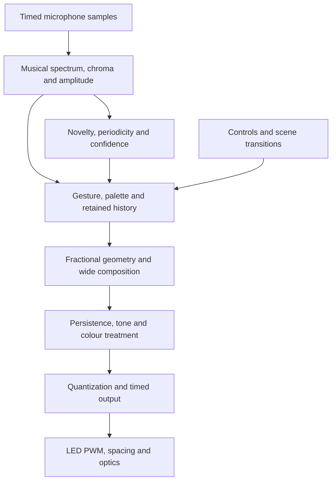
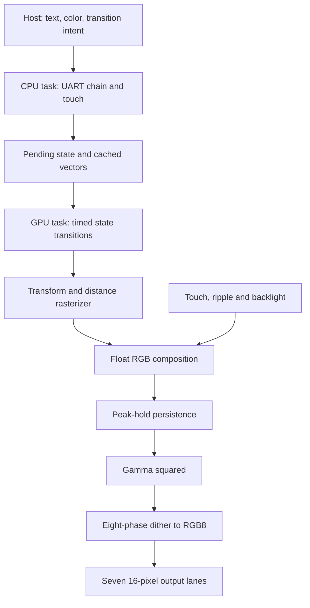
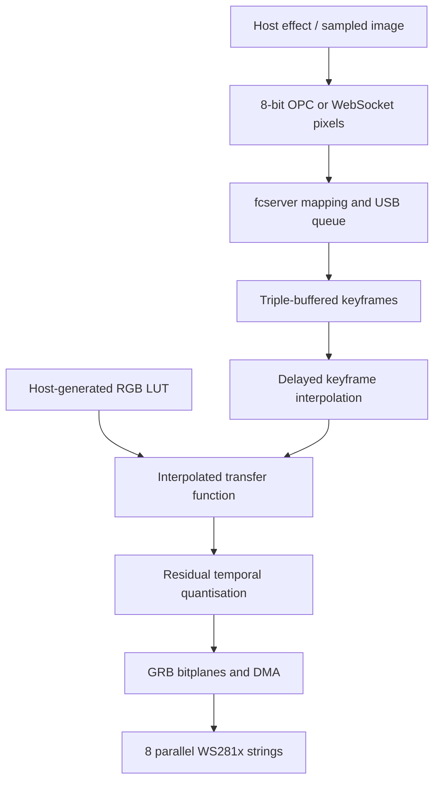

# Connor’s Light Engines — Teardown and K1 Translation

23 September 2026 · Source-pinned research, host derivations and proposed transfer work

## A shared architecture vocabulary

This map describes the relationships to preserve; each product chapter specifies its actual stages and order. Sensory Bridge and Emotiscope analyze sound. SuperPixie supplies a useful visual-only comparison. Fadecandy accepts host pixels and supplies an output reconstruction engine.



The key architectural boundary is between measured sound and authored appearance. Sample-domain observability should not be sacrificed to make a display look calm; a separate visual adaptation stage can provide that behavior. Conversely, a better analyzer does not specify how a retained trail should move or disappear.


---

# Connor's light engines: what the lineage reveals

Research snapshot: 23 September 2026. This teardown examines the official Sensory Bridge, Emotiscope and SuperPixie repositories, plus the requested PimentNoir Fadecandy history. It extends the earlier Emotiscope.HIL audit with the upstream version history and the perceptual relationships that a file-by-file port can miss.

## The central finding

The strongest source-supported explanation is **careful control of how a luminous object moves, retains history, changes colour and disappears**. Connor repeatedly spends limited computation on those relationships: musical frequency spacing, adaptive contrast, fractional geometry, persistent state, weak-colour preservation, output cadence, optics and expressive controls.

The important unit to transfer is a complete timed appearance. A mode's position formula, RGB values, nominal precision and BPM estimate are insufficient to specify it. In several places, the same operation controls more than one aspect of the look. Replacing it with a technically cleaner implementation can change the visual character.

This is a causal engineering explanation to test, not a claim that source inspection proves preference or market superiority. We have not conducted a controlled viewing study, reproduced Connor's shipped binaries, or measured his devices' optical output. The reports distinguish source behavior, author descriptions, mathematical derivations and aesthetic hypotheses.

## What this changes from our earlier reference

| Earlier or tempting assumption | What the upstream teardown establishes | Consequence |
|---|---|---|
| The local HIL tree describes Connor's whole architecture | It captures a particular derivative. Official Emotiscope also has 1.0, 1.1, 1.2, 2.0 and main histories. | Retain the HIL audit's scope; use named upstream versions for Connor's design. |
| Bloom's overwritten history is Connor's implementation | Official Emotiscope 1.1.0 transports persistent history and injects VU. The HIL rewrite overwrites its transported field. | The fork defect must not become our explanation of the original product. |
| Each later release improves the same DSP | Sensory Bridge changes rates, windows, normalization and defaults; some earlier techniques are disabled later. | Compare complete version profiles. Newest is not an adequate specification. |
| A high-precision frame or faster processor preserves the look | Motion resampling, retained state, nonlinear order and cadence also determine the result. | Preserve the visual dynamics as well as numerical range. |
| Better single-BPM tracking necessarily makes better rhythmic light | Emotiscope draws an ensemble of tempo candidates and changes composition with confidence. | Keep the good K1 tracker while exploring how uncertainty can be expressed visually. |
| Fadecandy's interpolation can be copied as one useful switch | Its source couples frame interpolation to colour-LUT interpolation; the historical frame schedule adds approximately a source-frame delay. | Separate these decisions for K1. Prompt musical response and smooth colour can coexist. |
| Machine learning for harmonic/instrument structure would be wholly new territory | Official Emotiscope contains an experimental populated neural network and instrument-classifier preparation, with important inactive paths. | Study the work already attempted; do not present an unvalidated model or an old proposal as a new breakthrough. |

The official Bloom reference is [release 1.1.0 at 634b7ed](https://github.com/Lixie-Labs/Emotiscope/blob/634b7ed8eefa2f1913ba1a1e7b29c116f22714d4/src/light_modes/active/bloom.h). The full branch/tag inventories and source-linked comparisons follow in the product chapters.

## Four discoveries that go beyond the previous precision advice

### 1. Bloom's speed slider changes its apparent material

In official Emotiscope Bloom, each update shifts the previous scalar image by `a = 0.125 + 0.875 × speed`, splitting each sample between adjacent destinations, and retains 99% of it. A new VU value is injected at the origin. Mirroring makes that origin the centre of the physical display.

Away from injection and boundaries, an impulse evolves as:

`u_next[j] = 0.99 × ((1−a)u[j] + a·u[j−1])`.

After `n` updates, its centroid is `n·a`, variance is `n·a(1−a)`, and retained sum is `0.99^n`. The update performs **transport, diffusion and decay together**. Slow movement spreads the signal over more updates; fast movement reaches an edge with less decay. At the maximum integer step, the transport adds no diffusion.

This supplies a concrete mechanism for the author's slow flutter and fast tunnel descriptions. It also exposes a portability trap: matching pixels per second and decay time does not automatically match spreading. For an illustrative 50 pixels/s trajectory, increasing the update rate from 100 to 400 Hz changes the equivalent diffusion coefficient from 12.5 to 21.875 pixels²/s when the fractional step changes accordingly. Those are mathematical properties of the update, not measured preferences.

**K1 opportunity:** retain a reference profile, then expose velocity, spread and lifetime independently in one new centre-origin ribbon. A slow sharp ribbon, fast diffuse cloud, quiet gap and weaker return become deliberate choices. This is a larger artistic opportunity than simply replacing Pixel8 with Pixel16.

The two products also remember different things. Sensory Bridge 4.x Bloom transports colour derived from chroma; released Emotiscope Bloom transports scalar VU history and applies the current spatial hue range afterward. Changing hue can recolour Emotiscope's entire existing trail. An RGB-history port retains previously deposited colours instead. **History's meaning and palette ownership are part of the effect contract**, even when both implementations are named Bloom.

### 2. The path between positions carries energy

Emotiscope's dot renderer fills the swept segment from the previous position to the new one, with fractional endpoint shaping. Its active path does not normalize the total light by distance travelled. Faster motion can therefore illuminate more area at comparable interior intensity. Musical energy can become spatial gesture rather than only a global brightness change.

The order of nonlinear operations also matters. For an isolated contribution below the tone-mapping knee, square-root coverage followed by a gamma square approximately restores a linear coverage relation. Replacing that final exponent with 1.5 produces a different edge response. Filtering, overlap, colour and clipping make the complete case more complicated. A stage called “gamma” cannot be judged independently of the values entering it.

**K1 opportunity:** compare three explicitly named motion treatments—constant peak, constant integrated energy and bounded velocity emphasis—on the same trajectory. Compare at matched average output as well as matched control settings. Preserve the current identity colour-correction default; this finding does not justify silently enabling another power curve.

### 3. Smoothness has several jobs

Feature smoothing, fractional transport, image filtering, phosphor-like persistence, palette motion, output interpolation and diffusion by the cover all soften something different. A single global smoothing control can unintentionally delay attacks, merge separate events and erase quiet gaps.

SuperPixie's final persistence uses `max(current, previous × decay)`: a new bright shape appears immediately and its predecessor fades. Emotiscope 2.0 experiments with phosphor behavior while still calling image filtering, so that branch does not demonstrate a universally delay-free chain. The source must be followed through every active stage.

**K1 opportunity:** give a scene a prompt accent, a moving body and a weaker afterglow with separate temporal roles. Retain a coherent palette and a meaningful gap between events. This is a testable way to get both smoothness and responsiveness; reducing every time constant is not the objective.

### 4. Uncertainty can be composed

Emotiscope Metronome gives multiple tempo candidates visible contributions. Spectronome gradually reallocates emphasis between spectrum and rhythmic movement as confidence changes. A half/double-time ambiguity can become related motion instead of a sudden jump between winning BPM labels.

**K1 opportunity:** use the existing stable flywheel for the main gesture, then permit a small bounded family of compatible secondary motions. Confidence changes their contrast. Sparse or unmetrical music still has a direct envelope/harmonic path. Compare the resulting clarity against both a winner-only view and the full ensemble; more simultaneous hypotheses can also create clutter.

## What the product lineage contributes

**Sensory Bridge** provides the most informative controlled history of design choices: FFT to note-aligned analysis; manual Boost to automatic sensitivity; spectral and visual smoothing revisions; independent LED updates; incandescent tint and bulb boundaries; high-precision working colours; on-strip feedback and different physical display formats. Its evolution shows frequent changes in aesthetic balance, not just accumulating features. In particular, 3.2 and 4.x are meaningfully different appearance profiles.

**Emotiscope** brings a compact optical object, dedicated rendering work, subpixel drawing, confidence-weighted rhythmic composition and a shared image-processing chain. Main retains the 1.1.0 firmware with later documentation changes. The 2.0 development branch contains substantial additional work, but feature announcements exceed some executing paths. The broken-labelled 1.2 branch and unfinished 2.0 branch must remain distinct from the latest public release.

**SuperPixie** isolates Connor's rendering philosophy from audio. Continuous vector objects, coordinated state transitions, float composition and local high-rate synthesis from low-rate semantic commands recur here. It supports the inference that the appearance between states is a major part of his craft.

**Fadecandy**, created by Micah Elizabeth Scott with its hardware/community collaborators, addresses another part of the problem: turning host keyframes into carefully timed, colour-corrected and quantized LED output. The requested PimentNoir history is useful, but branch names do not prove completed ports or newer rendering algorithms. Its source-pinned chapter separates the pixel mathematics, server, protocols and peripheral-specific driver.

## Same RGBIC family does not mean the same display

Emitter pitch, the number of pixels in each serial lane, physical cover, background black level and output schedule all change the result. Connor's author descriptions explicitly connect dense small emitters and the diffuser with the continuous luminous appearance. A demo video's camera exposure can add further integration; it is not a direct measurement of latency or optical precision.

At an illustrative 800 kbit/s, 64 RGB8 pixels require 1.92 ms of payload; 160 RGB8 pixels require 4.8 ms; 80 RGB16 pixels also require 4.8 ms. Reset and software/driver costs are additional. A faster MCU cannot shorten a fixed serial payload without changing topology or signalling. This supports the value of the existing K1 product decision to split each 160-pixel RGB16 channel into two independently driven halves.

Official Emotiscope's programmed RMT timing makes zero and one bits different total durations. Together with a freely running renderer, scene cost and bit content can affect update cadence; per-frame artistic coefficients can then change their physical time behavior. That is another reason to record the whole reference clock and display configuration before retiming a port.

Fadecandy's residual quantizer offers a particularly useful limit: the smallest 16-bit input in the host probe becomes one RGB8-count pulse every 257 output frames. At 400 Hz that spans about 0.643 seconds. Sixteen-bit internal arithmetic therefore does not imply sixteen independent optical bits within a musical transient. Native RGB16 avoids that specific external pulse-density requirement; its actual LED PWM and low-end optical response still matter.

## Higher-order implications

These are conditional engineering paths, not demonstrated product benefits.

| Starting decision | Second-order effect | Third-order effect | Fourth-order opportunity or risk |
|---|---|---|---|
| Preserve the coupled transport reference, then separate its controls | Velocity, diffusion and lifetime become intentional | The same gesture can be adapted to different lengths/cadences | A portable family of recognizably related K1 appearances, without equating byte identity with aesthetic identity |
| Maintain a prompt accent beside slower visual context | Attacks remain legible while colour/history stays calm | Less need to amplify every feature or flash the whole bar | Greater long-session comfort and clearer musical phrasing, if direct viewing confirms it |
| Preserve fine colour through composition | Faint tails and subtle palette differences survive | More contributions remain visible at once | Richer low-light scenes, or clutter unless occupancy and contrast are deliberately limited |
| Treat optics as part of the transfer path | Software spread and physical spread can be separated | Preview can use a measured spatial response | Faster authoring across bar variants and more consistent production appearance |
| Send timed visual intent and render locally | Radio traffic stays bounded while motion stays continuous | Multiple units can share choreography without pixel streaming | Spatial installations become feasible; common clocks and late-command rules still need explicit design |
| Build an offline authoring/replay workbench | The same features and trajectories can be compared quickly | Visual tuning becomes repeatable and source-bound | A growing, useful aesthetic reference collection instead of repeated unconnected experiments |

## Translation into the two K1 lanes

The earlier 23 September source audit remains the target-state reference for this report. It found existing 24 kHz / 180-sample / 80-bin AP implementations, corrected tempo coverage/indexing, established visual engines and working capture/output boundaries. This upstream research does not silently revise those contracts or claim the target trees have remained unchanged since that audit.

| Area | DualMCU | Titan Mini |
|---|---|---|
| Engine ownership | Keep RT1062 AP/VP and applied-state authority; S3 transports controls/state | Keep the existing PDM/hop publication, scalar AP and local renderer |
| Highest-value new visual work | One complete appearance profile with preserved fractional state and explicit motion/persistence semantics | The same profile producing genuine wide colour before the existing RGB16 packer |
| Output | Preserve the actual qualified backend; full product topology and current bench crop are different scopes | Preserve GPT/DMA pair ownership; current two physical halves constitute one selected logical channel |
| Fadecandy arithmetic | A scalar reference and, where useful, a measured packed-DSP kernel | Scalar reference first; M85 optimization chosen from measured cost, with memory/alignment assumptions checked |
| Native RGB16 decision | Retain scoped WS2816C/four-half-line decision; residual RGB8 dithering remains cancelled for that path | Preserve native wide output; do not add an external RGB8 dither layer by analogy |
| Host utility | Offline replay, preview and tuning outside the real-time SPI control link | Same; standard OPC RGB8 is not a lossless recorder of wide renderer output |

The most useful next work is a **matched appearance comparison**: official reference behavior, the current K1 composition and one deliberately modified profile, all receiving the same timed input. That closes a different gap from another raw-renderer parity pass. The accompanying handoff defines a bounded sequence and the evidence needed to decide what to retain.

## Reading and evidence guide

The product chapters contain the full lineage and high/low-level architecture; the cross-layer chapter develops alternative explanations and research links. The interactive laboratory shows the isolated transport mathematics only. It is not an emulator of Connor's complete firmware, a model of the K1 diffuser, or a predicted physical preference.

The evidence packet contains immutable ref inventories, source-linked findings, host probes and their results. Existing K1 decisions are carried from the retained versions of the earlier visual architecture review and today's HIL report. Historical plans are not treated as proof that their implementation is complete. The official repositories and retained source determine upstream behavior wherever release prose or comments disagree.


---

# Sensory Bridge: lineage, perceptual architecture, and transferable design principles

Research snapshot: 23 September 2026. Primary source: Connor Nishijima’s `connornishijima/SensoryBridge`, pinned at `5f329261987144242be4c3729f6d344631d3be1e` (tag `4.1.1`). This is an upstream teardown, independent of the user’s Emotiscope.HIL fork. This chapter examines upstream firmware; the earlier HIL audit covers the derivative and target lanes.

## The important conclusion

Sensory Bridge’s distinction is the way it **turns sound into stable, readable, moving visual objects**. The frequency transform is one contributor. The larger achievement is a coupled chain: musical frequency geometry, level adaptation, selective temporal smoothing, deliberate contrast, pitch-related color, spatial memory, subpixel transport, controlled low-light quantization, and restrained physical controls. Connor repeatedly uses performance improvements to make the same show more legible and pleasant.

That conclusion is an interpretation supported by the actual release trajectory and source. It is not proof of superiority to every competing product, nor a claim that these particular constants are perceptual optima. There was no controlled viewing comparison or fresh hardware measurement in this review.

The lineage is particularly valuable because it is **not a monotonic algorithmic upgrade**. Some capabilities are introduced, altered substantially, disabled, or replaced. “Use the newest Sensory Bridge pipeline” is therefore an insufficient migration specification. The correct reference includes the exact firmware, settings, LED geometry, refresh cadence, and output technology.

## Coverage and evidence method

GitHub plugin GET calls enumerated branches, releases, and Git tag refs; a public Git clone supplied exact source and history. The retained inventory contains all **15 tags, 14 releases, four named branches, and 97 reachable commits**. All tags were inventoried, all release notes read, and source snapshots extracted. The core audio/visual pipeline was read in full at 4.1.1; historical audio/render files, call sites and successive changes were inspected at 1.0, 1.1, 2.0, the 3.0 betas, 3.0, untagged 3.0.1, 3.1, 3.2, 4.0 and 4.1. Source references below use immutable SHAs wherever detailed behavior is asserted.

Evidence labels used here:

- **Source:** directly present in a pinned source path or retained diff.
- **Author intent:** release notes, comments or product documentation; not automatically achieved behavior.
- **Derived:** arithmetic from source settings; not measured latency or light output.
- **Inference:** a plausible explanation of the aesthetic effect.
- **Proposal:** a K1 direction to evaluate, with no claim of established benefit.

Source trees and release descriptions are not firmware-image provenance. No release binary was downloaded, disassembled, or matched to a tag. There is a concrete source/release discrepancy at 4.1.0 below. Dependency versions and compiler settings were not reproduced, and no claim is made that a fresh build matches Connor’s shipped images.

## 1. Complete public version lineage

Dates below are published release dates in UTC, except where explicitly called an untagged commit. Short hashes are expanded in `refs-inventory.json`.

| Ref | Date | Pin | What actually changes / why it matters |
|---|---|---|---|
| 1.0.0 | 2022-09-22 | `e9eb38f` | Initial public product baseline: ESP32-S2, 18,750 Hz / 256-sample capture, Hamming-window FFT, 128-pixel presentation, manually controlled Boost, ambient subtraction, historical smoothing and gain control. Audio and lights share the main loop. |
| 1.1.0 | 2022-09-22 | `8f19e44` | Four normalization zones keep a dominant spectral area from depressing the rest; alternative spectral scale; Bloom keeps scroll speed under mirroring and gains edge attenuation; nonblocking buttons. An aesthetic balance pass, not a new transform. |
| 2.0.0 | 2022-11-17 | `43f3bf2` | Broad rewrite. Automatic sensitivity frees the former Boost knob for color. Mood acts on spectral data, affecting derived modes. Three-pixel spatial blur, delayed lookahead repair, waveform-derived VU, antialiased VU dot, ESP-NOW setting synchronization. |
| `beta` branch | 2023-01-09 commit | `0c9a6b0` | Separate early 3.0 prototype, commit explicitly says only working on ESP32-S3. Floating Goertzel, 12,558 Hz / 192, 8,192-sample history, active window and A-weighting, one active GDFT mode. This branch is not the current beta and is not an ancestor of main. |
| 3.0.0-beta1 | 2023-01-16 | `9b3744e` | Mainline switch to 64 note-aligned fixed-point Goertzel bins, 24,400 Hz / 256; default 110–4,186 Hz; spectral-only partial product with expanded runtime tuning. |
| 3.0.0-beta2 | 2023-01-18 | `d34e6ac` | Restores Bloom and fast Bloom; adds octave-folded chromagram and boot animation; noise calibration animation returns. |
| 3.0.0-beta3 | 2023-01-20 | `23a3f95` | Nonlinear Bloom mapping produces acceleration toward edges; fade-through-black mode/calibration transitions; bass-focused chroma option; Sweet Spot restored; delayed configuration saves. |
| 3.0.0-beta4 | 2023-01-20 commit | `dc1723d` | Restores waveform/VU/VU dot and automatic DC estimate; silence dwell plus dimming. There is no separate release object for this tag. |
| 3.0.0-beta4-bugfix | 2023-01-21 | `182c288` | Removes a reference to deleted `CONFIG.WAVEFORM_NOISE_FLOOR`; this is the tag attached to the beta4 release page. |
| 3.0.0-beta5 | 2023-01-23 | `11603bf` | WebSerial settings integration; strip count/color order/interpolation options; chroma knob restoration, bass preset, command sanitization and factory-reset chord; waveform disabled again. |
| 3.0.0 | 2023-01-25 | `2343c1e` | Consolidates note-based frequency display, chroma color, nonlinear Bloom, transitions, standby dimming, softer indicators and USB mass-storage updates. Still one main audio/render loop. |
| untagged 3.0.1 | 2023-01-26 commit | `6d4628f` | Real firmware version `30001`, despite no 3.0.1 tag/release. Moves gain from the max-normalization target into a final multiplier; fixes mode names after waveform removal; adds settings refinements. |
| 3.1.0 | 2023-01-30 | `3534926` | Separate LED task; author reports ~200 Hz LED output. Capture becomes 12,200 Hz / 128. Active window, lowest-16-bin interlace, revised frequency weighting, gentler 1.2× calibrated-noise subtraction, per-mode eight-phase brightness dithering plus FastLED global dimming support. Current cap added. |
| 3.2.0 | 2023-05-08 | `a27d5db` | Incandescent tint, bulb pattern, preset themes, auto color movement and Kaleidoscope. Also significant DSP changes: returns to 24,400 Hz / 128, max window 3,000 samples, two gain zones, fourth-root mapping of normalized spectrum. Defaults change to unmirrored, standby disabled and warm filter 0.8. |
| 4.0.0 | 2023-07-11 | `a17ec09` | Signed Q15.16 working colors and common final four-phase quantization; Note Dots; on-strip knob UI; Base Coat; rewritten Kaleidoscope and fractional Bloom. Audio returns to 12,800 Hz / 96; window use/interlacing/lookahead disabled; amplitude-like normalization and slow global peak follower replace earlier chain. Default mirroring and standby return; warm filter becomes 0.5. |
| 4.1.0 | 2024-01-26 | `9a25d5c` | **Release notes say MicroDose dual-chain support. Tagged source does not contain it.** The firmware tree differs from 4.0.0 only in replacing the native-resolution scaling loop with `memcpy`; source still reports version 40000. Commit date is 2023-10-02. |
| 4.1.1 | 2024-03-22 | `5f32926` | Retained source now has MicroDose `NEOPIXEL_X2`, version 40101, LED task stack 4,096→8,192, unconditional `vTaskDelay(1)`, VU and memory-access refinements; Base Coat default switches off. Author specifically addresses occasional long-run freezes. |

The remaining branches are `connornishijima-patch-1` (`607b124`, README edit) and `connornishijima-patch-2` (`073398a`, LICENSE edit); both are merged into main. `main` is 4.1.1. The beta branch is a historical divergent experiment, not evidence of newer shipping functionality.

Primary chronology: [all releases](https://github.com/connornishijima/SensoryBridge/releases), [3.0 announcement](https://github.com/connornishijima/SensoryBridge/releases/tag/3.0.0), [3.1 announcement](https://github.com/connornishijima/SensoryBridge/releases/tag/3.1.0), [3.2 announcement](https://github.com/connornishijima/SensoryBridge/releases/tag/3.2.0), [4.0 announcement](https://github.com/connornishijima/SensoryBridge/releases/tag/4.0.0), [4.1 source comparison](https://github.com/connornishijima/SensoryBridge/compare/a17ec09f8ed2988f18a5f28a0a873ddc65135e39...9a25d5cac9efda8c55786cdcb91029f50e481b44), [4.1.1 source comparison](https://github.com/connornishijima/SensoryBridge/compare/9a25d5cac9efda8c55786cdcb91029f50e481b44...5f329261987144242be4c3729f6d344631d3be1e).

## 2. What changes across the major audio architectures

### FFT era: 1.0–2.0

The initial transform is a 256-sample real FFT at 18,750 Hz. Its linear bin spacing is approximately **73.24 Hz**, while adjacent bass semitones around 110 Hz are only about 6.54 Hz apart. Remapping a few FFT bins across 128 LEDs can create smooth graphics, but cannot recover absent low-frequency pitch resolution. Earlier code discards the first six bins (1.x) or shifts by four bins (2.0), then remaps/interpolates a restricted range. The issue was not simply a “slow FFT”: the analyzed frequency geometry was a poor match for the desired bassline geometry. [1.0 constants](https://github.com/connornishijima/SensoryBridge/blob/e9eb38ffdc223f8c201f600f0d000aa8e9887bbb/constants.h#L1-L6), [1.0 FFT](https://github.com/connornishijima/SensoryBridge/blob/e9eb38ffdc223f8c201f600f0d000aa8e9887bbb/fft.h#L29-L74), [2.0 FFT and remapping](https://github.com/connornishijima/SensoryBridge/blob/43f3bf29ab7f229771669331037268d6427e105a/SENSORY_BRIDGE_FIRMWARE/fft_parser.h#L54-L131).

1.1’s four auto-ranging zones solve a presentation problem: a strong band otherwise steals contrast from quieter parts of the spectrum. 2.0 combines spatial blur, gain followers, bounded rise/fall movement, a small history, and spike repair. The lookahead function displays an older frame after seeing its subsequent neighbors, replacing a short local reversal with their mean. It trades delay and brief-event fidelity for visual continuity. This is a deliberate visual filter, not extra information extracted from the audio. [1.1 normalization](https://github.com/connornishijima/SensoryBridge/blob/8f19e4440ec776fd2d7eb4514b532825d561cc8d/SENSORY_BRIDGE_FIRMWARE/fft.h#L82-L191), [2.0 blur](https://github.com/connornishijima/SensoryBridge/blob/43f3bf29ab7f229771669331037268d6427e105a/SENSORY_BRIDGE_FIRMWARE/fft_parser.h#L23-L52), [2.0 lookahead](https://github.com/connornishijima/SensoryBridge/blob/43f3bf29ab7f229771669331037268d6427e105a/SENSORY_BRIDGE_FIRMWARE/fft_parser.h#L253-L287).

**Transferable principle:** put the resolution where the intended visual meaning lives. A larger FFT is not automatically better; neither is Goertzel. Evaluate whether bass, harmonic movement, percussion and visual dwell are represented at suitable time/frequency scales.

### GDFT era: 3.0–3.2

64 target frequencies follow equal-tempered semitones, defaulting to A2 through C8, 110–4,186.009 Hz. Longer low-frequency windows and shorter high-frequency windows make adjacent bass notes more discernible while keeping treble updates economical. The released 3.0/3.1 code computes coefficients directly from target frequency; this is not inherently constrained to integer FFT bins. The author’s “parallel” language refers to a bank of frequency analyses; the C++ loops iterate them serially. It does not prove simultaneous execution or vectorization. [3.0 precomputation](https://github.com/connornishijima/SensoryBridge/blob/2343c1ead5af4e4b87bca1dca15d7291880fb7f9/SENSORY_BRIDGE_FIRMWARE/system.h#L209-L232).

3.0/3.1 include two smoothing stages called “followers” and “exponential averaging.” Both use first-order approach-to-target mathematics; one has different attack and release coefficients and acts before normalization, the other afterward. Their placement and asymmetric tuning matter more than the names. Mood changes the allocation across these stages. A slow normalization denominator provides local contrast adaptation; lookahead removes rapid alternation. All of these operations are part of the show’s transfer function. [3.0 detailed implementation](https://github.com/connornishijima/SensoryBridge/blob/2343c1ead5af4e4b87bca1dca15d7291880fb7f9/SENSORY_BRIDGE_FIRMWARE/GDFT.h#L155-L294).

3.1 spends saved work on an active Hann-like window and updates alternate members of the lowest 16 bins per hop. The release describes this as effectively hidden by the downstream filters. This is a perceptual scheduling strategy: reduce work where the final visible bandwidth is already low. But the two fields have different ages, which matters if a future engine treats the array as a simultaneous transient measurement. [3.1 core](https://github.com/connornishijima/SensoryBridge/blob/353492653aef5824bb681b597c15f9c71c5557c4/SENSORY_BRIDGE_FIRMWARE/GDFT.h#L59-L118), [3.1 lookahead](https://github.com/connornishijima/SensoryBridge/blob/353492653aef5824bb681b597c15f9c71c5557c4/SENSORY_BRIDGE_FIRMWARE/GDFT.h#L322-L374).

3.2 is especially easy to misread if only release notes are studied. Its public headline is incandescent simulation, but source returns the capture rate to 24.4 kHz, doubles the longest window to 3,000 samples, reduces gain zones, and takes the fourth root of normalized magnitudes before render contrast. Those are major changes in weak-detail visibility and dynamic range. A change in appearance cannot be attributed to the incandescent filter alone. [3.2 defaults](https://github.com/connornishijima/SensoryBridge/blob/a27d5db180b4c679d145e2129a314137408c47f1/SENSORY_BRIDGE_FIRMWARE/globals.h#L47-L86), [3.2 magnitude curve](https://github.com/connornishijima/SensoryBridge/blob/a27d5db180b4c679d145e2129a314137408c47f1/SENSORY_BRIDGE_FIRMWARE/GDFT.h#L278-L313).

### Latest retained architecture: 4.0–4.1.1

**Source flow:** I2S samples → microphone-specific scaling/DC subtraction and clipping → 4,096-sample history → 64 Goertzel analyses → magnitude square root and per-window amplitude normalization → 0.3 exponential average → calibrated-noise subtraction → Mood low-pass → slow global peak denominator → normalized spectrogram. In parallel, waveform RMS supplies VU. Positive changes in normalized spectrum feed optional hue motion. The LED task smooths the spectrum again, folds chroma, draws the selected mode and completes output conditioning.

Defaults are **12,800 Hz / 96 samples = 7.5 ms nominal capture interval**. The history’s capacity is 320 ms, but individual default windows are **27–978 samples, approximately 2.11–76.41 ms**. A 7.5 ms hop does not imply 7.5 ms end-to-end response, and 320 ms capacity does not imply every feature incurs 320 ms delay. [Capture](https://github.com/connornishijima/SensoryBridge/blob/5f329261987144242be4c3729f6d344631d3be1e/SENSORY_BRIDGE_FIRMWARE/i2s_audio.h#L46-L189), [defaults](https://github.com/connornishijima/SensoryBridge/blob/5f329261987144242be4c3729f6d344631d3be1e/SENSORY_BRIDGE_FIRMWARE/globals.h#L44-L82), [precomputation](https://github.com/connornishijima/SensoryBridge/blob/5f329261987144242be4c3729f6d344631d3be1e/SENSORY_BRIDGE_FIRMWARE/system.h#L209-L255).

The low-pass cutoff is `1 + 10 × Mood` Hz; Bloom forces this analysis Mood to 1.0 while still using the real Mood knob for transport speed. This is an important design separation: in Bloom, movement is made calmer by moving the history more slowly, not by making its source color equally sluggish. At 133⅓ analysis updates/s, the preliminary 0.3 EMA has a derived time constant of about 21 ms; the global peak denominator’s 0.005 attack and 0.0025 release correspond to roughly 1.50 and 3.00 s. These are source-derived ideal time constants, not measured response curves. [4.1.1 GDFT](https://github.com/connornishijima/SensoryBridge/blob/5f329261987144242be4c3729f6d344631d3be1e/SENSORY_BRIDGE_FIRMWARE/GDFT.h#L59-L201).

The current code is not the earlier windowed/interlaced implementation: multiplication by the window is commented out, `interlace_flip` is toggled but not used to skip bins, and the lookahead call is commented out. The coefficients now round an integer `k` using a window selected from adjacent-note spacing. Arithmetic from the exact table yields a worst nominal target offset of about **86.2 cents before Q14 coefficient quantization**. That establishes a mismatch between target labels and recurrence frequency, not a measured perceptual defect or a complete filter-response analysis. It also means the retained 4.x source does not substantiate the older marketing description of exact note detection. [Active loop](https://github.com/connornishijima/SensoryBridge/blob/5f329261987144242be4c3729f6d344631d3be1e/SENSORY_BRIDGE_FIRMWARE/GDFT.h#L65-L117), [rounded coefficients](https://github.com/connornishijima/SensoryBridge/blob/5f329261987144242be4c3729f6d344631d3be1e/SENSORY_BRIDGE_FIRMWARE/system.h#L238-L253), [disabled lookahead](https://github.com/connornishijima/SensoryBridge/blob/5f329261987144242be4c3729f6d344631d3be1e/SENSORY_BRIDGE_FIRMWARE/SENSORY_BRIDGE_FIRMWARE.ino#L135-L167).

**Why global normalization matters aesthetically:** it adapts to listening volume while retaining relationships between bands. Four independent gain zones can reveal a quiet melody alongside a strong bassline but can also flatten the mix’s intended balance. The later slow global denominator preserves more relative balance but lets a dominant source reduce visibility elsewhere. Neither is categorically correct. This is a direct ablation candidate, not a reason to silently retune K1.

## 3. Visual architecture and why it works

### Musical correspondence, with useful abstraction

The default spectrum assigns one spatial bin to each semitone and cycles hue once per octave. Harmonic relationships therefore form repeatable spatial/color structures. Chroma collapses octave identity into 12 pitch classes, producing a more stable signal for broad color or dot motion. It is not a transcription engine: harmonics and percussion also contribute, and chroma sum is not chord recognition. [Spectrum mapping](https://github.com/connornishijima/SensoryBridge/blob/5f329261987144242be4c3729f6d344631d3be1e/SENSORY_BRIDGE_FIRMWARE/lightshow_modes.h#L65-L96), [chroma folding](https://github.com/connornishijima/SensoryBridge/blob/5f329261987144242be4c3729f6d344631d3be1e/SENSORY_BRIDGE_FIRMWARE/led_utilities.h#L1209-L1243).

**Inference:** repeatable correspondence lets the viewer learn the display without consciously decoding it. A bassline changes shape rather than merely causing another generic flash. Folding octaves deliberately discards data to make color more coherent. More bins or more detected events can make that relationship harder to read if every component competes at equal salience.

### Six current modes are six different interpretations of a shared feature set

| 4.1.1 active mode | Feature-to-gesture mapping | What carries musical information |
|---|---|---|
| GDFT | 64 note magnitudes mapped to mirrored halves; mixed linear/quadratic contrast; pitch or selected hue | Spatial pitch structure and relative intensity |
| Chromagram gradient | Twelve pitch classes interpolated spatially, with a small background term and further contrast | Harmonic color structure with less octave clutter |
| Note Dots | Twelve mirrored dot pairs; magnitude controls radius and brightness; low-pass plus swept drawing | Motion separates pitch-class activity from a conventional bar graph |
| Bloom | New chroma-derived color enters center; fractional transport preserves prior color; outer fade shapes disappearance | A short visual history of changing harmony/energy |
| VU Dot | RMS-derived normalized radius, filtered motion, square-root brightness, symmetric dots | Loudness becomes geometry while brightness remains less volatile |
| Kaleidoscope | Low/mid/high spectral sums advance separate smooth-noise coordinates; envelope followers modulate their brightness | Timbre controls the motion of a continuous material |

The registry is in [the pinned sketch](https://github.com/connornishijima/SensoryBridge/blob/5f329261987144242be4c3729f6d344631d3be1e/SENSORY_BRIDGE_FIRMWARE/SENSORY_BRIDGE_FIRMWARE.ino#L56-L68). Implementations: [VU and Kaleidoscope](https://github.com/connornishijima/SensoryBridge/blob/5f329261987144242be4c3729f6d344631d3be1e/SENSORY_BRIDGE_FIRMWARE/lightshow_modes.h#L180-L341), [gradient/dots/Bloom](https://github.com/connornishijima/SensoryBridge/blob/5f329261987144242be4c3729f6d344631d3be1e/SENSORY_BRIDGE_FIRMWARE/lightshow_modes.h#L343-L498). The README’s six-mode list is older and does not describe this registry.

### Bloom’s evolution changes the meaning of time

In 2.0, Bloom scrolls an 8-bit image one or two pixels and injects brightness derived from summed FFT energy. In 3.0, chroma determines its color and a nonlinear spatial remap makes motion accelerate toward the edge. The author explicitly describes the resulting foreshortening as a cinematic goal. In 4.x, fractional image transport at `0.25 + 1.75 × Mood` pixels per rendered frame, 0.99 retention, fresh chroma at center pair 63/64, and outer-quarter quadratic fade replace that active nonlinear remapping. The old distortion functions remain commented out. [2.0 Bloom](https://github.com/connornishijima/SensoryBridge/blob/43f3bf29ab7f229771669331037268d6427e105a/SENSORY_BRIDGE_FIRMWARE/lightshow_modes.h#L33-L69), [3.0 Bloom](https://github.com/connornishijima/SensoryBridge/blob/2343c1ead5af4e4b87bca1dca15d7291880fb7f9/SENSORY_BRIDGE_FIRMWARE/lightshow_modes.h#L73-L130), [4.x Bloom](https://github.com/connornishijima/SensoryBridge/blob/5f329261987144242be4c3729f6d344631d3be1e/SENSORY_BRIDGE_FIRMWARE/lightshow_modes.h#L398-L498), [fractional transport](https://github.com/connornishijima/SensoryBridge/blob/5f329261987144242be4c3729f6d344631d3be1e/SENSORY_BRIDGE_FIRMWARE/led_utilities.h#L1247-L1290).

There is a deeper coupling than “keep 99% history.” **Changing Mood changes the lifetime of a mark at each spatial position.** At Mood 0.05, velocity is 0.3375 pixels/frame: nominal travel from center to edge takes approximately 187 frames, leaving about 15% of initial amplitude before the edge mask and interpolation losses. At Mood 1.0, the same distance takes roughly 31.5 frames and leaves about 73%. Thus higher Mood creates faster, brighter-reaching trails even with identical injected audio. At a hypothetical fixed 200 Hz, those travel times would be about 0.93 s versus 0.16 s. These are simplified source-derived examples, not measured display behavior.

**Proposal:** treat transport, lifetime, injection and edge extinction as a coupled artistic model. A new profile can separately expose physical velocity and material persistence, but the established coupled behavior must remain an available reference. Converting just velocity to seconds while retaining per-frame decay would alter the appearance under load.

### Motion instead of indiscriminate brightness modulation

Kaleidoscope does not need a stable BPM estimate. In 4.x it uses summed low/mid/high spectral activity to move noise coordinates; the “onsets” wording in comments and the older release is not an accurate description of those current sums. It separates a continuously textured field from its music-driven coordinate velocity and slower brightness envelopes. VU Dot similarly maps loudness into radius and uses square-root brightness. [Kaleidoscope](https://github.com/connornishijima/SensoryBridge/blob/5f329261987144242be4c3729f6d344631d3be1e/SENSORY_BRIDGE_FIRMWARE/lightshow_modes.h#L224-L341).

**Inference:** this is a major contributor to musicality without exhausting the viewer. The music animates an object that retains identity. If every transient resets hue, position and brightness, that identity disappears. The opportunity for K1 is richer structured motion from a small number of stable features, not necessarily a more complex classifier.

### Color has inertia

Optional automatic color movement starts with positive spectral changes, takes a square root, thresholds the result, then applies a cubic response and a cap. Hue velocity rises rapidly on sufficient novelty and decays afterward. Random destinations reverse direction only near a target; a second smoothing state adjusts the spatial hue-mixing sign. This is stateful color travel driven by events, rather than a fresh random color at every beat. [Novelty](https://github.com/connornishijima/SensoryBridge/blob/5f329261987144242be4c3729f6d344631d3be1e/SENSORY_BRIDGE_FIRMWARE/GDFT.h#L203-L242), [hue dynamics](https://github.com/connornishijima/SensoryBridge/blob/5f329261987144242be4c3729f6d344631d3be1e/SENSORY_BRIDGE_FIRMWARE/led_utilities.h#L1150-L1206).

This feature acts on the already normalized/smoothed spectrum. It measures visual change after level adaptation, not raw acoustic onset strength. **Second-order implication:** changing AGC or spectral smoothing also changes the color choreography, even if the color code is untouched.

## 4. The output pipeline is part of the instrument

Current order: mode image → optional Prism repetitions → bulb cover → optional forced incandescent hue → mirror/unmirror layout → master/Photons²/silence gain and clipping → incandescent tint → optional Base Coat → control UI → clipping → strip resampling → per-channel quantization/dither → optional reversal → FastLED output/current limiting.

Sources: [LED task ordering](https://github.com/connornishijima/SensoryBridge/blob/5f329261987144242be4c3729f6d344631d3be1e/SENSORY_BRIDGE_FIRMWARE/SENSORY_BRIDGE_FIRMWARE.ino#L177-L229), [output path](https://github.com/connornishijima/SensoryBridge/blob/5f329261987144242be4c3729f6d344631d3be1e/SENSORY_BRIDGE_FIRMWARE/led_utilities.h#L614-L744).

**High precision is retained where dimming hurts most.** 4.x working RGB channels are `SQ15x16`. Brightness scaling occurs before the final 8-bit conversion, so a dim hue can retain fractional channel contributions that an early Pixel8 pipeline would erase. This matters greatly after squaring the Photons control. But the source is not high precision in every dimension: `hsv()` obtains a full-brightness base color from 8-bit FastLED HSV, then lifts it; Bloom converts a chroma sum to `CRGB` for saturation/hue manipulation before lifting it again. These are specific precision boundaries, not reasons to dismiss the whole renderer. [Color construction](https://github.com/connornishijima/SensoryBridge/blob/5f329261987144242be4c3729f6d344631d3be1e/SENSORY_BRIDGE_FIRMWARE/led_utilities.h#L54-L67), [Bloom color round trip](https://github.com/connornishijima/SensoryBridge/blob/5f329261987144242be4c3729f6d344631d3be1e/SENSORY_BRIDGE_FIRMWARE/lightshow_modes.h#L455-L481).

**Dithering is a display-time operation.** 3.1/3.2 use eight threshold phases in selected mode brightness calculations. 4.x places a four-phase scheme after all modes and resizing. Each RGB channel uses the same phase at a pixel, while successive pixels offset the phase. This avoids independently pulsing the components of a neutral color, and distributes adjacent-pixel pulses in space. The pattern is periodic and can become visible in moving-eye or camera observations. It is not a stochastic error-diffusion method. [3.1 table](https://github.com/connornishijima/SensoryBridge/blob/353492653aef5824bb681b597c15f9c71c5557c4/SENSORY_BRIDGE_FIRMWARE/constants.h#L49-L58), [4.1.1 quantizer](https://github.com/connornishijima/SensoryBridge/blob/5f329261987144242be4c3729f6d344631d3be1e/SENSORY_BRIDGE_FIRMWARE/led_utilities.h#L219-L275).

For a constant target, the four-phase quantizer can express quarter-code averages, approximately two extra fractional bits in that idealized sense; it does **not** make the LEDs physically 16-bit. Its `254 × channel` scale and thresholds `{0.25,0.5,0.75,1.0}` also produce downward fractional rounding rather than unbiased residual feedback. At 200 output frames/s, a four-frame pattern repeats at 50 Hz, though individual pulse structure, neighboring pixels and LED PWM all affect visibility. Refresh rate alone is not a universal “invisible dither” guarantee.

**The warmer look is an artistic color transform.** The current incandescent filter linearly mixes toward channel gains `{1, 0.4453, 0.1562}`. At the default 0.5 mix these become `{1, 0.72265, 0.57810}`. This reduces blue relative to red, but it is not an instrument-calibrated blackbody or color-temperature simulation. The bulb overlay repeats `{0.25,1,0.25,0}`, creating deliberate bright centers and dark boundaries. Those boundaries make a continuous strip read as discrete luminous objects. [Tint](https://github.com/connornishijima/SensoryBridge/blob/5f329261987144242be4c3729f6d344631d3be1e/SENSORY_BRIDGE_FIRMWARE/led_utilities.h#L277-L289), [bulb cover](https://github.com/connornishijima/SensoryBridge/blob/5f329261987144242be4c3729f6d344631d3be1e/SENSORY_BRIDGE_FIRMWARE/led_utilities.h#L1076-L1094).

**Base Coat is a visible tradeoff.** 4.0 introduces a dim neutral foundation to reduce low-level sparkle, but 4.1.1 defaults it off. It fills negative space, alters black level and affects power as well as appearance. It is applied after user brightness in this source, though its width is disabled near the bottom of Photons and reduced with silence. It should be evaluated as an aesthetic material choice, not assumed to improve every mode.

**There is no single universal final gamma curve in this renderer.** Feature contrast, per-mode power laws, Photons², warm tint, output quantization and FastLED behavior jointly form its transfer function. Adding another gamma stage can crush precisely the quiet detail the prior stages recover. A K1 port needs explicit stage semantics and a display calibration path, not a generic “gamma fix.”

## 5. Physical format, scheduling and interface are inseparable from the result

The documented hardware family must be separated from firmware version numbers:

| Physical variant | Verified identity | Lineage boundary |
|---|---|---|
| Original Sensory Bridge controller | Retained board silk says REV. 1; schematic names ESP32-S2-MINI-1-N4R2 and SPH0645LM4H-B | This is the controller, with microphone and controls; a firmware 4.x label does not establish a Rev. 4 PCB |
| Proposed controller Rev. 1.1 wording | 2.0 release says the Boost control will be relabeled Chroma on future Rev. 1.1 boards | A documented plan; this teardown did not establish a separate released Rev. 1.1 CAD/BOM |
| Mini Mast Rev. 1 accessory | Schematic contains exactly 128 SK6805-1515 parts; board says REV 1 | A display accessory, not a replacement MCU/controller |
| MicroDose accessory | Author documents 128 1 mm emitters, 1.5 mm pitch, one 128-pixel chain or two 64-pixel chains | A denser display and transport-cadence evolution; exact emitter part and complete CAD/BOM were not audited |

CAD anchors: [controller component identities](https://github.com/connornishijima/SensoryBridge/blob/5f329261987144242be4c3729f6d344631d3be1e/extras/OSHW/PCB/SENSORY_BRIDGE.sch#L8243-L8254), [controller revision](https://github.com/connornishijima/SensoryBridge/blob/5f329261987144242be4c3729f6d344631d3be1e/extras/OSHW/PCB/SENSORY_BRIDGE.brd#L12291), [Mini Mast LED instances](https://github.com/connornishijima/SensoryBridge/blob/5f329261987144242be4c3729f6d344631d3be1e/extras/OSHW/PCB/MINI_MAST.sch#L271-L400), [Mini Mast revision](https://github.com/connornishijima/SensoryBridge/blob/5f329261987144242be4c3729f6d344631d3be1e/extras/OSHW/PCB/MINI_MAST.brd#L200).

The Mini Mast is documented as 128 small LEDs on a 260 mm PCB; MicroDose reduces the format to 128 one-millimeter emitters with 1.5 mm pitch and a nominal 20 cm strip. MicroDose can divide those pixels into two simultaneous 64-pixel chains. The physical pitch gives gradients and motion more samples per apparent object, while the split reduces serial transmission time. This is a product-level decision to improve a perceptual pipeline using the same broad WS2812-compatible interface. The exact optical construction and all LED package revisions were not audited here. [Author Mini Mast description](https://github.com/connornishijima/SensoryBridge/blob/5f329261987144242be4c3729f6d344631d3be1e/README.md#L92-L98), [MicroDose specification and wiring](https://sensorybridge.rocks/microdose.html).

128 pixels at conventional 800 kbit/s, 24-bit serial signaling require about 3.84 ms of payload time; two 64-pixel chains require about 1.92 ms if actually transmitted in parallel, plus reset/latch and software overhead. Those are derived wire budgets, not measured rates. More LEDs or a 48-bit protocol change the available output cadence even on a faster CPU. Thus RGBIC performance cannot be assessed from internal arithmetic or CPU speed alone.

3.1’s separate LED task enables output modulation between audio analyses. It should not be confused with two physical cores on the ESP32-S2; the author explicitly describes task scheduling on one core. The current source calls `xTaskCreatePinnedToCore(...,1)` and uses shared arrays. Its actual behavior depends on the ESP32/Arduino target and scheduling implementation. 4.1.1’s larger stack and explicit yield were long-run reliability repairs, showing that output smoothness depends on robust scheduling, not merely average FPS.

The controls are unusually coherent: Photons chooses brightness; Chroma chooses color agency; Mood chooses temporal character. Automatic gain in 2.0 removes a calibration burden from the user and frees a control for expression. On-strip control feedback, smooth mode changes, a silence dwell and quieter indicators make the object comfortable to leave running. These are parts of the visual architecture because they determine whether the show is stable, intrusive, or easy to shape. [Control intent](https://github.com/connornishijima/SensoryBridge/blob/5f329261987144242be4c3729f6d344631d3be1e/README.md#L22-L48), [mode transition](https://github.com/connornishijima/SensoryBridge/blob/5f329261987144242be4c3729f6d344631d3be1e/SENSORY_BRIDGE_FIRMWARE/led_utilities.h#L942-L973).

SensorySync broadcasts settings, not audio, features, pixel frames or a common presentation clock. Multiple units listen locally. This can produce an attractive family resemblance while retaining local acoustic variation, but it cannot establish tightly synchronized gesture phase or equal feature age. [Packet contract](https://github.com/connornishijima/SensoryBridge/blob/5f329261987144242be4c3729f6d344631d3be1e/SENSORY_BRIDGE_FIRMWARE/p2p.h#L12-L74).

An adjacent curiosity is `audio_transfer.h`: a DTMF-like acoustic data receiver with familiar telephone tone frequencies, calibration, synchronization and checksum handling, entered via a boot mode. This is a configuration/modem experiment, not USB PCM input or a tempo detector. It illustrates repurposing the same spectral primitive as a control channel. For K1, acoustic control could be an offline installation aid, but should not displace reliable existing wired/radio transport. [Acoustic transfer source](https://github.com/connornishijima/SensoryBridge/blob/5f329261987144242be4c3729f6d344631d3be1e/SENSORY_BRIDGE_FIRMWARE/audio_transfer.h#L1-L75).

## 6. What is likely to be the “secret sauce”

| Coupled mechanism | Immediate effect | Second-order effect | Third/fourth-order consequence for K1 |
|---|---|---|---|
| Musical bins + repeatable note color | Pitch changes form interpretable spatial/color changes | Harmonics recur in related patterns | The viewer can learn the visual language; more semantic labels may add less value than keeping that language stable |
| Slow gain adaptation + quicker local response | Loud and quiet recordings remain legible | Relative contrast depends on recent context | AGC changes also alter novelty, hue travel, persistence and perceived energy; assess whole gestures, not only audio-feature error |
| Spatial memory + antialiased transport | Movement reads as continuous objects | Light carries recent music through space | A display becomes a short visual memory; geometry and velocity define how much past music remains visible |
| Separate sound, motion and output rates | Analysis need not run at every dither update | More refresh can improve dim colors without new audio | Performance budget should protect presentation cadence; CPU acceleration that merely increases effect speed can reduce parity |
| Fine working precision + late quantization | Quiet colored detail survives brightness scaling | Lower average brightness becomes usable | Better comfort and perceived richness can follow without brighter LEDs; testing only full brightness misses the benefit |
| Warmth + darkness + controlled boundaries | Emitters resemble a material/object rather than raw RGB points | Viewer attention is guided by contrast | Calibration should preserve artistic transforms while measuring real emitters; indiscriminate “accurate RGB” can erase the intended look |
| Few expressive controls + consistent transitions | User can find a pleasing response quickly | Less manual sensitivity fiddling | A profile architecture that exposes every DSP parameter may undermine the product even when technically more capable |

None of these mechanisms alone proves preference. Their interaction is the best source-supported explanation of why a relatively modest MCU can deliver a distinctive result.

## 7. Directions Connor’s retained source leaves open

These are bounded hypotheses for K1, not assertions that Connor has never tried them elsewhere.

1. **Represent musical time at more than one bandwidth.** Keep an immediate transient accent and a slower harmonic/material field. The fast path need not drag the whole color field around. Compare against a single smoothed feature stream with identical total light energy and palette. This extends the demonstrated separation of motion and brightness while reducing the need to choose one global latency/smoothness compromise.
2. **Measure age per feature family.** Bass windows, interlaced bins, chroma and RMS do not refer to the same temporal support. Carry timestamps/window centers and define what each visual gesture expects. A fast onset can anchor the center while a later stable harmonic estimate colors the trail. Do not force every feature to the longest delay merely to make timestamps equal.
3. **Preserve a reference artistic clock, then add a separate rate-invariant profile.** Existing frame-based tuning is behavior to preserve. In a new profile, couple transport and decay in seconds or distance, and evaluate whether apparent material survives different LED lengths, protocol widths and missed frames. Do not silently replace frozen K1 reference tuning.
4. **Keep genuine precision through hue/mixing and the output limiter.** Remove specific early 8-bit round trips in an opt-in profile and retain headroom through blending. Evaluate whether native high-bit output or an improved quantizer preserves more low-light color under the actual driver, current cap and optics. Bit width alone is not acceptance evidence.
5. **Turn normalization into a deliberate artistic choice.** Compare global, gently frequency-shaped, and restrained local normalization on bass-dominant, sparse and dense music. Preserve mix balance where desired while avoiding invisible upper structure. A single maximum denominator is not always the best perceptual model.
6. **Treat output modulation as calibrated spatial-temporal sampling.** Compare ordered thresholds, bounded residual accumulation, and native high-bit output at actual refresh rates. Include stationary eyes, movement and camera exposure. Avoid globally synchronous dithering that makes a whole strip pulse; avoid independently phased RGB that can create chromatic sparkle.
7. **Use confidence to control abstraction, not to freeze the show.** When harmonic or beat confidence is weak, retain continuous motion and broad energy/timbre relationships rather than forcing unstable note/beat decisions. Sensory Bridge demonstrates musical-looking behavior without an explicit beat tracker; K1’s richer features should improve that gracefully.

## 8. A practical ablation plan

Use pinned replay input and the same physical geometry, brightness, palette, current ceiling and exposure conditions. Capture full intermediate feature and frame traces at bounded cost. Every variant is a named profile; preserve the incumbent K1 reference. Implementation belongs to the separate execution brief and existing lane authority.

| Ablation | Question | What to inspect |
|---|---|---|
| Same features; Pixel8 early vs high precision through final output | Is lost low-light chroma a material limitation? | Dark ramps, slow palette changes, tiny moving objects; channel dropout, visible banding and preference at matched perceived brightness |
| Same spectrum; legacy gain vs slow global vs limited local gain | Does normalization help legibility or flatten musical balance? | Bass masking, quiet melodic visibility, post-loud-section recovery, hue motion changes |
| Same chroma injection; integer vs fractional transport | Is motion continuity doing more work than extra modes? | Slow center-origin movement, small intensity marks, subpixel coverage and moving-object continuity |
| Same path; coupled legacy Mood vs independently controlled speed/lifetime | Is the familiar brightness/reach coupling valuable? | Trail extent, persistence, cue density and response across Mood settings |
| Same output; final four-phase vs residual quantizer vs native high-bit | Which method is best on the actual RGBIC? | Low-level hue, motion sparkle, repeated temporal patterns, camera artifacts and output timing |
| Same music; brightness-driven field vs velocity-driven field | Can musical energy be expressed with less global flashing? | Readability during dense mixes, stable background identity, perceived responsiveness and viewer preference |
| Same slow field; with/without a bounded fast accent | Can response feel immediate while harmonic structure stays calm? | Onset correspondence, over-accenting, rhythmic clarity, sustained-note continuity |

Prefer short, discriminating scenes and representative music sections before long-run qualification. Objective metrics can detect clipping, discontinuity, output timing or excessive hue churn; they do not replace direct visual preference. Do not optimize a proxy metric into a claim of musical quality.

## 9. Specific limitations and source ambiguities to carry forward

- 4.1.0’s release description and retained source disagree; exact source/image parity is unresolved.
- The README still describes MIT and older modes, while the current LICENSE is GPLv3 following the February 2024 license commit. Preserve the exact license/attribution for the selected source revision; this is a provenance finding, not legal advice.
- Several comments no longer describe active code: 256-sample hop, interlacing, windowing, nonlinear Bloom and a high-precision hue lookup are examples. Read executed call paths.
- 4.x array exchange between tasks is shared mutable state without a coherent immutable frame boundary; `lock_leds()` and `unlock_leds()` currently have their bodies commented out. A target port should use its established publication mechanism rather than transplant this concurrency model.
- `draw_dot()`’s intended energy normalization uses a normalized coordinate distance clamped to at least one, so valid 0–1 positions make its multiplier one; `draw_line()` adds interior lit pixels twice. These are source-level reasons not to assume mathematically energy-conserving swept points. They may also be part of the visible legacy aesthetic; no hardware severity is claimed.
- Strip interpolation fetches adjacent pixels without a complete boundary policy in all helper paths. Audit bounds if extracting code; do not infer current K1 shares these problems.
- No retained 4.1.1 active BPM/beat-tracking engine was found in the normal music loop. Old `extras/misc` sketches and README future plans are not shipped feature evidence.
- Actual FPS, glass/diffuser behavior, microphone response, LED PWM, current limiting and dependency/toolchain choices remain physical/build variables. Demo videos and author performance figures establish intent and exemplars, not a matched benchmark.

## Source navigation

For current code, the immutable base is:

`https://github.com/connornishijima/SensoryBridge/blob/5f329261987144242be4c3729f6d344631d3be1e/SENSORY_BRIDGE_FIRMWARE/`

The principal audit paths are `SENSORY_BRIDGE_FIRMWARE.ino`, `GDFT.h`, `i2s_audio.h`, `system.h`, `lightshow_modes.h`, `led_utilities.h`, `constants.h`, `globals.h`, `knobs.h`, `p2p.h` and `audio_transfer.h`. `refs-inventory.json` records complete SHA identities, and `derived.json` records transparent arithmetic used in this report. The report does not assert that a source-only aesthetic analysis replaces direct viewing of Connor’s hardware or K1.


---

# Emotiscope upstream teardown: released behaviour, unfinished evolution, and perceptual mechanisms

Source capture: 23 September 2026. Official repository: `Lixie-Labs/Emotiscope`. Public GitHub plugin branch/release metadata cross-checked against a complete Git clone. This report concerns official upstream, not SpectraSynq's Emotiscope.HIL derivative. The distinctions below materially change what should be treated as Connor's design.

## Principal findings

1. **The useful reference is a family of behaviours, not one latest version.** Official `main` has the same source as release 1.1.0; its October 2024 date only reflects README edits. Branches 1.2 and 2.0 contain important experiments but have no corresponding public release in the retrieved release collection. Both are explicitly described as broken/in progress. 2.0 is an IDF rewrite on the 1.1 ancestry, not a simple descendant of the 1.2 branch.
2. **Upstream Bloom was not broken in the way the HIL derivative was.** Release 1.1.0 and branch 2.0 retain a VU-driven scalar history, fractionally transport it, decay it, and inject only its origin. The HIL rewrite overwrites that entire transported field with chroma. That defect belongs to the derivative. Official Bloom's repeated interpolation is itself a diffusion mechanism; removing it can remove part of the visual character.
3. **The aesthetic is a stack of coordinated transfer functions.** Musical spacing, adaptive exposure, separate views of amplitude/pitch-class/rhythm, sustained motion, fractional coverage, generous floating-point composition, image conditioning, and high-cadence quantization all contribute. Their coupling matters: changing gamma changes subpixel edges and effective white balance; changing Bloom speed changes transport, diffusion and spatial fade; changing frame cadence changes phosphor persistence and colour inertia.
4. **The tempo bank makes ambiguity useful.** Metronome renders weighted hypotheses, and Spectronome retains more spectral content when concentration is weak. It does not need a single infallible beat estimate before showing something meaningful. This is stronger than a beat-detector-plus-flash architecture. It is not evidence that the underlying estimator is accurate.
5. **2.0 is a design notebook worth mining, not a drop-in upgrade.** It explores a second spectral representation, autocorrelation, independent colour modes, reversible image feedback, screen preview, external Godot controls and profiling. Current source does not deliver every announced feature. In particular, pitch production is disabled; announced frequency/tempo ranges disagree with the actual constants; both LPF and phosphor remain in the rendering call chain.

## 1. Complete surviving reference inventory

All five branches and five tags returned by current enumeration are captured in `ref-inventory.json`. Four public release records are in `releases.json`.

| Reference | Exact commit | Commit date (UTC) | Meaning |
|---|---|---|---|
| `1.0` branch | `3abb70022b75fc3f3c7efa37c24915249f8593d8` | 2024-04-12 | Post-release maintenance, MAC-string fix |
| `1.1` branch / `1.1.0` tag | `634b7ed8eefa2f1913ba1a1e7b29c116f22714d4` | 2024-05-14 | Latest public product release retrieved; The Color Update |
| `1.2` branch | `26fd2e3e809c67fbf22595278c407a44cf894747` | 2024-06-14 | Explicit BROKEN VERSION; presets/network/FFT/Beat Tunnel work |
| `2.0` branch | `92e14bdd36d96f1da59f852a4a769af0639b7116` | 2024-08-31 | Native IDF / multiplayer research branch |
| `main` branch | `d0fef9a40aabc0b623d2e14c9dffdc9706a1ec90` | 2024-10-02 | Same source as 1.1.0; only README/FUNDING differs |
| `0.0.0` tag | `4a5fb07ed2a4d31077d0309ea246154a428b618f` | 2024-02-29 | Alpha OTA test, not a real release per release body |
| `0.0.1` tag | `48ffa89bfdecf82ada1a4ac747de067476a3d655` | 2024-04-05 | Beta OTA test, not a real release per release body |
| `1.0.0` tag | `2c7813bf6b2b2c9487bac9d6fa544e14a30383c7` | 2024-04-06 | Initial product release |
| `1.1.0-beta` tag | `ad6e821b0a7657111da94c4638645560f6b01cc9` | 2024-05-13 | Beta merge snapshot; no separate release record retrieved |

Release publication dates: 0.0.0 on 2024-03-01; 0.0.1 on 2024-04-05; 1.0.0 on 2024-04-06; 1.1.0 on 2024-05-13. The 1.1.0 release publication precedes the commit timestamp by a few hours; report both rather than invent a linear ordering. Current branch/tag inventory does not prove that no deleted or private versions ever existed.

The Git merge-base of 1.2 and 2.0 is `634b7ed` (1.1.0). Relative to each other, 1.2 has 25 unique commits and 2.0 has 72. The latter manually rebuilt and reincorporated ideas rather than inheriting the 1.2 branch as-is. `main` has 10 commits beyond the release ancestry, but a source diff shows only `.github/FUNDING.yml` and README differences. This is why "read latest main" misses the later experiments.

Sources: [branch collection](https://api.github.com/repos/Lixie-Labs/Emotiscope/branches?per_page=100), [tag refs](https://api.github.com/repos/Lixie-Labs/Emotiscope/git/matching-refs/tags/), [release collection](https://api.github.com/repos/Lixie-Labs/Emotiscope/releases?per_page=100), [1.1.0 release](https://github.com/Lixie-Labs/Emotiscope/releases/tag/1.1.0).

## 2. Evolution as design decisions

| Stage | Audio / timing | Visual / output | Design implication |
|---|---|---|---|
| Initial public code, February 2024 | Goertzel analysis, tempo, VU, mic calibration; repeated core-ownership experiments | Float framebuffer, custom RMT, touch/UI, remote app | Author iterates across the entire product, not solely the FFT |
| 1.0 release family | 12.8 kHz, 64-sample read, nominal 5 ms hop; 64 note filters starting 110 Hz; 64 nominal tempo labels 32–158 BPM in 2 BPM increments | Mode-local brightness squaring; four-phase ordered temporal dithering; VU-history Bloom | A complete perceptual system precedes more elaborate colour processing |
| 1.1 Color Update | Same nominal capture; note floor moves to 77.78175 Hz; adaptive stationary-noise suppression; nominal 96 one-BPM tempo labels 48–143 | HDR soft knee, final gamma 2, white balance, error accumulation with random initial phases, auto-colour, smoother Metronome, odd/even Hype separation | Low-light and transition quality receive deliberate attention, not just new modes |
| 1.2 branch | 25.6 kHz capture, reads 128 samples per call despite CHUNK_SIZE=64 (still 5 ms); note analysis decimates by two; separate FFT; nominal 128 tempo labels 60–187 | Blur, gamma 1.5 LUT, Perlin, Beat Tunnel; configuration/network restructuring | Two representations of sound: musical-note structure and wider-band transient structure |
| 2.0 branch | Native IDF; head returns capture to 12.8 kHz/128 = 10 ms; note analysis every other full-rate sample; FFT reads pair-averaged half-rate history; profiler and custom Xtensa float loops | Separate gradient/Perlin colour mode, phosphor decay added, RGB preview, external Godot controller/network changes | Improve iteration and control infrastructure while exploring the audiovisual engine |

The 1.1 release describes colour reproduction, stationary-noise suppression, HDR, final gamma and tempo-related changes. Those claims are supported by the release source, with defects and qualifications below. Its author treats the app, touch interface, sleep/wake transitions and physical presentation as part of the instrument. The README's high-frame-rate/neon-display language is product intent, not a measured latency result.

Useful history anchors (all in official Git): `f9da319`/`2b686e1`/`55c50b5` (February 6, move to IDF5-era driver and recover two halves), `c5769ba` (April 22, error-accumulator dither), `1e062c1` (April 22, gamma), `60ee126` (May 3, automatic background-noise calibration), `219c547` (May 10, new softness), `03e456b`/`7d19262` (June 7–8, separate FFT for tempo), `f73ee5c` (July 4, hand-optimized float assembly), `6ecb067` (August 24, lower sample rate for FFT resolution), `92881a5` (August 27, phosphor-decay change), `5686d7e` (August 28, full-colour streaming). Commit messages convey intent; source establishes implemented behaviour.

## 3. Released 1.1: audio-to-light architecture

The release splits core 1 audio/web from core 0 graphics. This is an ESP32 task split, not a portable ownership contract. Shared mutable spectra, histories and tempo phases cross that split. Audio acquisition is the practical CPU cadence; the GPU advances continuously and is bounded by compute and LED transmission. Novelty is logged on the GPU at nominal 50 Hz, so the feature engine is not purely driven by the sample clock.

The nominal pipeline is:

1. I2S microphone → fixed bit extraction, offsets and clipping → float history (4096 samples).
2. Interlaced variable-window Goertzel bank → frequency-dependent magnitude scaling → stationary-noise subtraction → gain adaptation → clipped normalized spectrum → temporal smoothing.
3. Independent amplitude envelope and folded 12-class chroma.
4. Positive changes of the musical spectrum → 50 Hz novelty history → slow periodicity/phase bank.
5. Mode selects a relationship between features and image geometry; image postprocessing maintains continuity and colour character; final quantization drives two physical 64-pixel halves of one 128-pixel image.

See pinned [main foreword and ownership](https://github.com/Lixie-Labs/Emotiscope/blob/634b7ed8eefa2f1913ba1a1e7b29c116f22714d4/src/EMOTISCOPE_FIRMWARE.ino#L14-L40), [microphone](https://github.com/Lixie-Labs/Emotiscope/blob/634b7ed8eefa2f1913ba1a1e7b29c116f22714d4/src/microphone.h), [Goertzel](https://github.com/Lixie-Labs/Emotiscope/blob/634b7ed8eefa2f1913ba1a1e7b29c116f22714d4/src/goertzel.h), [VU](https://github.com/Lixie-Labs/Emotiscope/blob/634b7ed8eefa2f1913ba1a1e7b29c116f22714d4/src/vu.h), and [GPU sequence](https://github.com/Lixie-Labs/Emotiscope/blob/634b7ed8eefa2f1913ba1a1e7b29c116f22714d4/src/gpu_core.h#L17-L110).

### What the audio deliberately retains and discards

**Musical spacing:** 64 targets are semitone-related, not equal-width FFT buckets. In 1.1, `BOTTOM_NOTE=12` indexes a quarter-step lookup and `NOTE_STEP=2`; targets are 77.78175–2959.956 Hz. Window lengths adapt to nearby-note spacing. This gives low notes more observation time and high notes quicker response. Low and high bins therefore do not represent identical observation ages.

**Relative exposure:** the engine makes weak musical structure visible by tracking the strongest spectral value and adapting scale. A quartic bin-position weighting balances the raw spectral response. These are designed feature transfers, not calibrated sound-level measurements. Normalization is part of the look; substituting a mathematically superior FFT while changing these transfers can make the product worse visually.

**Three useful abstractions:** spectrum preserves register; chroma folds octave structure; VU retains an amplitude gesture. VU is maximum sample power plus adaptation and smoothing, not RMS. Different modes expose different time/structure views rather than treating every effect as a recoloured volume bar.

**Stationary-noise learning:** samples of raw bins are logged each second, averaged over ten slots, then integrated into a noise floor. This can reduce persistent environmental tones. It also reduces sustained musical material; this is a design tradeoff to compare with drones, organ notes, held synth pads and bass pedals, not a universal "noise removal" truth.

### Ambiguity is rendered rather than hidden

Metronome computes each candidate's contribution as `m_i² / sum(m)`, maps its phase to a sinusoidal position, scales excursion with square-root contribution and opacity with contribution, and draws all sufficiently weighted candidates. Hype combines odd and even bins separately; this mitigates cancellation between neighboring candidates with opposing phases. It is not kick/snare decomposition.

Spectronome first draws spectrum, then scales it by `0.15 + 0.85*(1 − confidence^(1/4))`, then adds Metronome. Thus a concentrated rhythm can occupy the foreground while uncertain rhythm leaves more immediate spectral detail. The 0.15 floor retains context. The confidence is concentration of bank energy, not a calibrated probability of beat correctness.

Source: [Metronome](https://github.com/Lixie-Labs/Emotiscope/blob/634b7ed8eefa2f1913ba1a1e7b29c116f22714d4/src/light_modes/active/metronome.h#L5-L44), [Hype](https://github.com/Lixie-Labs/Emotiscope/blob/634b7ed8eefa2f1913ba1a1e7b29c116f22714d4/src/light_modes/active/hype.h#L1-L50), [Spectronome](https://github.com/Lixie-Labs/Emotiscope/blob/634b7ed8eefa2f1913ba1a1e7b29c116f22714d4/src/light_modes/active/spectronome.h).

**Inference:** this is a graceful-degradation architecture. Missing a beat need not produce a dead, delayed or visibly wrong display because non-beat structure remains meaningful. A K1 hierarchy that routes all motion through a single stable-beat gate can accidentally lose that property, even if its tempo tracker is more accurate.

## 4. The visual mechanisms that survive a close teardown

### 4.1 Bloom is a dynamical medium

Official Bloom keeps a scalar field, fractionally shifts it by `s=.125+.875*speed`, multiplies by `.99`, injects bounded VU only at index zero, then maps intensity to the user's colour range. Mirroring maps radial zero to centre 63/64. The field stores **intensity history, not historical RGB colours**; changing hue recolours the whole existing ribbon immediately. An RGB-history port creates a different memory effect even when geometry is identical.

[Official Bloom](https://github.com/Lixie-Labs/Emotiscope/blob/634b7ed8eefa2f1913ba1a1e7b29c116f22714d4/src/light_modes/active/bloom.h#L1-L39), [fractional sprite kernel](https://github.com/Lixie-Labs/Emotiscope/blob/634b7ed8eefa2f1913ba1a1e7b29c116f22714d4/src/leds.h#L62-L103).

Away from boundaries and injection, a transport step is:

`x_i(next) = .99 * [(1−s)*x_i + s*x_(i−1)]`.

For a normalized impulse, after `n` steps its centroid has moved `n*s`, its variance is `n*s*(1−s)`, and its total mass has decayed by `.99^n`. That is **advection, diffusion and decay in one cheap operation**. The variance result is the binomial-kernel derivation, not a measured optical blur. It explains why this can feel like flowing luminous material rather than a bitmap shifted down a strip.

| Speed setting | Shift/frame | Speed at illustrative 400 FPS | Centroid travel per mass e-fold | Variance after 100 frames |
|---|---:|---:|---:|---:|
| 0 | 0.125 px | 50 px/s | 12.44 px | 10.94 px² |
| 0.5 | 0.5625 px | 225 px/s | 55.97 px | 24.61 px² |
| 1 | 1 px | 400 px/s | 99.50 px | 0 px² |

For an isolated interior impulse before boundary loss, all settings have integrated-intensity e-fold time 99.50 frames: 249 ms at 400 FPS, 995 ms at 100 FPS. This describes pulse mass, not its local peak, which diffusion also lowers. A raw frame-rate port changes the material; a dt-correct pure advection port preserves speed but can remove diffusion. To match the old behaviour, define reference velocity, diffusion and decay independently, then retain the desired coupling deliberately. Do not assume that eliminating numerical diffusion improves the visual result.

### 4.2 Fractional geometry and output transfer were co-tuned

`draw_dot` saves the previous position and draws a swept segment to the new position. The renderer fills traversed pixels, not just one sampled point. Endpoint coverage and opacity are square-rooted before additive colour. The computed travel-distance normalization exists as an unused local; longer sweeps can deposit more integrated light.

The 1.1 final gamma squares each RGB component. For one isolated unit-colour contribution below the tone-map knee, with fixed hue, no warmth/white-balance attenuation, no background, no overlapping additive contribution and no intervening temporal filtering, `sqrt(coverage*opacity)` followed by gamma 2 yields `coverage*opacity`. This is a useful compatibility relationship. In 2.0, gamma 1.5 leaves the same primitive at `(coverage*opacity)^.75`; a 10% coverage edge becomes 17.78% instead of 10%. These are conditional algebraic examples, not claims about physical luminance under all compositing conditions.

Sources: [swept drawing](https://github.com/Lixie-Labs/Emotiscope/blob/634b7ed8eefa2f1913ba1a1e7b29c116f22714d4/src/leds.h#L392-L443), [1.1 gamma](https://github.com/Lixie-Labs/Emotiscope/blob/634b7ed8eefa2f1913ba1a1e7b29c116f22714d4/src/leds.h#L615-L619), [2.0 gamma](https://github.com/Lixie-Labs/Emotiscope/blob/92e14bdd36d96f1da59f852a4a769af0639b7116/main/leds.h#L424-L454).

**Inference:** some perceived liveliness comes from speed-dependent light deposition and wide soft edges. A physically energy-normalized streak might be technically neater and aesthetically flatter. Preserve a switchable reference before changing energy normalization.

### 4.3 High precision is valuable before quantization

Release 1.1 renders into floating-point RGB, permits values above one, applies background and overlays, brightness, image LPF, a soft knee, warmth and white balance, boot brightness, gamma, and finally 8-bit GRB quantization. It does not repeatedly round to bytes while creating the image. The soft knee starts at 0.75 and approaches one via tanh; 2.0 moves the knee to 0.9. Additive gestures can coexist with highlights without immediate hard clipping.

The release calls its working space Linear RGB. The implemented artistic powers, HSV values and coverage compensation should nevertheless be treated as explicit transfer functions; no LED radiometric calibration or universal perceptual uniformity follows from that label.

White-balance multipliers are `{1,.9375,.84}` before output gamma. Their post-transfer contribution is approximately `{1,.8789,.7056}` with gamma 2, or `{1,.9077,.7699}` with gamma 1.5, in the isolated linear region. Moving gamma or white balance is therefore a look change, not simple code cleanup. Warmth similarly interacts with the final transfer.

Source: [1.1 conditioning and tone map](https://github.com/Lixie-Labs/Emotiscope/blob/634b7ed8eefa2f1913ba1a1e7b29c116f22714d4/src/leds.h#L615-L725), [2.0 conditioning](https://github.com/Lixie-Labs/Emotiscope/blob/92e14bdd36d96f1da59f852a4a769af0639b7116/main/leds.h#L310-L454).

### 4.4 Dither is part of the material and timing budget

1.0 uses a common four-step threshold cycle. 1.1 keeps per-pixel/channel fractional error, initially randomized, adds residuals above `.055`, and emits an extra code when accumulated error reaches one. 2.0 lowers the threshold to `.0275`. Runtime behaviour is deterministic accumulation after random initialization; it is not fresh independent RNG noise on every frame.

This permits intermediate time-averaged low-level channel intensities on ordinary 8-bit RGBICs. It also suppresses very small residuals rather than integrating all the way to arbitrarily rare flashes. Its quality depends on actual optical frame cadence, LED PWM, spatial diffusion, viewing motion and cameras; 32-bit floats do not make the physical output a literal 32-bit display.

At an illustrative 400 FPS, an unsuppressed constant fractional residual `.055` yields roughly 22 one-code pulses per second. Spatially decorrelated phases and an optical diffuser can change how visible this is; that requires viewing/optical evidence. Simply lowering the threshold because another lane has more CPU can introduce isolated low-light sparkle.

Sources: [1.0 quantization](https://github.com/Lixie-Labs/Emotiscope/blob/3abb70022b75fc3f3c7efa37c24915249f8593d8/src/led_driver.h#L168-L207), [1.1 error quantization](https://github.com/Lixie-Labs/Emotiscope/blob/634b7ed8eefa2f1913ba1a1e7b29c116f22714d4/src/led_driver.h#L199-L238), [2.0 quantization and transmit](https://github.com/Lixie-Labs/Emotiscope/blob/92e14bdd36d96f1da59f852a4a769af0639b7116/main/led_driver.h#L240-L294).

### 4.5 Softness, novelty-driven colour and optical form reduce visual chaos

1.1's Softness maps to image LPF cutoff `0.5 + 14.5*(1−sqrt(softness))` Hz. The implied one-pole time constant spans 10.61–318.31 ms. That is a major aesthetic lever: high display frame rate does not imply every displayed quantity changes instantly. Mode switches temporarily slow this filter rather than running an explicit dual-effect crossfade.

Auto-colour raises normalized novelty times .75 to the sixth power, keeps decaying momentum, caps it and advances hue. Small fluctuations have little influence while large changes can move the palette. This makes colour behave at a different timescale from geometry. It is a crude but economical attention mechanism.

The product README explicitly emphasizes dense 128-pixel optics, a diffuser and a neon-like appearance. **Inference:** the intended result depends on continuous-looking spatial light, not pixels judged in isolation. The same firmware on exposed widely spaced LEDs is not the same perceptual system. An optics-matched comparison is essential before attributing all superiority to DSP.

Sources: [softness and mode drag](https://github.com/Lixie-Labs/Emotiscope/blob/634b7ed8eefa2f1913ba1a1e7b29c116f22714d4/src/gpu_core.h#L69-L103), [auto-colour](https://github.com/Lixie-Labs/Emotiscope/blob/634b7ed8eefa2f1913ba1a1e7b29c116f22714d4/src/leds.h#L445-L464), [product README](https://github.com/Lixie-Labs/Emotiscope/blob/d0fef9a40aabc0b623d2e14c9dffdc9706a1ec90/README.md).

## 5. 2.0: what is actually present at the pinned head

| Topic | Stated intent / history | Actual head and consequence |
|---|---|---|
| Wider transient spectrum | Documentation describes 1–12800 Hz as tempo input | I2S is 12.8 kHz; FFT 256 reads pair-averaged 6.4 kHz history. Nominal Nyquist is 3.2 kHz, bin spacing 25 Hz, window duration 40 ms. This is not the announced high-cymbal-band detector. |
| FFT smoothing | Four history slots | Four spectra summed then adaptively normalized; no explicit divide by four before max normalization. Max reference falls by .99/hop and attacks by .25 of excess. Final output clipped 0–1; low-bin weighting is strongly shaped. |
| Note analysis | Continue musical Goertzel alongside FFT | Uses every other full-rate sample, not the pair-averaged FFT history; 6.4 kHz coefficients, same nominal 77.78–2959.96 Hz targets; half-band decimation filtering differs by path. Noise floor is explicitly set to zero after calculation. |
| Tempo | Documentation announces 60–188 BPM | 96 labels 60–155 at head; scheduler covers 0–94, misses 95. Integer-rounded coefficients still alias nominal labels. |
| Pitch / Wave | Autocorrelation-based tonal mode advertised | `estimate_pitch()` body and CPU call are commented out. Pitch mode remains registered and its local averaging history/index are non-static. Do not claim a functioning shipped pitch mode. |
| Softness | Commit says LPF replaced by phosphor | GPU calls both `apply_softness()` and `apply_phosphor_decay()`. The latter limits downward change per frame; positive changes pass immediately at that stage. Earlier LPF still slows attack. |
| Auto-colour | Same novelty-driven design retained | Reads `novelty_curve_normalized`, but no writer to that array remains in the inspected head. With static zero initialization this feature does not receive the new FFT novelty. |
| Preview | Full colour streaming | Renderer copies post-gamma float RGB; CPU reduces adjacent pairs by per-channel max, square-roots, and quantizes to 64 RGB pixels. This is a useful remote appearance preview, not an exact optical/dither capture. |
| App | Godot, external hosting, multiplayer | Separates UI assets from MCU firmware footprint, USB provisioning and WS changes. Documentation explicitly calls early 2.0 broken and warns about filesystem compatibility; no 2.0 release retrieved. |

Pinned sources: [microphone](https://github.com/Lixie-Labs/Emotiscope/blob/92e14bdd36d96f1da59f852a4a769af0639b7116/main/microphone.h#L20-L123), [FFT](https://github.com/Lixie-Labs/Emotiscope/blob/92e14bdd36d96f1da59f852a4a769af0639b7116/main/fft.h#L1-L156), [note analysis](https://github.com/Lixie-Labs/Emotiscope/blob/92e14bdd36d96f1da59f852a4a769af0639b7116/main/goertzel.h#L195-L349), [tempo](https://github.com/Lixie-Labs/Emotiscope/blob/92e14bdd36d96f1da59f852a4a769af0639b7116/main/tempo.h#L152-L258), [pitch producer](https://github.com/Lixie-Labs/Emotiscope/blob/92e14bdd36d96f1da59f852a4a769af0639b7116/main/pitch.h#L58-L92), [CPU](https://github.com/Lixie-Labs/Emotiscope/blob/92e14bdd36d96f1da59f852a4a769af0639b7116/main/cpu_core.h#L29-L59), [phosphor](https://github.com/Lixie-Labs/Emotiscope/blob/92e14bdd36d96f1da59f852a4a769af0639b7116/main/leds.h#L547-L581), [preview](https://github.com/Lixie-Labs/Emotiscope/blob/92e14bdd36d96f1da59f852a4a769af0639b7116/main/preview.h), [2.0 description](https://github.com/Lixie-Labs/Emotiscope/blob/92e14bdd36d96f1da59f852a4a769af0639b7116/the_multiplayer_update.md).

### Phosphor is a bounded linear tail, not an exponential decay

After initialization, define `d = max(.05*(1−softness), .001)`. For each RGB component the stage behaves as `y_next = max(x_now, y_prev−d)`. It follows brighter input immediately and decreases by at most `d` per render. A unit-to-zero input takes 20 frames at softness 0, 40 frames at .5, and 1000 frames at 1: at 400 FPS, 50 ms, 100 ms, and 2.5 s. At 100 FPS those times quadruple. This is a slew-limited envelope in image space; it is not a physical model of phosphor and does not use `delta`.

Because the stage follows an LPF, the complete step response has a softened attack plus a constrained tail. Separating attack bandwidth, tail shape, tail duration and spatial spread in a K1 profile would retain the intent while making the material portable. Applying one global low-pass to everything risks delaying the very attacks that make musical contact convincing.

### Physical part and clock reality

Connor's own portfolio identifies **128 XL-1010RGBC LEDs, 1 mm packages at 1.5 mm pitch**, behind a black diffuser. It describes them as WS2812B-compatible, with variable 300–500 FPS graphics and 100 Hz audio acquisition. Those are author's product claims, and the 100 Hz capture matches the later branch rather than released 1.1's nominal 200 Hz. It is more precise to say **the same class of low-cost 8-bit addressable LEDs**, not assert an identical LED die/PWM controller across every competing product. [Author's hardware description](https://connor.nishiji.ma/products/emotiscope.html).

Both inspected release 1.1 and 2.0 drivers output **one 128-pixel image split into two 64-pixel strings**, on GPIO 21/17. This is parallel transport, not two independent visual channels. Source programs 10 MHz RMT: zero bit 0.4 µs high + 0.6 µs low, one bit 0.7 µs high + 0.6 µs low, reset 50 µs. Thus programmed per-half wire duration ranges 1.586–2.0468 ms depending on the bitstream, before software overhead. These source bounds are consistent with the possibility of hundreds of updates per second; they do not certify LED timing compliance or actual 450 FPS. Both use `with_dma=0`, despite general comments praising DMA. [Release driver](https://github.com/Lixie-Labs/Emotiscope/blob/634b7ed8eefa2f1913ba1a1e7b29c116f22714d4/src/led_driver.h#L134-L185).

`REFERENCE_FPS=100` normalizes certain phase increments; it is **not** a 100 FPS output cap. GPU loops run continuously. Release 1.1 updates an FPS estimate from 16 reciprocal frame intervals when reporting every 2 seconds; 2.0 averages 64 intervals via its stats routine. LPF uses that estimate, while Bloom, auto-colour momentum and phosphor use per-frame constants. This creates an important adjacent effect: scene complexity and even programmed wire bit density can influence render cadence, and cadence can influence gesture speed/persistence. Retiming the port must preserve chosen visual dynamics explicitly. [Release profiler](https://github.com/Lixie-Labs/Emotiscope/blob/634b7ed8eefa2f1913ba1a1e7b29c116f22714d4/src/profiler.h#L145-L173).

### Hidden research: Connor had already considered semantics and sub-frame audio

The release tree contains more than the active modes:

- `extras/harmonics_remover/old/training_idea.txt` sketches MIDI-derived supervision: remove drums and out-of-range notes, render 12.8 kHz mono, run the same 64-bin frontend, and learn a representation without upper harmonics. It proposes exporting weights/biases to ESP-DSP-compatible float arrays.
- `src/neural.h` actually contains populated 64→36→8→36→64 weights and sigmoid feed-forward, including sqrt spectral input and zeroed edge bins. The CPU invocation is commented out at 1.1/main and it is not included in the active main compilation list. Commit `4bd16ec51f844a271f174b180271a25a397db77e` (March 13) reports sub-millisecond experimentation; that message is not an independently reproduced benchmark or accuracy result.
- `extras/instrument_classifier/dataset_processing/README.md` and `src/notes.h` describe OpenMIC-2018 preprocessing and a separate proposed 64→32→32→32→20 instrument network, with vocal presence as a possible reduced task. The populated 64-output network should not be mislabeled as the 20-class instrument model. No validated/deployed instrument classifier is established by these artifacts.
- `src/notes.h` also considers sub-frame audio for a 200 FPS CPU / 500 FPS GPU timing mismatch. Interpolating/rendering between audio observations was already on the author's agenda.
- `extras/WEB_APP_DESIGN_NOTES.txt` explicitly calls for the immediate feel of SensoryBridge's physical knobs, with the firmware declaring available controls and per-mode relevance so the UI need not hardcode the feature set.

Sources: [harmonic-learning proposal](https://github.com/Lixie-Labs/Emotiscope/blob/d0fef9a40aabc0b623d2e14c9dffdc9706a1ec90/extras/harmonics_remover/old/training_idea.txt), [populated network](https://github.com/Lixie-Labs/Emotiscope/blob/634b7ed8eefa2f1913ba1a1e7b29c116f22714d4/src/neural.h#L1-L94), [instrument/sub-frame notes](https://github.com/Lixie-Labs/Emotiscope/blob/634b7ed8eefa2f1913ba1a1e7b29c116f22714d4/src/notes.h#L52-L95), [UI design notes](https://github.com/Lixie-Labs/Emotiscope/blob/d0fef9a40aabc0b623d2e14c9dffdc9706a1ec90/extras/WEB_APP_DESIGN_NOTES.txt).

**Consequence:** AI instruments, harmonic suppression and sub-frame interpolation cannot honestly be sold as directions Connor never considered. The unproven opportunity is to make such features measurably useful to composition while keeping a reliable immediate fallback. Harmonic suppression also has an aesthetic risk: overtones may be exactly what makes a spectral image rich. A cleaner note transcription is not necessarily a better light show.

## 6. Defect provenance: avoid blaming the derivative's changes on Connor

| Finding | Official 1.1 | Official 2.0 | Prior HIL derivative |
|---|---|---|---|
| Bloom history overwritten with chroma | **No**: VU injects index0 only | **No**: same retained field semantics | **Yes** in audited v1.1_build /320adaptation |
| Mirrored spectrum indexes more bins than64 | Safe with default 128 pixels; generic-length assertion insufficient | Same fixed geometry dependency |160 logical variant indexes 80 values from 64 → reproduced overrun |
| Tempo first sample under/over-read | Index `(1024−1)−1024` gives−1 | Explicit `uint16_t index` turns−1 into65535 | Inherited1.1-style under-read reproduced |
| Tempo coverage |48 of 96 visited by alternating offset plusstep2 |95 of 96 visited because modulo95 | Inherited48 of 96 and historical CSV confirms it |
| 1.2 coverage | Separate branch:127 of 128, because exclusive max index resets before 127 | Not inherited verbatim | Not relevant to earlier HIL proof |
| Parameterized precision/gamma | Float renderer/gamma 2 | Float renderer/gamma 1.5 LUT | Multiple families existed; do not merge semantics |

The default upstream hardware avoids the160/64 overrun because128/2 = 64. Support for arbitrary even lengths is insufficient to prove all mappings safe. The tempo/window issues are actual upstream source findings; no claim is made here about their exact on-device manifestations or the quality of a consumer's observed show. At 2.0 head, additional robustness issues include shared cross-core data, ignored clipping return, zero-max normalization and disabled feature producers. The design can be perceptually effective while its implementation is not an appropriate unqualified numerical oracle.

## 7. Lateral directions and higher-order consequences for K1

### A. Preserve the medium, then improve its controls

**First order:** reproduce one official 1.1 scalar Bloom kernel and one Metronome gesture using fixed feature inputs. **Second order:** expose velocity, diffusion, intensity-history versus RGB-history, and tail duration separately; keep a reference preset that couples them as upstream does. **Third order:** changing frame scheduling no longer changes artistic intent. **Fourth order:** product presets become portable across DualMCU and Titan, and optical variants can be calibrated without rebuilding the audio engine.

This is not another "fix Bloom" task: current K1 already has working centre transport. It is a comparison of the numerical medium and its preserved state against Connor's original.

### B. Use uncertainty as a composition signal

Retain immediate spectral/onset detail when beat confidence is poor; gradually give more space to periodic motion when rhythm becomes concentrated. Let multiple phase hypotheses influence broad motion if useful, while a more conservative tracker controls discrete timed events. This avoids forcing a single confidence gate to serve both expressive animation and precise synchronization. Evaluate whether ambiguity produces attractive complexity or clutter rather than presuming one is always better.

### C. Distinguish fast contact from persistent atmosphere

Use a fast onset/attack layer plus a slower energy/chroma/history layer. An asymmetric release can provide long trails without applying the same delay to attacks. The author's 2.0 phosphor experiment points toward this, but the actual head still layers an LPF first. A useful K1 extension is explicit attack/release and material controls with time units, not blindly copying a per-frame subtraction.

### D. Keep appearance transforms together

Fractional coverage, additive composition, tone map, colour correction, output transfer and quantization form a coupled system. A new 16-bit backend will not recover information already quantized earlier, and changing only the final bit depth does not preserve the old edge-energy relationship. Freeze candidate profiles at meaningful boundaries and compare emitted light through the intended optics. For Titan's high-precision direction, this upstream mechanism supplies a better target than byte-expanded output.

### E. Separate sound observability from display exposure

Musical note spectrum, wideband transient spectrum and autocorrelation are complementary representations. Emotiscope 2.0's idea is sound even though its pinned head has disabled/inconsistent pieces. Keep raw or consistently normalized diagnostic features alongside artistic normalized ones. A display that rescales everything can remain lively while concealing bad capture gain, spectral loss or a silent feature producer. This separates reliable engineering evidence from deliberately expressive rendering.

### F. Treat the host preview as an instrument, not the renderer's authority

The external Godot UI suggests a richer authoring/scrubbing/preset environment without moving realtime light generation off-device. Its current 64-pixel max-pooled preview is useful for control feedback, but cannot validate dither, low-light sparkle, emitted gamma or capture-to-photon latency. A K1 tool should label which stage is previewed and preserve timestamps. Hosting or a server can improve iteration and coordination; it need not become a mandatory link in local music reaction.

### G. Optics and cadence can dominate nominal algorithm count

The likely "secret sauce" is joint optimization for a narrow, dense, diffused display: continuous motion and smooth dark colours on a physical light surface. More bands, AI labels, higher sample rate or a larger mode list do not automatically improve that objective. Hypothesis: a small number of carefully composed independent visual timescales, observed through the correct optics, will explain more preference than detector complexity alone. The appropriate evidence is controlled visual comparison with matched optics/brightness/geometry, plus objective capture and timing traces—not a market-ranking claim.

## 8. Evidence boundaries and reusable source set

This is a source/history teardown and algebraic analysis. No new Emotiscope board build, optical measurement or consumer-product comparison was performed. Reported FPS in README/history is an author's claim;400 FPS in equations is a deliberately labelled illustrative reference. Source snapshots, ref/release inventory and `derived-relationships.json` are retained. The source clone contains all reachable history and all current refs. The upstream 1.1 license is GPLv3; retained/adapted source needs its existing attribution and license provenance preserved.

The most valuable transfer target is the **relationship between signal, gesture, persistence, colour and optics**. Reproduce that relationship from pinned official source, then improve specific weaknesses. A blanket port from any single branch would mix released aesthetics, unfinished experiments and implementation defects.


---

# SuperPixie: the adjacent renderer worth studying

Audit date: 2026-09-23. Firmware authority: `connornishijima/SuperPixie_Firmware`, `main` at `cacbe615aa31a3c8d5a7d7e66286c67a7a7779ce`. The companion Arduino library was inspected at `796b55d93e49e343851c67d450d9996799e2862f`. Facts below come from source; derivations and recommendations are labelled. This is a bounded source teardown, not a hardware evaluation.

## What this product is

SuperPixie is a self-addressing, chainable vector text/icon display. Its node firmware targets the original dual-core ESP32 and drives a 7 × 15 RGB matrix plus one backlight LED. It has UART chain discovery, local capacitive touch, font rasterization, transitions, gradients and temporal dithering. **There is no audio acquisition, spectrum, onset or tempo analysis in this firmware.** It is useful here because it exposes Connor's rendering choices independently of his music analysis.

The [firmware README](https://github.com/connornishijima/SuperPixie_Firmware/blob/cacbe615aa31a3c8d5a7d7e66286c67a7a7779ce/README.md) explicitly identifies the code as a pre-release preview. The inspected repository has one branch, no tags, no releases, and 23 commits. Its latest commit is dated 2023-09-25 UTC; do not invent subsequent product versions from that absence. The source carries an MIT license, copyright Lixie Labs.

## Public evolution that is actually visible

| Checkpoint | Source change | Architectural significance |
|---|---|---|
| [Initial upload, 2023-08-24](https://github.com/connornishijima/SuperPixie_Firmware/commit/500c46ae95323e47b1d3dd978b252a61aaacb40b) | One `NEOPIXEL` chain; an XY lookup; float drawing masks but `CRGB` color buffers; optional blurred secondary mask; weighted old/new frame blending | Already separates semantic vector drawing from physical LEDs, but quantizes colors before persistence and output |
| [GPU-first rewrite, 2023-09-14 UTC](https://github.com/connornishijima/SuperPixie_Firmware/commit/bdf135b2a9a518c21f902a20717d6952c435b706) | Replaces much of the earlier control and render structure; adds dedicated dithering and math files; restructures vector/state transitions | A deliberate renderer-first refactor, not merely more effects |
| [2023-09-25 UTC update](https://github.com/connornishijima/SuperPixie_Firmware/commit/cacbe615aa31a3c8d5a7d7e66286c67a7a7779ce) | Restores the UART command/chain layer, adds touch/ripple behavior and firmware build artifacts; final float render path and seven short output lanes | Local motion and light synthesis become autonomous; the host sends intent |

The source version macro remains `10000` across these checkpoints. It is therefore a poor historical identifier; use the commit hashes. The older public TODO issues are partly generated from comments, and automated closure after the rewrite is not proof that each corresponding feature was validated.

## Architecture map



The actual `xTaskCreatePinnedToCore` arguments assign the GPU task to core **1** and CPU task to core **0**, despite contradictory adjacent comments. The GPU loop clears its float framebuffer, draws background, characters, backlight, debug overlay, ripple and touch, applies global brightness, applies persistence, then quantizes and transmits. Its loop runs freely with `yield()`; no fixed frame schedule appears here. [Main loop](https://github.com/connornishijima/SuperPixie_Firmware/blob/cacbe615aa31a3c8d5a7d7e66286c67a7a7779ce/SuperPixie_Firmware.ino#L93-L218), [task creation](https://github.com/connornishijima/SuperPixie_Firmware/blob/cacbe615aa31a3c8d5a7d7e66286c67a7a7779ce/system.h#L56-L83).

### 1. Continuous geometry before pixels

Characters are cached as up to 128 line segments in each of two slots. Font coordinates have hundredth-unit resolution. Position, scale, rotation and opacity remain floating point; the physical 7 × 15 LED grid is sampled only after those transformations. For each segment, the rasterizer visits a bounded rectangle and calculates squared distance to the segment.

For a pixel within a unit-wide stroke, the mask is:

`coverage = (1 − distance_squared)² × opacity`

The segment mask combines with a **maximum**, so intersections of a glyph's own strokes do not automatically double their brightness. Color is applied afterward. This is a compact form of continuous, softly sampled geometry, though it is not exact pixel-area integration. Two characters can coexist during transitions. [Rasterizer and vector loader](https://github.com/connornishijima/SuperPixie_Firmware/blob/cacbe615aa31a3c8d5a7d7e66286c67a7a7779ce/vector_drawing.h#L14-L137).

**Inference:** The visual object is not tied to an LED index. That gives smooth motion and shape changes even with only seven columns. For K1, a continuous centre-origin ribbon, pulse or field should likewise be the object; the 160 LED samples are its output representation. Fractional movement is useful well before increasing LED count.

### 2. Geometry and appearance transition together

There are two pending/current system states plus a resolved state, and two character states. A `show` command starts a timed transition. The GPU derives progress from elapsed milliseconds and interpolates brightness, foreground colors, backlight and background. Character transitions combine crossfade with translation, rotation, scale or flip; the choices include fade-through-black and push in four directions. [System transition](https://github.com/connornishijima/SuperPixie_Firmware/blob/cacbe615aa31a3c8d5a7d7e66286c67a7a7779ce/system.h#L138-L259), [transition implementations](https://github.com/connornishijima/SuperPixie_Firmware/blob/cacbe615aa31a3c8d5a7d7e66286c67a7a7779ce/transitions.h).

**Inference:** The quality gain comes partly from the path between states. This suggests treating K1 mode/palette changes as authored motion, not merely changing a mode identifier. K1 already has palette transitions; the further opportunity is a consistent scene transition policy for geometry, palette, intensity and retained motion state, including interruption halfway through a transition.

### 3. Instant attack with persistent release

The final `apply_frame_blending()` implements, independently for each RGB component:

`output = max(current, previous_output × blend)`

It is **not** an ordinary weighted average. A new bright stroke arrives at full amplitude immediately; its old image decays. This differs from the initial implementation's old/new weighted blend, which smooths both attack and release. [Final persistence](https://github.com/connornishijima/SuperPixie_Firmware/blob/cacbe615aa31a3c8d5a7d7e66286c67a7a7779ce/leds.h#L193-L218), [initial persistence](https://github.com/connornishijima/SuperPixie_Firmware/blob/500c46ae95323e47b1d3dd978b252a61aaacb40b/leds.h#L176-L188).

**Recommendation:** Evaluate this as an explicit artistic primitive for K1's centre-origin gestures. It could preserve transients that a general low-pass filter softens. Make decay time-based: `decay = exp(−dt/τ)`. Keep this separate from desired motion blur and audio smoothing.

**Second-order cost:** Per-channel maxima can preserve old red under new green and create yellow persistence, even if neither frame requested yellow. Brightness is applied before persistence, so a sudden dim command can leave old bright pixels decaying. A calibrated emergency/blackout stage must have defined ownership. `blend=1` never decays, so true black is not automatic. These are artistic and control semantics, not just performance questions.

### 4. Precision is preserved until the final output stage

The final framebuffer, blended frame, history and debug frame use three float channels per pixel. Brightness and composition therefore retain fractional values before a gamma-square operation, conversion to a 16-bit intermediate and final RGB8 dither. The source allocates 7 × 16 cells for rectangular access; only the middle column's sixteenth cell is the real backlight. Other final-row cells are virtual.

**Derived memory:** Four RGB float buffers, one RGB8 buffer, two masks and two 128-line caches consume approximately **10,648 bytes**, before state, fonts, task stacks and library allocations. This is inexpensive on the current K1 processors, but the lesson is where precision is lost rather than a requirement to use float everywhere. Well-defined fixed-point fields can preserve the same fractional information. [Buffers and layout](https://github.com/connornishijima/SuperPixie_Firmware/blob/cacbe615aa31a3c8d5a7d7e66286c67a7a7779ce/leds.h#L11-L41).

**Recommendation for Titan:** This supports the existing high-precision renderer opportunity: expanding a finished RGB8 channel by 257 does not restore fractional motion/color already discarded. Carry additional precision through composition, brightness, decay and the output transfer function, then target the physical LED's available resolution. Do not add an RGB8 dither layer merely because this older LED path needed one.

### 5. High refresh is a color resource, not only a motion metric

The firmware wires seven short 16-pixel output lanes and disables FastLED's own dither. A source comment claims over 850 FPS and a 6.625× wire-time advantage versus one 106-pixel chain. Those are **author claims**, not timing results reproduced by this review. The application calls seven controllers; exact concurrency depends on the FastLED ESP32 RMT backend. The included build map contains the RMT implementation, but CI does not pin FastLED or the ESP32 core versions. Avoid treating the comment as a guarantee for an arbitrary present-day build. [Output setup](https://github.com/connornishijima/SuperPixie_Firmware/blob/cacbe615aa31a3c8d5a7d7e66286c67a7a7779ce/leds.h#L74-L117), [CI](https://github.com/connornishijima/SuperPixie_Firmware/blob/cacbe615aa31a3c8d5a7d7e66286c67a7a7779ce/.github/workflows/arduino_build.yml).

The custom dither cycles eight fractional thresholds: 0, 32, …, 224. Neighboring checkerboard cells use offset phases, and the checkerboard swaps each frame. Every cell still visits all eight thresholds each cycle. This yields roughly **three extra temporal bits**, not a 16-bit physical LED channel. The calculation performed by this review finds **2,041 distinct static cycle means** over all 65,536 intermediate input values. [Dither thresholds](https://github.com/connornishijima/SuperPixie_Firmware/blob/cacbe615aa31a3c8d5a7d7e66286c67a7a7779ce/dithering.h), [output quantizer](https://github.com/connornishijima/SuperPixie_Firmware/blob/cacbe615aa31a3c8d5a7d7e66286c67a7a7779ce/leds.h#L235-L316).

**Derived portability trap:** Eight frames at 850 FPS repeat at 106.25 Hz; eight frames at 120 FPS repeat at 15 Hz. Copying the algorithm to a slower strip can trade banding for visible flicker or moving dotted trails. At `blend=0.99`, the persistence half-life likewise changes from approximately 81 ms at 850 FPS to 575 ms at 120 FPS. Output cadence, temporal color synthesis and artistic persistence must be designed together.

There are also quantizer imperfections. With a post-gamma 16-bit value of 1, the cycle outputs one RGB8 count once per eight frames (mean 0.125), while the corresponding ideal fractional count is 1/256. The strict threshold comparison rounds positive fractions up to the next eighth. The clamp of the integer part to 254 causes a non-monotonic corner: intermediate 65,279 produces mean 255; 65,280 produces mean 254. These are source-derived arithmetic findings, not measured optical artifacts. A reconstruction and machine-readable results are included in `superpixie-evidence/`.

## The host protocol idea worth retaining

The companion library sends text, colors, brightness, transition type/duration, persistence and `COM_SHOW`; it does not continuously stream the matrix. A broadcast string supplies each node's character through its discovered address. The node renders all intermediate frames. Touch and transition completion can return upstream. Its hardware bus mode routes the input directly through the ESP32 GPIO matrix to reduce software forwarding delay. [Node command implementation](https://github.com/connornishijima/SuperPixie_Firmware/blob/cacbe615aa31a3c8d5a7d7e66286c67a7a7779ce/uart_chain.h#L364-L610), [bus mode](https://github.com/connornishijima/SuperPixie_Firmware/blob/cacbe615aa31a3c8d5a7d7e66286c67a7a7779ce/uart_chain.h#L171-L192), [host API](https://github.com/connornishijima/SuperPixie/blob/796b55d93e49e343851c67d450d9996799e2862f/src/SuperPixie.cpp#L303-L413).

**Recommendation:** Preserve K1's existing control/data ownership. The transferable idea is a bounded semantic transaction—desired scene parameters plus timing—applied locally by the real-time renderer. It fits the DualMCU split better than pixel streaming through S3. It does not justify replacing K1's existing SPI protocol with this UART protocol.

**Third-order opportunity:** Low-bandwidth intent can support synchronized product choreography while each unit independently resamples geometry and preserves high output cadence. To achieve that, K1 would need a defined shared start time, transaction revision, interruption policy and late-command policy. SuperPixie's `show` uses receipt time; its chain-head completion reply is not evidence that every node completed or that photons were synchronized.

## What should not be imported unchanged

The attractive rendering ideas coexist with unfinished implementation details:

| Source finding | Implication for any reuse |
|---|---|
| Ordinary shared state and a `freeze_led_image` bool are accessed across tasks; no publication/ownership primitive is present | Reconstruct the behavior inside a single render owner with immutable/bounded command snapshots |
| Character-state completion copies `sizeof(current_character_state)`, a one-byte index, instead of the character-state structure | Do not regard the current transition-state code as a reliable reusable engine |
| UART append and declared data lengths lack the required bounds checks; no CRC validation is present | Reuse the semantic command concept, not this parser |
| Source defines version/FPS commands that are not fully implemented | Enum presence is not feature completion |
| Boot fade, touch smoothing and persistence use per-frame coefficients | Preserve time constants across processor speed and output cadence changes |
| RGB gamma is hard-coded to a square; no LED/channel calibration or current model is established here | Do not confuse a useful artistic transfer function with calibrated photometry |

Pointers: [state-copy defect](https://github.com/connornishijima/SuperPixie_Firmware/blob/cacbe615aa31a3c8d5a7d7e66286c67a7a7779ce/system.h#L211-L232), [packet append](https://github.com/connornishijima/SuperPixie_Firmware/blob/cacbe615aa31a3c8d5a7d7e66286c67a7a7779ce/uart_chain.h#L348-L362), [packet decoding](https://github.com/connornishijima/SuperPixie_Firmware/blob/cacbe615aa31a3c8d5a7d7e66286c67a7a7779ce/uart_chain.h#L612-L654).

## K1 evaluation priorities and higher-order effects

1. **Preserve continuous geometry through output precision.** Compare the same fractional centre-origin motion and dark gradients through the incumbent and candidate rendering profiles. Evaluate optical smoothness, dark-level stability and timing, not only byte equality or FPS.
2. **Separate attack, persistence and scene transitions.** Compare peak-hold release against an EMA at matched decay time. Ask whether transient timing survives and whether retained colors or spatial tails obscure later events.
3. **Treat refresh and dither as one design.** A high frame counter alone is insufficient: qualify actual latch cadence, LED PWM behavior, dark gradients, motion and camera/eye movement. For K1's native RGB16 path, retain the settled decision to cancel residual RGB8 dithering. This historical quantizer is a benchmark lesson, not a proposal to restore that feature.
4. **Use semantic choreography at the control seam.** A renderer-local timed transition can make fader updates and scene changes smooth without sending every intermediate pixel or requiring a faster radio link.

**Fourth-order inference:** Increasing spatial sampling and dark-level precision can make motion and envelopes easier to read, reducing the temptation to add more aggressive audio gain, more palette changes or more effects. Conversely, excessive persistence can visually manufacture rhythm or smear genuine silence. The experiment should therefore hold audio features and artistic intent constant while changing the rendering transfer path. This is how to distinguish a rendering improvement from a louder/brighter preset.

SuperPixie's strongest contribution to this study is evidence that Connor repeatedly invests in the path from an abstract visual object to light: fractional geometry, coherent transitions, tailored persistence, late quantization and a deliberately fast output structure. Those choices are a plausible part of the perceived polish. Source alone cannot establish that they explain superiority over all competing products.


---

# Fadecandy teardown: what to borrow, what not to copy, and why precision alone is insufficient

Research snapshot: 23 September 2026. Primary source: PimentNoir/fadecandy `36f616158f195a327f8486474af2956dad52881d` (master, last commit 14 March 2020). Source analysis, retained Git history, and a host arithmetic probe; no target performance or photometric measurement is claimed.

## Decision

**Borrow Fadecandy's separation of responsibilities and explicit colour mathematics, not its firmware image or historical network stack.** Its central achievement is converting modest host keyframes into much smoother physical light using a high refresh rate, an interpolated transfer function, and retained quantisation error. The ARM optimisation made that practical on a small Cortex-M4. It did not create musical meaning: that lives in the host's effect generator.

For K1, the existing native WS2816 direction remains stronger than restoring external 8-bit temporal dithering. The open opportunity is to maintain precision in the actual visual state, spatial coverage, palette and transfer stages, and retain rapid onset timing. Titan's Pixel8→×257→Pixel16 path can only transmit 256 distinct pre-existing channel values: wider transport alone cannot recover lost information. A separate high-precision centre-origin profile can address that without rewriting every established mode.

The fresh findings beyond the previous precision/LUT/cadence decisions are:

1. **Fadecandy's frame interpolation is deliberately delayed playback.** It starts moving from the preceding frame towards the newest frame only after the newest frame has arrived. At steady 60 Hz this adds about one 16.7 ms source interval. That is useful for host-generated animation but can blunt a music transient.
2. **Its frame-interpolation switch also disables LUT interpolation.** Those must be independent in a K1 design: prompt audio response should not reduce colour precision.
3. **The advertised 16-bit fade resolution is an integration-over-time property.** A target of one full-range 16-bit LSB becomes one 8-bit LSB pulse every 257 refreshes. At 400 Hz, events are 642.5 ms apart. This is not 16 bits of optical precision within a beat or a camera exposure.
4. **The inspected fork's promising branch names do not represent completed new renderers.** `ditheringwork` and `stm32f4portage` contain the same firmware tree. The long-strip history does not make the present master support arbitrary strip lengths.
5. **The server is useful as a reference for a visual laboratory, not automatically as K1's runtime.** Its relay sees upstream OPC packets, not post-LUT, post-dither, or optical frames. A beautiful preview cannot certify the physical output.
6. **One actual server colour-curve configuration produces NaN.** The configurable linear/nonlinear join is not safe to copy without domain validation and corrected maths.

## 1. Identity and evolution

Fadecandy is Micah Elizabeth Scott's project, with its output engine derived from Paul Stoffregen's OctoWS2811. It is not a Connor product; it supplies an adjacent precedent for the final light-output stages.

The GitHub plugin reports the PimentNoir repository as public, default branch master, `fork:false`. That field does not erase its ancestry. The retained graph includes repeated merges explicitly naming `https://github.com/scanlime/fadecandy`. The latest such merge is `ee9da650fd3e27c48ac3dff5ec0a28284a6cad42` (7 January 2019), whose second parent is upstream snapshot `79b0355a3628eace0f5b4dcffc1c3013e1f4ac6e`. The live upstream API returned 404 during this audit, so the comparison is against that retained, attributable upstream snapshot; it is not a claim about an unseen present upstream tip.

Git clone and GitHub refs both show **no tags** in this mirror. Do not infer a release from the `DEVICE_VER_STRING`: master prints `1.09` while the USB BCD device constant remains `0x0108`.

| Branch | Exact tip | What the source establishes |
|---|---|---|
| master | `36f616158f195a327f8486474af2956dad52881d` | Last change merges a Node example dependency update. Actual firmware configured for 8×64 pixels. Teensy 3.1 build scaffolding is present. |
| ditheringwork/master | `42bd86596c9bd67ea9052f233672ed9484db9d04` | 2014 branch; firmware difference from common base is Makefile clean-target maintenance. No distinct new dither algorithm. |
| stm32f4portage/master | `97ca3ac47e220e7540b1a04f9d2c794c926331ee` | Same firmware subtree as ditheringwork: `95d1da8bded54d3386c0f803040bd652be34b795`. The name does not establish an STM32 port. |
| longstrip/master | `a11b6d025251da58379e2b0d9edf708f8abc8491` | 2014 exploratory lineage, including “at least compile” and intermediate 256-LED work. Its firmware changes are already reachable in master. Current constants remain 64. |
| formicah/master | `5d132523d0348714417eb4c6ebb02cc91c5ac2cd` | 2014 integration branch; relative to its common base, server Makefile changes, no distinct firmware algorithm. |

The rendering core files `fc_pixel.cpp`, `fc_pixel_lut.cpp`, and `fc_draw.cpp` are byte-for-byte unchanged between master and retained upstream `79b0355…`. PimentNoir's material differences lie in examples, deployment helpers, MCU support scaffolding and size-constant factoring; not a hidden replacement of the central ARM pipeline.

Useful design-history points, derived from actual commits:

| Date / commit | Design movement |
|---|---|
| 18 July 2013 `4c3d4b5…`, `a079c823…` | Initial dither implementation imported from Wavebucket and a host test harness. |
| 22–23 July 2013 `942e16e…`, `20a492e…`, `c36382b…`, `2ce8f5c…` | LUT interpolation, linearised LUT storage, timed frame interpolation, 257-entry tables. |
| 23 July 2013 swizzle experiments and reverts | Bit-packing and register-pressure optimisations were measured; attractive rewrites were reverted when slower. |
| 17 October 2013 `0e21592…` | Residuals widened to signed 16 bits after edge-case overflow glitches. |
| 19 October 2013 `074e58f…` | Packed halfword `SMUADX` LUT interpolation; intentionally sacrifices one stored LUT bit. |
| 20 October 2013 `f9d80e0…` | Four compiled inner loops specialise frame/LUT interpolation and dithering on/off. |
| 20–21 October 2013 `3795373…`, `023b600…` | Linear low-end colour segment introduced to reduce flicker, then disabled by default. |
| 8 January 2014 `54c93a6…` | Interrupt-driven USB processing. |
| 2014 PimentNoir work | Long-strip experiments, Teensy 3.1 scaffolding and FFT/noise/particle examples. |
| June 2017 / January 2018 `b31d460…`, `c356860…` | OPC relay added, later merged upstream. |
| January 2019 → March 2020 | Last retained upstream merge, example updates, dependency bump. |

This development process is instructive: expose a simple mathematical reference, profile on the real processor, specialise only the hot path, and validate glitches at extreme values. It is not evidence that every surviving implementation detail is ideal for modern K1.

## 2. End-to-end architecture



### Host and transport

A generator creates the artistic content. It may operate on a 2D image, 3D coordinates, particles or direct pixel values. OPC carries 8-bit RGB with a four-byte header; it does not carry audio features, a shared presentation clock or a high-precision pixel payload. The C++ example framework itself shades in float and then rounds to 8-bit at its OPC output. That location is an explicit precision boundary.

`fcserver` accepts raw OPC TCP or binary OPC in WebSockets, plus JSON management commands and a small HTTP user interface. It maps channels and ranges to device pixels, can reverse physical ranges and swizzle colour components, handles device arrival/removal, and calculates colour correction tables. The firmware applies those tables; the server is not doing the final per-frame temporal dither.

Each USB video frame comprises 25 packets of 64 bytes, containing 21 RGB pixels per packet except the final partial packet. The LUT uses 25 packets with 31 little-endian 16-bit entries each: 257 entries for each of R/G/B. The firmware allocates 104 USB buffers: three complete 25-packet video buffers, one 25-packet LUT buffer, and four extra buffers. A framebuffer points directly to USB packets instead of copying them into another packed image.

### Firmware memory and ownership

`fbPrev` and `fbNext` are immutable keyframes for the current draw; `fbNew` is being filled by incoming USB traffic. A final packet marks a video update pending. While pending, new framebuffer packets are deferred. The main loop rotates buffers at a boundary and resumes the USB receiver. The active LUT is a linear array separate from the incoming packet representation.

Main loop order is important: draw a new output buffer → `leds.show()` swaps and starts output → finalise received keyframe/LUT updates → increment frame counter. Because new frames become visible at these boundaries, this is coherent at the rendering level. It is not a modern arbitrary-producer snapshot API: the LUT receive path is explicitly unsynchronised while the main loop linearises it, and configuration flags take effect immediately. Directly copying these shared-state patterns into an RTOS would require a new ownership contract.

At the configured size, the main named arrays are:

| Array or pool | Derived size |
|---|---:|
| Double-buffered DMA bitplanes | 64×12×4 = 3,072 bytes |
| Dither residuals, 512 RGB pixels | 512×3×2 = 3,072 bytes |
| Active LUT | 257×3×2 = 1,542 bytes |
| 104 USB packet structs | 104×68 = 7,072 bytes, excluding allocator bookkeeping |

These are not the total firmware RAM cost. The transfer lesson is bounded pools and explicit ownership, not preserving this particular layout on RT1062 or RA8P1.

## 3. Exact pixel maths

The analysed functions are [fc_pixel.cpp](https://github.com/PimentNoir/fadecandy/blob/36f616158f195a327f8486474af2956dad52881d/firmware/fc_pixel.cpp#L25-L89), [fc_pixel_lut.cpp](https://github.com/PimentNoir/fadecandy/blob/36f616158f195a327f8486474af2956dad52881d/firmware/fc_pixel_lut.cpp#L28-L86), [fc_draw.cpp](https://github.com/PimentNoir/fadecandy/blob/36f616158f195a327f8486474af2956dad52881d/firmware/fc_draw.cpp#L25-L376) and [fadecandy.cpp](https://github.com/PimentNoir/fadecandy/blob/36f616158f195a327f8486474af2956dad52881d/firmware/fadecandy.cpp#L45-L195).

For one colour component, interpolation coefficient `a` ranges from 0 to 65536. The source expands 8-bit values while interpolating:

`x = (previous × 257 × (65536−a) + next × 257 × a) >> 16`.

Thus an 8-bit endpoint value `v` reaches `v×257`, while intervening frames can contain finer values. Multiplying a static 8-bit sample by 257 alone does not provide those extra levels.

Next, let `j=x>>8`, `f=x&255`. The clear full-precision LUT reference is:

`y = (L[j] × (256−f) + L[j+1] × f) >> 8`.

The final entry at index 256 is a sentinel corresponding to the point just past 65535; it makes the last interpolation segment well defined. The optimised implementation stores every received LUT entry shifted right by one, then executes two signed 16×16 products and an add using `SMUADX`, shifting by seven instead of eight. The stored knots are therefore 15-bit, even though interpolated results occupy the 16-bit intensity range.

Then, for each component:

`accumulated = y + previous_residual`

`output8 = saturate_unsigned16(accumulated + 128) >> 8`

`new_residual = accumulated − output8 × 257`.

This is deterministic temporal error feedback. Residuals are independent per colour component and pixel; there is no spatial error diffusion, noise-shaped blue-noise seed, pair-aware decorrelation, or reset-on-black code in this kernel. Identical histories and inputs produce identical pulse sequences, so a uniform dim field can modulate coherently.

The output is packed GRB and transposed into eight simultaneous streams. C++ bitfields were selected because the original compiler generated useful `BFI` instructions. That transposition is tied to eight adjacent GPIO port bits; it is not a reusable WS2816 48-bit duty-table encoder.

### A hidden coupling: two interpolators share one switch

The no-interpolation variant both chooses the latest framebuffer without blending **and** replaces LUT interpolation with `lut[x>>8]<<1`. For a nominal identity table and 8-bit input 128, the host probe yields 32896 with interpolation and 32768 without it. The first transmitted value also differs because the residual recurrence begins from zero. This is a real behavioural difference beyond reducing animation delay.

For K1, independently control:

- musical-state evaluation / animation timing;
- colour-table interpolation;
- transport quantisation.

A prompt-onset mode should retain the exact same colour transfer function as a smoothly interpolated mode.

## 4. Timing: why smooth output can damage musical response

The coefficient uses `now−tsNext` divided by `tsNext−tsPrev`, clipped to the previous inter-arrival interval. At the instant the newest keyframe arrives, interpolation is at the older keyframe. At a steady rate, it catches the new frame around the time the following frame arrives. The source documents that slower arrivals cause a hold and faster arrivals force a jump.

Therefore, a 60 Hz host stream adds approximately 16.7 ms of interpolation lag; 30 Hz adds roughly 33.3 ms. These figures isolate the reconstruction policy; they exclude capture, analysis, queues, DMA and LED PWM latency. The timestamp is the device's frame-finalisation time, not a host event or photon time.

For K1's local engine, the host-jitter problem largely disappears. The audio features already arrive at 24 kHz/180-sample hops (7.5 ms). Evaluate motion at the renderer's current monotonic time; apply fresh onset/energy changes immediately, while using time-based evolution for hue, trails and motion. Where keyframe reconstruction is still useful, compare its delay against a causal predictor with bounded confidence and an immediate onset path. Prediction is a proposal to test, not an instruction to invent beats.

A subtle follow-on effect: interpolation and gamma do not commute. Fadecandy interpolates in its host input colour domain, then applies the transfer curve. Moving interpolation to after the LUT changes perceived fade timing and total optical energy. K1 must name the domain at each stage; adding a gamma curve to an already corrected signal can make the product appear less responsive even with identical timestamps.

### Wire budget is determined by the longest serial chain

For illustration, at an assumed 800 kbit/s:

`wire_time = pixels_in_longest_chain × bits_per_pixel / 800000 + reset_time`.

These are ceilings, not measured board rates. Reset and waveform timing must match the exact LED revision and current backend; the 300 µs examples do not overwrite the existing driver constants.

| Arrangement | Payload | Assumed reset | Wire-only ceiling |
|---|---:|---:|---:|
| Fadecandy, 8 parallel strings of 64, RGB24 | 1.92 ms | 50 µs (source driver) | 507.6 Hz; README reports roughly 400–425 Hz in practice |
| One 160-pixel RGB24 chain | 4.80 ms | 50 µs | 206.2 Hz |
| One 160-pixel RGB24 chain | 4.80 ms | 300 µs | 196.1 Hz |
| Two parallel 80-pixel RGB48 halves of one 160-pixel channel | 4.80 ms | 300 µs | 196.1 Hz |
| One 160-pixel RGB48 chain | 9.60 ms | 300 µs | 101.0 Hz |

Titan pin-12 presently means two 80-pixel halves of **one selected 160-pixel logical channel**. It does not prove full independent A/B output. A future four-parallel-80 arrangement for full A/B has the same ideal longest-chain budget, but twice the aggregate output/state requirements and its own actual backend qualification.

### A finite-time precision envelope

The included probe compiles the exact pixel sources with host equivalents of `USAT` and `SMUADX`. For a constant post-LUT target of 1, it observes three one-code pulses in 771 refreshes, first at zero-based frame 127, with 257-refresh spacing. At 400 Hz, the spacing is 642.5 ms; at the illustrative 196.1 Hz ceiling it is 1.3107 s.

Over a fixed window of N refreshes, the average of 8-bit integer samples has granularity 1/N of an 8-bit step. The optimistic bookkeeping precision is approximately `8 + log2(N)` bits, provided the scene is stationary and the observer/instrument integrates that entire window. Four refreshes in 10 ms at 400 Hz support at most roughly two extra averaged bits; they do not make a 16-bit instantaneous display. Optical PWM, noise, viewing conditions and quantiser spectra can make practical discrimination worse.

This explains why simply increasing internal bits or saying “delta sigma” does not create the same visual experience. It also supports the existing WS2816 decision: transmit genuinely high-precision values natively, then measure the LED's low-level transfer/PWM behaviour. Do not reintroduce 8-bit residual dither as the product default merely because it helped an older 8-bit controller.

## 5. What is actually ARM-specific?

| Element | Source assumption | RT1062 / Titan implication |
|---|---|---|
| Packed LUT multiply | `SMUADX` on two signed halfwords; knots reduced to 15-bit | M7/M85 DSP support makes an equivalent implementation plausible. Prove code generation and numerical error with the actual compiler; a full-precision scalar reference remains the authority. |
| Saturation | `USAT` | Portable clamp has simple semantics. Use current CMSIS intrinsic only after matching signed ranges. |
| LUT load | `*(uint32_t*)(lut+index)`; often halfword-aligned only; little-endian halfword order | C++ aliasing/alignment assumptions require repair. `memcpy`/explicit loads or a supported unaligned-load primitive preserve defined semantics. M7/M85 memory type, MPU and trap configuration matter. |
| Bitplane transpose | Compiler-specific bitfield layout intended to become `BFI` | Reuse the idea of efficient packing, not this structure for GPT duty tables or 48-bit pixels. |
| CPU settings | Cortex-M4 Thumb, size optimisation; 48 MHz MK20DX128 default, optional 96 MHz MK20DX256 | Neither cycle counts nor old compiler choices predict current performance. Small 320-pixel transforms may not justify packed optimisations at all. |
| Output engine | Kinetis FTM, port-edge DMA triggers, GPIOD, three DMA channels and exact pin assignments | Retain K1's established lane backend. This code is not a portable Teensy 4 / RA8P1 output driver. |
| Memory/cache | Small MCU DMA layout, no modern lane cache contract | Preserve each lane's current DMA ownership/cache policy. Titan's sealed scalar/cache-disabled baseline is not permission to inherit a historic accelerated build. |

CMSIS documents these packed DSP intrinsic semantics in its [SIMD intrinsic reference](https://arm-software.github.io/CMSIS_6/latest/Core/group__intrinsic__SIMD__gr.html). That reference does not certify a K1 build or memory mapping.

The performance lesson extends beyond assembly. Fadecandy fuses expansion, interpolation, LUT evaluation, quantisation and output packing into one traversal, and compiles four variants to remove branches from the per-pixel loop. On K1, first measure whether colour maths, effect maths, cache traffic or wire time is dominant. Optimising a few hundred LUT calls cannot overcome a 5 ms serial wire interval. Fusing too early also removes useful diagnostic boundaries, so preserve a reference implementation and stage hashes.

## 6. Server utility, with clear limits

Source anchors: [FCDevice colour and queue code](https://github.com/PimentNoir/fadecandy/blob/36f616158f195a327f8486474af2956dad52881d/server/src/fcdevice.cpp#L235-L384), [OPC dispatch and relay](https://github.com/PimentNoir/fadecandy/blob/36f616158f195a327f8486474af2956dad52881d/server/src/fcserver.cpp#L143-L166), [relay implementation](https://github.com/PimentNoir/fadecandy/blob/36f616158f195a327f8486474af2956dad52881d/server/src/tcpnetserver.cpp#L569-L589), [configuration](https://github.com/PimentNoir/fadecandy/blob/36f616158f195a327f8486474af2956dad52881d/doc/fc_server_config.md).

**Useful directly as a protocol/reference design:** geometry-to-pixel mapping; host shader examples; range reversal and swizzling; an external pixel-preview interface; capturing upstream keyframes; loading calibrated transfer tables; comparing effects with a known frame sequence.

**Requires an adapter for K1:** the server natively discovers Fadecandy/DMX/optional supported SPI devices, not K1's local audio/visual feature seam. A new device backend or a separate host bridge would be needed. Ordinary OPC RGB is 8-bit, so it can display a representative preview but cannot serve as the canonical high-precision reference. Record K1's full-precision frames and timestamps separately, then derive OPC previews.

**Does not provide:** musical analysis; audio-to-photon timestamps; photometric calibration; a shared physical presentation clock; reliable post-dither pixel capture; automatic full-precision K1 state replay; proof of independent A/B mapping. Its relay runs after dispatching the incoming OPC packet and retransmits that packet. It cannot show whether an individual device dropped, transformed or delayed it.

The server permits at most two pending USB video transfers per Fadecandy device, with a latest waiting framebuffer when full. This bounds one queue, but also means a captured upstream stream can contain frames never displayed. It is unsuitable as a source of physical-frame truth unless submit/complete/drop records are added. Two devices receiving the same OPC packet do not thereby latch photons at the same time; firmware timestamps and interpolation clocks are local.

Build viability matters on the user's Apple Silicon Mac. The legacy Makefile explicitly asks for 32-bit Darwin output. The later CMake path avoids that exact switch, but carries old bundled network/USB dependencies, assumes its patched WebSocket version, and disallows system alternatives in its current branches. Its git submodules point at historical `scanlime` repositories. This audit did not certify a modern native fcserver build. A small contemporary OPC-compatible preview/replay adapter may be less work and more testable than rehabilitating the whole server.

### A real colour-generator defect to avoid importing

The generator accepts `gamma`, `whitepoint`, `linearSlope` and `linearCutoff`. Its linear condition is `input×slope <= cutoff`, but its nonlinear branch subtracts `slope×cutoff` from input. For general slope, the boundary is at `cutoff/slope`, not `slope×cutoff`.

The host probe reproduces `linearSlope=2`, `linearCutoff=1/256`, `gamma=2.5`, entry 1 with exact input `256/65535`: the real piecewise predicate selects the nonlinear branch, whose base is negative and `pow` produces NaN. Converting that NaN into the subsequent integer is not a sound transfer-table construction. The identity/default and the common slope=1 case do not encounter this particular mismatch. If K1 needs a low-end toe, derive a monotonic finite curve with endpoint and continuity assertions; do not copy the legacy function as calibration authority.

The higher-order colour issue is that whitepoint is applied **before gamma**. A nominal multiplier of 0.8 under pure gamma 2.5 produces about 0.572× output, not 0.8×. This is not necessarily wrong for an artistic input domain, but it is not the same as linear-light white balancing. K1's artistic palette controls and measured output calibration should be distinct stages to prevent double correction.

## 7. Adjacent ideas hiding outside the firmware

The C++ examples contain a useful conceptual architecture: an effect receives spatial coordinates plus elapsed time, returns floating RGB without side effects, and has separately defined frame and post-process callbacks. They can operate on arbitrary 3D point layouts instead of assuming the pixel's physical wiring index is its geometry. This is directly relevant to K1 centre-origin and eventual top/bottom choreography, even though the original framework's dynamic vectors, KD-tree and desktop dependencies are unnecessary for a fixed 160×2 geometry.

`examples/cpp/lib/brightness.h` estimates output energy in an assumed gamma domain and adjusts a whole effect to an average-brightness interval, accounting for pixel saturation. It also measures frame-to-frame brightness change. These are useful *evaluation* signals: compare effects at matched optical energy, and distinguish an effect that is more appealing from one that simply emits more light. Its up-to-50-iteration floating loop and automatic lifting of sparse scenes should not be dropped into the real-time product: a minimum-energy controller can fill intentional darkness or amplify noise.

PimentNoir's Processing FFT example combines filtered frequency energy, coherent noise, image/algorithmic colour selection, particle size and angular/radial motion. The artistic observation is that frequency data modulates a coherent moving field rather than becoming a literal bar graph. The library/desktop implementation is not an MCU solution, and its file header has distinct licensing language from the MIT core. Use its compositional ideas as design references; do not assume the repository-level licence applies uniformly to every added example.

Fadecandy's own narrative foregrounds diffusers and physical LED art. The emitted object is the combination of shader, quantisation, LED, diffuser, geometry, observer and camera—not just the RGB array. This explains why a mathematically superior frame can still look less rich than another product: it may allocate energy, contrast and motion poorly for the optics.

## 8. Second-, third- and fourth-order implications for K1

| Chain of consequences | Practical action / falsifiable question |
|---|---|
| Better precision → darker usable gradients → sparse gestures remain legible → more expressive quiet passages | Render a subpixel centre-born ribbon with a true dark gap; compare old/new precision at matched measured energy. Does detail survive without filling the gap? |
| Global smoothing → reduced noise → rounded transients → perceived disconnection from rhythm | Separate fast onset gain from slower colour/position/trail states. Measure onset-to-output and compare the same audio/control trace. |
| Early 8-bit quantisation → fine state lost → ×257 expands only code spacing → native 16-bit wire advantage wasted | Instrument distinct values before output conversion and preserve a 16-bit/float coverage and compositing path to the final LED encoding. |
| Temporal dither → fractional average brightness → low-frequency pulse structure at deep black → coherent sparkle in large uniform regions | This is a benchmark lesson for the native-16-bit design, not a request to restore dither. Test dark ramps and camera exposures on the exact LED. |
| CPU optimisation → more free compute → temptation to increase spectral/effect complexity → more timing uncertainty without perceptual gain | Spend headroom first on deterministic cadence, source timestamps and a simpler high-quality spatial renderer. Add features only when blind, energy-matched comparisons improve. |
| One global colour curve → easy tuning → changing gamma changes timing/colour/energy together → effect comparisons become confounded | Record transfer-profile identity in every visual capture; freeze calibration while comparing visual grammar. |
| Host preview → rapid iteration → trust in pre-wire pixels → false hardware parity | Preview canonical high-precision frames; log actual latch sequence separately; validate one optical scene where camera and numeric traces agree. |
| Shared server → easy fanout → independent device clocks and queue drops → apparent phase drift across units | Treat host packet sequence and presentation/latch timestamps as distinct. The current local engines should retain authority for autonomous sound-to-light. |
| Energy normalisation → fair comparison → possible removal of intentional silence/contrast → homogenised effects | Use energy matching in evaluation, not a compulsory runtime brightness floor. Preserve true black and negative space. |
| Geometry abstraction → centre symmetry independent of wiring → easier variants and porting → same semantic renderer on both engines | Define centre coordinates/coverage once; lane-specific mapping only at output. Current Titan two halves remain one logical channel. |

An opportunity Connor may or may not have explored is **an explicitly causal, optics-aware renderer**: the onset appears promptly, continuous motion is evaluated analytically in time, subpixel coverage conserves light energy, and measured LED/diffuser behaviour determines the final transfer. Nothing in this audit establishes that Connor has never considered those ideas. They are testable K1 directions beyond merely copying mode names or increasing FFT size.

## 9. Bounded translation slices

These are proposed implementation slices for the owning lane agent; they are not changes made by this research.

1. **Reference and signal domains.** Define a scalar high-precision colour/coverage reference with named domains (artistic/perceptual or linear-light), identity transfer as the current default, explicit saturation and endpoint rules. Split frame interpolation, LUT interpolation and encoding controls. Keep existing reference modes and their byte outputs unchanged.
2. **One centre-origin gesture.** Implement or adapt one high-precision ribbon/return or bloom gesture through the full path. Separate fast onset and slow styling states; evaluate all movement by actual elapsed time. Preserve centre 79/80 and true-black behaviour. A/B and physical-half mappings must be explicit.
3. **Two-lane backend comparison.** DualMCU retains RT1062 audio/render/output ownership and S3 control transport. Titan retains its sealed scalar/PDM/GPT lane and current two-half topology. Feed the same timestamped feature/control trace into both host renderers; compare canonical high-precision frames before comparing encoded output.
4. **Optional host laboratory.** Produce an OPC-compatible 8-bit preview from canonical frames, while storing lossless 16-bit/float frames, source-hop ID, render time, control revision and transfer-profile ID. Add replay and timeline views before considering a full fcserver port. Do not stream raw pixels through the S3 control SPI contract as an incidental consequence.
5. **Physical value assessment.** Use the existing owning lane's permitted test process to compare low-end ramps, moving subpixel edges, silence entry/exit and onset scenes on the actual strips/optics. Separate colour precision, latency, spatial continuity, current/energy and subjective preference. A source-level improvement is not an optical PASS.

Acceptance questions that can resolve whether this is useful:

- Does the new profile actually produce intermediate values that survive to GRB48, rather than an expanded 8-bit lattice?
- Does disabling frame smoothing leave the LUT result unchanged?
- Do black, full-scale and endpoint LUT values remain finite and in range for every accepted profile?
- Is a fresh onset visible in the next eligible physical frame without waiting one additional analysis/keyframe interval?
- Does the same centre-origin motion have consistent speed at different render/wire rates?
- Are gaps and centre symmetry preserved at low brightness and during mode/colour transitions?
- Can an upstream preview, a canonical render and an actual output completion be distinguished in a trace?
- Does the new profile win a level-matched visual comparison without violating the existing lane's audio/output timing gates?

## 10. Evidence and limitations

`manifest.json` contains exact branch tips, common bases, retained upstream identity, source SHA-256 hashes and derived wire budgets. `pixel_probe.cpp` includes the exact repository pixel/LUT files, emulates ARM arithmetic intrinsics, and demonstrates the interpolation coupling and temporal sequence. Its final calculation reproduces the server's documented nondefault curve formula. `pixel-probe.log` records the observed host output.

Reproduce from the `fadecandy` evidence directory; the two exact source files are included in its `source/` subdirectory:

```bash
g++ -std=c++17 -O2 -fno-strict-aliasing pixel_probe.cpp -o pixel_probe
./pixel_probe
```

The compiler flag allows the historical source's aliasing-style load on this host. The probe neither certifies that load as portable C++ nor tests ARM instruction latency, target cache coherency, electrical waveforms, native fcserver startup, LED PWM depth or observer preference.

Additional primary anchors: [USB ownership](https://github.com/PimentNoir/fadecandy/blob/36f616158f195a327f8486474af2956dad52881d/firmware/fc_usb.cpp), [buffers](https://github.com/PimentNoir/fadecandy/blob/36f616158f195a327f8486474af2956dad52881d/firmware/fc_usb.h), [DMA driver](https://github.com/PimentNoir/fadecandy/blob/36f616158f195a327f8486474af2956dad52881d/firmware/OctoWS2811z.cpp), [actual constants](https://github.com/PimentNoir/fadecandy/blob/36f616158f195a327f8486474af2956dad52881d/firmware/fc_defs.h), [host build](https://github.com/PimentNoir/fadecandy/blob/36f616158f195a327f8486474af2956dad52881d/server/CMakeLists.txt), [brightness evaluation](https://github.com/PimentNoir/fadecandy/blob/36f616158f195a327f8486474af2956dad52881d/examples/cpp/lib/brightness.h), [effect interface](https://github.com/PimentNoir/fadecandy/blob/36f616158f195a327f8486474af2956dad52881d/examples/cpp/lib/effect.h), [README timing rationale](https://github.com/PimentNoir/fadecandy/blob/36f616158f195a327f8486474af2956dad52881d/README.md).


---

# Why these projects can look different: cross-layer teardown and lateral directions

This analysis separates directly observed implementation behavior, mathematical consequences, and aesthetic hypotheses. The user's judgment that Connor's products look unusually good is the question to explain, not a market comparison proven by this review. No preference study or new optical measurement was performed.

The strongest explanation is a coordinated **appearance system**: musical features retain continuous detail; drawing has spatial memory and subpixel coverage; multiple timescales control different kinds of change; floating-point compositing preserves faint contributions; output transfer and temporal quantization preserve those contributions on inexpensive LEDs; optics blend emitters into a continuous luminous object. The value lies in how these decisions interact. A faster FFT, more feature bins, or a 16-bit packet alone cannot reproduce the result.

## Source scope

The detailed source statements here refer to these immutable revisions, not to all versions:

| Project | Pin used here | Files inspected |
|---|---|---|
| Emotiscope official repository | `92e14bdd36d96f1da59f852a4a769af0639b7116` | `main/leds.h`, `main/gpu_core.h`, `main/light_modes/active/{bloom,metronome,spectronome}.h`, `main/led_driver.h` |
| SuperPixie official repository | `cacbe615aa31a3c8d5a7d7e66286c67a7a7779ce` | `vector_drawing.h`, `transitions.h` |

These are complementary to the separate version-by-version source audit. In particular, do not attribute the local HIL fork's overwritten Bloom history to upstream Emotiscope: this official source injects VU into transported history. Likewise, a release's advertised feature must not be confused with an executing producer or renderer.

Primary source links: [Emotiscope LEDs](https://github.com/Lixie-Labs/Emotiscope/blob/92e14bdd36d96f1da59f852a4a769af0639b7116/main/leds.h), [GPU chain](https://github.com/Lixie-Labs/Emotiscope/blob/92e14bdd36d96f1da59f852a4a769af0639b7116/main/gpu_core.h), [Bloom](https://github.com/Lixie-Labs/Emotiscope/blob/92e14bdd36d96f1da59f852a4a769af0639b7116/main/light_modes/active/bloom.h), [Metronome](https://github.com/Lixie-Labs/Emotiscope/blob/92e14bdd36d96f1da59f852a4a769af0639b7116/main/light_modes/active/metronome.h), [Spectronome](https://github.com/Lixie-Labs/Emotiscope/blob/92e14bdd36d96f1da59f852a4a769af0639b7116/main/light_modes/active/spectronome.h), [SuperPixie vector rendering](https://github.com/connornishijima/SuperPixie_Firmware/blob/cacbe615aa31a3c8d5a7d7e66286c67a7a7779ce/vector_drawing.h), [SuperPixie transitions](https://github.com/connornishijima/SuperPixie_Firmware/blob/cacbe615aa31a3c8d5a7d7e66286c67a7a7779ce/transitions.h).

## 1. Bloom contains an implicit material model

**Observed.** Upstream Bloom creates a zeroed scalar image, splats the preceding image forward by `0.125 + 0.875 × speed` pixels, multiplies retained history by 0.99, and replaces the first sample with current VU. It subsequently maps that image to hue and mirrors it when requested. `draw_sprite_float()` distributes each source sample between two adjacent destinations in proportion to fractional position. History is meaningful here; it is not merely a previous-frame cache.

**Mathematical consequence.** Ignoring injection, ends, clipping, and color conversion, an isolated impulse transported by fractional step `a ∈ [0,1]` each frame obeys

`u[n+1,j] = g × ((1−a)u[n,j] + a·u[n,j−1])`, with `g = 0.99`.

After `n` steps, its normalized centroid is `n·a`, spatial variance is `n·a(1−a)`, and total retained amplitude is `gⁿ`. These follow from convolution with the two-tap kernel `[1−a, a]`; no fluid simulation or perceptual assumption is needed.

The speed control therefore changes at least three visible properties together:

- Travel speed increases with `a`.
- Spreading per distance traveled decreases with `a`, because variance/centroid is `1−a`.
- A fast packet reaches the edge after fewer decay steps and retains more amplitude there.

This offers a concrete explanation for the author's slow flutter versus fast tunnel descriptions. At the fastest setting `a=1`, transport itself adds no diffusion; at intermediate fractional steps it does. The name “speed” hides a change in apparent material.

**Porting consequence.** A mathematically exact shift, a sharper interpolation kernel, a wider framebuffer, or a simple conversion to pixels/second can all alter the appearance. Even preserving velocity and exponential decay does not preserve implicit diffusion. In the continuum comparison, the effective numerical diffusion coefficient is `D = a(1−a)/(2Δt)`. As a purely illustrative calculation, 50 px/s sampled at 100 Hz gives `a=.5` and `D=12.5 px²/s`; sampled at 400 Hz it gives `a=.125` and `D=21.875 px²/s`. The velocity is unchanged while spreading increases by 75%.

**New K1 direction.** Preserve one source-equivalent appearance profile, then make transport velocity, diffusion, and decay independently adjustable in a second profile. This turns an accidental coupling into a deliberate artistic vocabulary: a sharp slow ribbon, a diffuse fast cloud, an energetic outbound stroke, a quiet gap, and a weaker returning stroke. Those combinations are difficult to express through the donor's one speed parameter. Use mirrored distance from the centre as the transport coordinate; apply the existing product geometry separately.

**Falsifiable question.** With identical injected VU and matched centroid speed, does explicit diffusion reproduce the donor's width and tail? Does the user prefer any of the independently controlled variants? Compare an impulse and a two-pulse pattern before music; they reveal diffusion, merging, and decay directly. The prediction fails if the rendered or measured widths do not follow the kernel model after accounting for clipping and optics.

## 2. The rasterizer makes motion contribute energy

**Observed.** `draw_dot()` saves the prior position and draws the complete prior-to-current line segment. `draw_line()` computes fractional endpoint coverage, multiplies by opacity, takes its square root, and adds color over the affected pixels. The commented-out distance normalization is inactive.

**Consequence.** This avoids skipping intermediate pixels when an object moves several pixels per frame. It also means a longer movement usually illuminates more pixels at comparable interior intensity. The rasterizer is not an energy-normalized shutter model. Square-root shaping increases fractional endpoint contributions relative to linear coverage, before the later image processing stages.

**Hypothesis.** The light may look energetic partly because velocity increases swept area and integrated brightness, rather than because audio amplitude alone controls brightness. This relationship can make swaying tempo patterns feel physically expressive. It also means a frame-rate change can affect the look even when positions are time-corrected, because displacement per frame changes.

**New K1 direction.** Make the relationship explicit: a selectable, bounded speed-to-radiance response alongside shutter width. Retain the donor-style profile as one choice. Compare constant peak intensity, constant integrated energy, and a modest bounded velocity boost. “Physically correct” energy normalization is not automatically aesthetically better.

**Falsifiable question.** On the same timed trajectory, compare total pre-transfer image sum, peak value, trail width, and physical luminous output. Then show the three profiles at matched average brightness. If the claimed expressiveness disappears when average brightness is matched, the improvement was largely brightness rather than trajectory quality. This is useful knowledge, not a failed artistic result.

## 3. Ambiguity can become visual texture instead of a detection failure

**Observed.** Metronome iterates over the complete tempo bank. Each candidate contributes roughly `magnitude² / sum`, has its own phase, and receives a hue based on its bank position. There is no requirement to choose one winning BPM before drawing. Spectronome continuously dims Spectrum as tempo confidence rises, with a retained spectrum floor, then adds Metronome.

The architecture is unusual in a productive way: uncertainty is mapped to composition. Several simultaneous hypotheses can coexist visually; rising confidence changes the balance of representations. A winner-take-all beat tracker can have higher nominal BPM accuracy while generating harsher visual jumps when the winner changes by an octave or briefly becomes wrong.

**Hypothesis.** Some of the musicality comes from retaining harmonic and metrical ambiguity. Half-time and double-time components can form related motion instead of forcing a binary choice. This is not proof that each tempo candidate represents a separate instrument. The author's examples of simultaneous snare and hi-hat rates are explanatory illustrations, not source separation.

**New K1 direction.** Separate stable phase ownership from a small, continuously weighted family of compatible motions. Let the established flywheel provide the centre gesture; let a bounded secondary component represent half/double-time evidence or spectral novelty. Allocate contrast, not just additive brightness, among them. Do not destabilize the current beat tracker to recreate upstream bugs.

**Falsifiable question.** Compare (a) one winning tempo, (b) all candidates, and (c) a continuity-preserving small family on syncopation, halftime changes, rubato, and a drumless phrase. Measure discontinuities and phase jumps; ask the user which makes the phrasing easiest to follow. This can reveal whether full uncertainty is helpful or merely clutter.

The adjacent MIR idea is predominant local pulse: a periodicity representation can be used to synthesize a continuous pulse signal instead of producing only discrete beat labels. The research supports the existence of that alternative representation, not an automatic improvement for K1. See [R1].

## 4. “Softness” is several different temporal operations

**Observed.** This Emotiscope GPU chain applies spatial blur, then image softness, then phosphor decay, before tone mapping and gamma. Softness is an exponential image low-pass whose cutoff spans 0.5–15 Hz; its coefficient uses the measured FPS variable. Phosphor decay limits negative change per frame while allowing positive change through. The same softness control participates in both. Mode-change blending and screensaver blending further influence the image low-pass. Auto color has a different nonlinear novelty response and momentum decay.

This is not one universal smoothing function. It combines spatial interpolation, spectral/feature smoothing, persistent visual state, image low-pass, asymmetric fall behavior, color momentum, and optical integration. They can conceal noise while retaining different kinds of motion; they can also accumulate delay and smear separation between musical events.

**New K1 direction.** Define the purpose of each timescale explicitly: immediate onset accent, medium envelope gesture, slowly evolving color context, independent afterglow. Preserve a fast accent path through the softer body of the image. That can produce an object that feels smooth yet responds promptly. Increasing the global FPS or reducing every filter time constant together is an indiscriminate remedy.

**Falsifiable question.** Remove only one temporal operation at a time, holding trajectory and average brightness fixed. Measure onset rise, tail duration, and the valley between two closely spaced events. A useful profile preserves a visible new event while allowing the previous event to remain as a lower-contrast tail. These are different objectives; the optimal delay depends on the intended effect.

## 5. The nonlinear order is part of the look

**Observed.** This source keeps floating-point RGB through additive drawing, image filtering, per-channel soft clipping, warmth/white balance, and gamma before final quantization. Its `CRGBF` values are not documented calibrated radiometric quantities. HSV-value operations and square-root coverage shaping already encode artistic nonlinearities.

**Consequence.** “Use linear light everywhere” is an incomplete migration instruction. A correct calibrated light pipeline is valuable, but first distinguish three domains:

1. Measurement: audio magnitude/power, time, confidence and provenance.
2. Appearance: gesture amplitude, visibility, palette coordinate, occupancy, trail and contrast.
3. Device emission: calibrated RGB drive, current limits, transfer, quantization and wire format.

A value called brightness in one domain is not interchangeable with brightness in another. Applying the new transfer to values that already received an artistic gamma can double-shape the result. Similarly, per-channel clipping can shift hue as components saturate; normalizing by maximum component preserves ratios but produces a different highlight style.

**New K1 direction.** Keep a clear appearance-to-emission boundary, then evaluate a bounded highlight and contrast policy there. Choose whether bright overlap should whiten, preserve hue, or compress the whole image. Make that choice deliberate rather than an incidental overflow or double correction. Wider pixels make this choice possible; they do not make the choice for us.

## 6. More feature detail can reduce visual clarity

The full strip is a limited communication surface. Every independent motion, hue change, tail and background competes for it. More spectral bins, more palettes, or more semantic labels can increase activity while making rhythm and phrase changes harder to see.

**Hypothesis.** The missing variable may be a contrast/occupancy budget: how much of the display is allowed to be bright at once, how deep the gaps become, and how often a new visual event is introduced. Connor's bounded palette range, mirrored geometry, persistent forms, and confidence blending are candidate mechanisms that can keep the visual vocabulary coherent. Source alone cannot prove which one drives preference.

**New K1 direction.** Author a small number of visual roles: a primary gesture, a weaker response, and an ambient field. Envelopes decide intensity, phase decides motion, and longer-term context decides palette or shape only when useful. Silence, gaps, and held color are first-class outputs. A new high-level music model should initially select among authored roles at low rate rather than issuing pixel-level commands or rewriting the entire style every few frames.

**Falsifiable question.** With the same audio features, compare one dominant gesture plus two subordinate layers against unconstrained additive rendering. Match average power and palette. Ask whether the listener can follow phrasing better and whether repeated listening remains pleasant. Numeric sparsity or entropy is a descriptor, not an aesthetic score.

Color research offers a caution against universal note-to-hue claims: Palmer and colleagues found emotion-mediated music/color associations for their tested US/Mexican samples and classical excerpts. That does not establish a universal musical palette, a genre detector, or an MCU-ready emotional classifier. It supports giving users stable palette control and treating context-dependent color as a separate hypothesis. See [R2].

## 7. The optical object is part of the renderer

The Emotiscope author explicitly credits the diffuser and small, closely packed LEDs in describing a continuous neon-like appearance. Micah Scott's own Fadecandy tutorial treats material and LED-to-diffuser distance as parts of the design, describing a diffuser as a spatial low-pass filter. These are primary design statements, not independent comparative measurements. See [R3, R4].

**Consequence.** A source-equivalent framebuffer can look unlike the donor on a different optical stack. Pixel pitch, emitter size, gap, scattering, reflective cavity, cover surface, viewing distance, room light and camera exposure all change the reconstructed image. A diffuse stack also makes faint spatial interpolation more useful, because contributions from adjacent LEDs overlap visibly.

**New K1 direction.** Record an optical point-spread profile for each physical channel using a single illuminated pixel and a small number of drive levels, with a fixed camera and exposure. It is a characterization of the whole setup rather than an absolute photometric calibration. Use that profile in the desktop preview to approximate how motion kernels overlap on the real device. Then compare physical and software blur jointly. Do not try to invert scattering aggressively: positive bounded LED drive cannot generally undo arbitrary blur, and sharpening can create halos or lose energy.

**Falsifiable question.** Replay the same linear-drive frames through two diffuser distances while keeping framing/exposure fixed. If the apparent superiority follows the optic rather than the firmware profile, the missing work is optical co-design. If both contribute, preserve the interaction instead of crediting only DSP.

## 8. Dithering quality depends on where and when error becomes visible

More accumulator bits do not equal more independent bits in each physical frame. Temporal dithering distributes quantization error across time. Its benefit depends on the actual physical refresh, internal LED PWM behavior, brightness, pixel motion, spatial mixing, eye movement and camera integration. Directly copying a schedule from an 8-bit LED system onto a native 16-bit target may add modulation without useful information.

The temporal light modulation research of Miller and colleagues shows that visibility depends on waveform, depth, duty cycle and motion, with effects observable above simple steady-gaze flicker thresholds. This supports evaluating a moving dim pattern, not merely a stationary averaged patch; it does not specify a universally safe or invisible dither frequency for K1. See [R5].

The graphics work on spatiotemporal blue noise shows that error distribution across space and time matters under filtering. Its GPU demonstrations are not evidence that a particular mask improves a 160-pixel LED bar. The transferable question is whether neighboring pixels and channels accumulate correlated error that appears as synchronized shimmer. See [R6].

**New K1 direction.** For 8-bit outputs, compare the existing residual scheduler against spatially decorrelated initial error and a small bounded alternative schedule. Look at dark gradients while stationary and moving. For native 16-bit output, retain identity/no extra dither unless there is a measured quantization problem to solve. Use the measured optics and actual refresh schedule when selecting error distribution.

The Fadecandy server is most attractive here as a development instrument: fast visual prototyping, replaying exactly the same frames, per-device mapping, and color adjustment without reflashing. It is not inherently a better real-time musical controller, and frame interpolation adds its own latency/appearance choices. Preserve the engine's autonomous path; use host tools to accelerate authoring and comparison. The source audit separately covers current macOS/build status and firmware portability.

## 9. SuperPixie suggests a visual primitive layer

SuperPixie does not provide another audio front end. Its interesting contribution is architectural: character geometry is represented as line segments, transformed in floating point, rasterized by distance into a mask, and transitioned by evolving position, scale, rotation and opacity. In the inspected rasterizer, overlapping segment coverage uses a maximum rather than unrestricted additive accumulation. Transitions operate on two visual states.

**New K1 direction.** Use a small parameterized primitive language for ribbons, lobes, travelling wavefronts, masks and centre-origin paths. Audio drives those parameters; the rasterizer handles coverage and the output stage handles emission. A/B independence and top-to-bottom choreography become transformations and phase relationships instead of duplicated effect implementations. No font machinery is needed for the strip.

**Falsifiable question.** Implement one existing effect with a primitive representation and compare its timed trajectories and output profile. The success criterion is simpler authoring and additional useful variants with bounded cost, not more abstraction for its own sake. SuperPixie's approach gives a concrete source precedent for persistent shape/state control.

## Second-, third-, and fourth-order effects

These are causal chains to investigate, not a ranking of already-proven benefits.

| Initial choice | Second-order effect | Third-order effect | Fourth-order implication |
|---|---|---|---|
| Fractional feedback transport | Adds diffusion with motion | Speed also changes width and retained edge energy | A port that is numerically “better” can erase the signature; an explicit material model can extend it |
| Swept segment without energy normalization | Higher displacement lights more area | Tempo motion contributes brightness as well as position | Optimizing FPS can unintentionally change perceived excitement |
| Retain several tempo candidates | Avoids hard winner changes | Metrical ambiguity becomes layered movement | Detector accuracy and aesthetic quality require separate comparisons |
| Smooth image and limit decay | Preserves continuity and afterglow | Nearby events merge; quiet gaps disappear | Better high-level music interpretation may still produce worse phrasing unless contrast is reserved |
| Higher precision | Preserves small numerical contributions | More tails and background become visible | The image can become busier; higher precision may require deliberate occupancy control |
| Stronger diffusion/optical blur | Hides emitter segmentation | Adjacent RGB contributions mix into larger forms | Palette/coverage tuned on bare LEDs may not survive the product optic |
| More features or semantic labels | More possible control signals | More state changes and competing meanings | A slower authored vocabulary can outperform more detailed per-frame control |
| Faster output | Finer temporal placement and quantization opportunities | Different histories, sweep lengths, and error cycles | Preserve continuous-time appearance contracts separately from throughput |
| Server-led authoring | Faster iteration and shared fixtures | More precise comparison of appearance hypotheses | A small desktop workflow may produce more visual progress than another MCU optimization pass |
| One parameter for multiple behaviors | Easy user control and cohesive presets | Narrow reachable set of visual materials | Internally separating controls enables new looks, while a curated macro can keep the user interface simple |

## A bounded investigation that reveals something new

Do this with the current engines and existing recordings. Start with controlled features and frame replay; involve the physical device when the question actually depends on emission or optics. These are proposed comparisons, not a claim that the tests already ran.

| Comparison | Hold fixed | Change | What it answers |
|---|---|---|---|
| Transport material | Injected features, centroid velocity, overall decay | Implicit vs explicit diffusion | Whether Bloom's appearance is transport physics rather than feature quality |
| Swept motion | Trajectory and average brightness | Constant peak vs constant energy vs bounded velocity boost | Whether motion-energy coupling drives the perceived liveliness |
| Temporal roles | Audio, geometry, palette | Global softness vs fast accent + slow body | Whether smoothness and responsiveness can coexist better |
| Uncertainty as composition | Novelty/tempogram input | Winner, full bank, small family | Whether musical ambiguity is useful texture or clutter |
| Quiet space | Features, mean power, palette | Unbounded additive layers vs contrast/occupancy allocation | Whether fewer, clearer events outperform more information |
| Physical reconstruction | Exact drive sequence and view | Optical spacing plus selected 8-bit error schedule | Whether the missing quality resides after the framebuffer |

Use an impulse pair, a smooth crescendo, isolated bass, sustained vocal/instrument vibrato, dense percussion, syncopation, rubato, a quiet passage and a phrase transition. Reuse a small set of excerpts across all comparisons. Include one previously unseen excerpt before selecting a favored profile to reduce tuning to a showcase clip.

Record source/profile identity, timing, mean power proxy and the visual settings with every comparison. Present unlabeled A/B examples to the user where practical. A preference reversal on different music is useful: it identifies a profile family or macro control, rather than forcing a universal winner. Do not turn a descriptive image metric into an unsupported score of beauty or musicality.

## Alternative explanations to keep in view

- **Optics and size:** a compact diffuse display can hide segmentation that a long bare strip exposes. Compare physical geometry, not just RGB values.
- **Camera processing:** exposure, clipped highlights, white balance, shutter duration, rolling shutter and local tone mapping can smooth or exaggerate motion. A web clip is not a measurement of emitted light or end-to-end latency.
- **Selection:** published demonstrations may favor particular music and settings. Use difficult and previously unseen music as well as the clips that first attracted attention.
- **Operator tuning:** a good set of slider mappings and defaults may let an artist find pleasing settings more reliably than a technically richer but less coherent control surface.
- **Loudness:** uncontrolled brightness and audio level can dominate comparisons. Match these before attributing a difference to algorithmic quality.
- **Version identity:** an advertised or remembered look may belong to an older implementation. The regressions and changing feature sets in the lineage audit make this especially relevant.

The practical direction is to preserve reference appearances as complete timed systems, then extend a few purposeful controls: transport material, motion-energy relationship, temporal role separation, and contrast allocation. That goes beyond copying code or adding precision while staying directly connected to what these projects actually do.

## External primary research

- **R1 — Meinard Müller / AudioLabs, Fundamentals of Music Processing notebooks:** [spectral novelty](https://www.audiolabs-erlangen.de/resources/MIR/FMP/C6/C6S1_NoveltySpectral.html); [predominant local pulse](https://www.audiolabs-erlangen.de/resources/MIR/FMP/C6/C6S3_PredominantLocalPulse.html). The latter page exceeded the browser fetch size, so rely on the surfaced author search material for its role and do not claim an audited implementation here.
- **R2 — Palmer, Schloss, Xu & Prado-León (2013), Music–color associations are mediated by emotion:** [original paper](https://pmc.ncbi.nlm.nih.gov/articles/PMC3670360/); [DOI](https://doi.org/10.1073/pnas.1212562110). The subsequent open encountered the PMC browser check; original article text was available in the search result.
- **R3 — Lixie Labs, Emotiscope project details (2024):** [author description](https://hackaday.io/project/195577-emotiscope-a-music-visualizer-from-the-future/details). Treat claims such as no visible latency and up-to refresh as author claims, not measurements.
- **R4 — Micah Scott, LED Art with Fadecandy:** [author tutorial](https://learn.adafruit.com/led-art-with-fadecandy?view=all). Includes optical material/distance design and expression goals, as well as a later compatibility note; do not treat its old installation steps as current tested instructions.
- **R5 — Miller, Rodriguez-Feo Bermudez, Irvin & Tan (online 2023; issue 2024), Phantom array and stroboscopic effect visibility under combinations of TLM parameters:** [original journal article](https://journals.sagepub.com/doi/10.1177/14771535231169904). Its reported human experiment concerns TLM visibility, not aesthetic ranking of LED visualizers.
- **R6 — Wolfe, Morrical, Akenine-Möller & Ramamoorthi (2022), Spatiotemporal Blue Noise Masks:** [author research page](https://research.nvidia.com/publication/2022-07_spatiotemporal-blue-noise-masks). The inference to a low-pixel-count LED line must be evaluated separately.

All external sources retrieved 2026-09-23. No external source is used to claim market superiority, infer Connor's undocumented intent, or assert that a proposed K1 change is already preferred.


---

# K1 appearance transfer — implementation and evaluation handoff

23 September 2026. Companion to the source-pinned Connor/Fadecandy teardown. This is the next-work specification produced by the research; it is not a claim that the changes or physical comparisons below have run.

## Objective

Establish which complete rendering relationships explain the desired appearance, then transfer one visibly useful profile into the existing K1 engine. Finish with a reproducible reference, a clearly named candidate, a matched comparison and an adoption decision grounded in actual appearance and timing.

The initial candidate should preserve fractional history and expose its transport, spread and decay deliberately. Native high precision is necessary where fractions would otherwise be lost; it does not by itself define the look.

## Authority and fixed context

| Reference | Scope |
|---|---|
| Sensory Bridge 3.2 `a27d5db…` and 4.1.1 `5f32926…` | Two materially different audio/visual profiles; full SHAs and source paths are in `sensory/refs-inventory.json`. |
| Emotiscope 1.1.0 `634b7ed8eefa2f1913ba1a1e7b29c116f22714d4` | Released scalar-VU Bloom, swept dots, float composition and complete output chain. Main has identical firmware. |
| Emotiscope 2.0 `92e14bdd36d96f1da59f852a4a769af0639b7116` | Unfinished experimental reference for separate colour control, phosphor and preview; inactive/incorrectly advertised paths are explicitly documented. |
| SuperPixie `cacbe615aa31a3c8d5a7d7e66286c67a7a7779ce` | Continuous geometry, semantic scene transitions and immediate-attack persistence; not a music analyzer. |
| Fadecandy `36f616158f195a327f8486474af2956dad52881d` | Arithmetic/server reference; retain its exact source attribution and distinguish the historical Kinetis backend from portable maths. |
| Current K1 authority | Each lane's active instructions, behavioral reference, control contracts and actual source/image identity. The earlier 23 September target audit is a dated source map, not a substitute for rechecking the affected files when implementation begins. |

Preserve current 24 kHz/180-sample/80-bin AP semantics; corrected K1 tempo behavior; centre-origin geometry with 79/80 as the centre pair; independent A/B controls; established capture and output ownership; true-black lifecycle; and identity colour correction by default. Carry the scoped WS2816C/four-half-line product decision and cancelled residual-RGB8-dither work. Current bench topology remains a separate evidence scope.

Use existing lane isolation and change registration. Preserve the current compatibility path and named 23-mode renderer reference. Do not retune frozen 100 Hz/10 ms artistic parameters merely because the AP interval is 7.5 ms.

## Work package 1 — executable appearance references

**Why:** A mode name and a final RGB dump omit the history meaning, clock, palette ownership and output transforms that determine the appearance.

Create a host reference for the smallest relevant official functions and their actual call order. Record source blob hashes, settings, logical geometry, state initialization, reference update cadence and every omitted stage. Keep original behavior and any correctness repair as separate profiles. The evidence packet already supplies small numerical probes; reuse them where they answer the question.

For Bloom, distinguish:

- Sensory Bridge's chroma-derived colour history.
- Emotiscope's scalar VU history recoloured using current hue controls.
- K1's existing authored/history behavior.

A reference must declare whether palette changes recolour existing trails or only new deposits. Preserve the fractional resampling kernel, origin replacement, decay, edge policy and quantization points. A pure shift with the same centroid is not the same reference.

**Output:** one machine-readable appearance descriptor per admitted reference, deterministic timed input and state/frame traces. Verify the original source path before calling a result “upstream parity.” Correctness repairs must be listed, not hidden behind the same label.

## Work package 2 — matched diagnostic scenes

**Why:** Whole-song comparisons confound capture, AGC, gesture, brightness and optics. Small scenes identify what changes; music determines whether the change is useful.

Use host-generated feature sequences for a single impulse, two nearby impulses, a sustained level, a gradual swell, a palette change during a trail, and a rapid control interruption. Then use the same admitted recorded music through the relevant complete AP profile. Keep direct feature replay separate from full PCM replay.

Hold geometry, scene timing, palette, brightness/current ceiling and compared output stage fixed. Compare:

1. Repeated fractional transport versus one-time translation at matched centroid motion and retained sum.
2. Original coupled speed/spread/decay versus an explicitly separated candidate.
3. Swept constant-peak, constant-energy and bounded velocity-emphasis drawing.
4. Existing temporal chain versus prompt accent plus controlled persistence.
5. Incumbent precision versus wide state through the final meaningful operation.

Start with the first comparison that distinguishes the observed shortcoming. Do not run an exhaustive permutation of all parameters. Preserve exact darkness where the scene or product state requests it.

**Output:** common inputs, per-stage traces and side-by-side visualizations. Metrics describe centroid, spread, retained sum, peak, rise/tail time, gap depth, hue change, clipping and presentation age. They are not an automatic aesthetic score.

## Work package 3 — one complete K1 profile

**Likely source seams, recheck before editing:** `core/visual/product_effect_renderer.*`, `product_palette.*`, `channel_render_state.*`, `product_output_treatment.*`, and the existing pixel/output boundary. On Titan, corresponding derivative paths are under `src/k1/`; `platform/ra8p1/palette_runtime.*`, `hd_pixel16.h` and the `fixture_app.cpp` lift bridge compose the live path. Use the declared derivative/reference update process.

Implement one wide, centre-origin profile alongside compatibility output. Store the selected history representation at sufficient precision, apply palette/geometry/treatment in a declared domain and quantize only where the physical path requires it. An adapter that multiplies Pixel8 by 257 is still a compatibility path; it cannot restore earlier fractions.

For the new independent-control profile, define velocity in pixels/s, diffusion in pixels²/s and decay in seconds or distance. Choose the discrete update from those semantics and prove its boundedness. Preserve the legacy coupled profile for comparison. Do not claim that a new transport equation is an exact donor reproduction.

Keep artistic intensity/colour distinct from device calibration and aggregate output limiting. Preserve identity correction unless a separate colour candidate is being evaluated. Ensure the final gain/limiter sees all displayed contributions and channels. Apply blackout after any history/persistence path capable of retaining light, while preserving authored state only where the accepted lifecycle requires it.

**Output:** one selectable profile, complete producer-to-wire vectors, and a reference selector that reproduces established behavior. No capture driver, tempo replacement or LED-backend rewrite belongs in this work package.

## Work package 4 — host authoring and replay utility

**Why:** Fadecandy's most useful adjacent capability may be shorter iteration time, provided the observer accurately names what it displays.

First use existing K1 replay and recording seams. If a Fadecandy/OPC preview adds value, put it behind a host adapter. Keep canonical wide frames, timestamps and source identity in the recorded reference; derive RGB8 previews afterward. Ordinary OPC packets are not a lossless record of wide output or proof of physical presentation.

Evaluate the actual native macOS build before depending on legacy fcserver. The source has old dependencies and 32-bit assumptions on one build route. A small contemporary preview/replay adapter is an alternative when only mapping and visualization are needed. Do not introduce a PC dependency into normal autonomous K1 playback or stream pixels through the S3 control SPI contract.

Separate frame interpolation, LUT interpolation and output quantization. Preserve immediate onset response; use local trajectory evaluation at intended presentation time where the renderer owns the motion. Copy no transfer-curve generator without finite, monotonic, endpoint and identity checks—the packet reproduces a non-default Fadecandy NaN case.

**Output:** a usable offline comparison loop and a statement of its precision/timestamp boundaries. A UI that displays only pre-output keyframes must be labelled accordingly.

## Work package 5 — physical comparison and decision

Perform physical work within the current lane assignment and authorization. Target identity, mapping, output faults and evidence scoring must be reliable for the claim being made; unrelated later qualifications do not block independent host work.

Compare the selected profile on the same actual LEDs, geometry and optical stack. Fix camera position, exposure and white balance when video is used. Show brightness-matched comparisons as well as equal-setting comparisons. Include direct viewing, dim moving patterns, closely spaced musical events and sparse/held material. Measure actual output cadence and event-to-visible timing where responsiveness is claimed.

Characterize a single-pixel spatial response through the physical cover at a few drive levels if optical blur is a plausible explanation. Treat this as setup-specific characterization, not absolute calibrated photometry. Native LED PWM and camera integration must remain distinct from software frame counters.

**Output:** the preferred profile and why; demonstrated timing/cost; the rejected alternatives; and which apparent improvements disappear after brightness or optics are controlled. If no useful visual difference remains, retain the incumbent and close the candidate honestly.

## Acceptance and genuine dependencies

| Claim | Required evidence |
|---|---|
| Exact reference behavior | Source/configuration pins and deterministic vectors including retained state, not only final frame shape |
| Correct new transport | Declared mathematical semantics; conserved/decaying sum as intended; bounded values; centre/direction and boundary checks |
| Genuine wide colour | Distinct fractional source values survive the complete treatment and packer; no hidden Pixel8 round trip |
| Improved appearance | Controlled direct comparison with stated preference and competing explanations; numerical descriptors alone cannot pass this claim |
| Preserved response | Explicit event, availability, render, submission and presentation times; interpolation delay included |
| Runtime suitability | Fixed storage, no steady-state allocation, actual loaded target timing, correct DMA ownership and no required fault regressions |
| Product compatibility | Existing profile vectors and control/blackout behavior preserved; admitted exceptions named |

Stop the affected action when its source/profile or target identity is unknown, the reference itself fails its declared invariants, the active lane has a conflicting owner, or required physical evidence is invalid. Preserve the failure and resume after that specific condition is repaired. Source comparison, host mathematics and documentation can continue independently.

Deliver changed paths and identities, reference/candidate traces, the actual comparison result, remaining untested claims and the next concrete action. Keep a complete appearance reference available to future agents so this work becomes cumulative.
