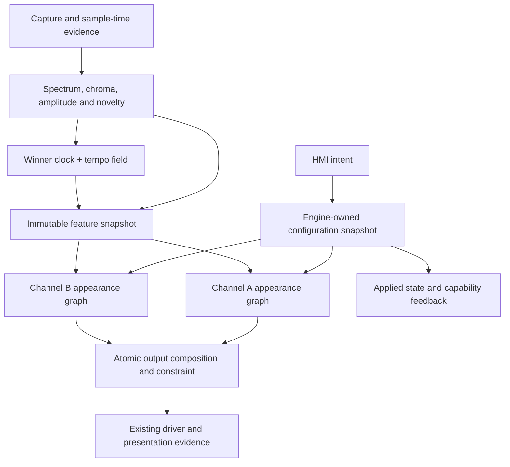
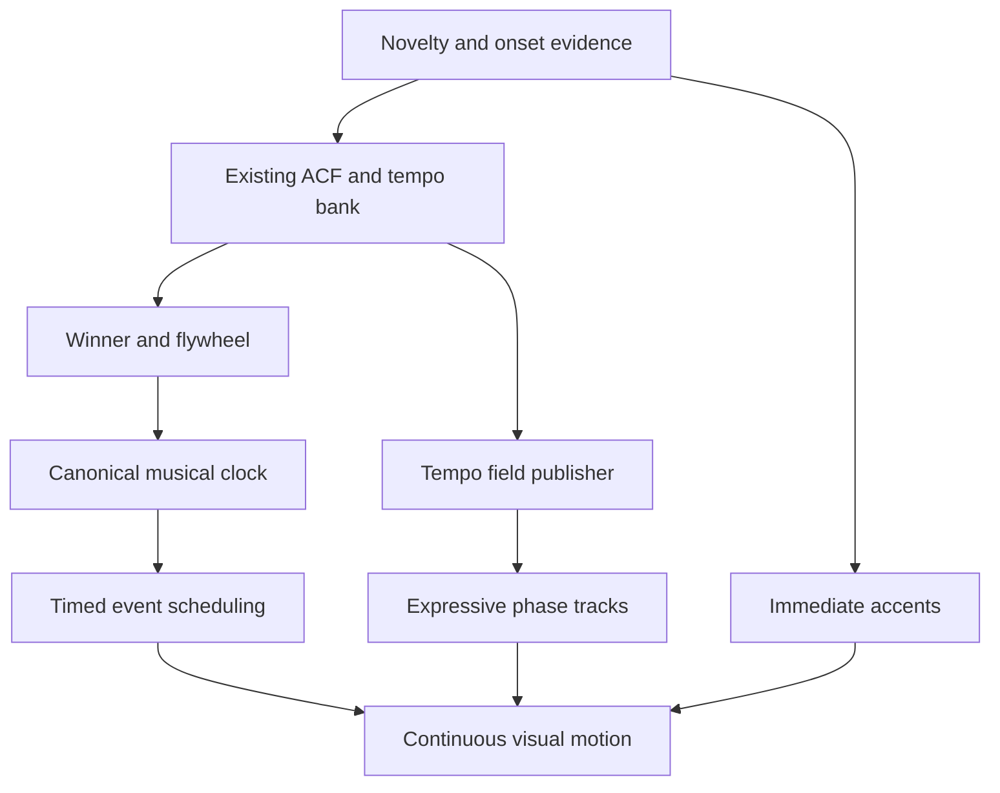
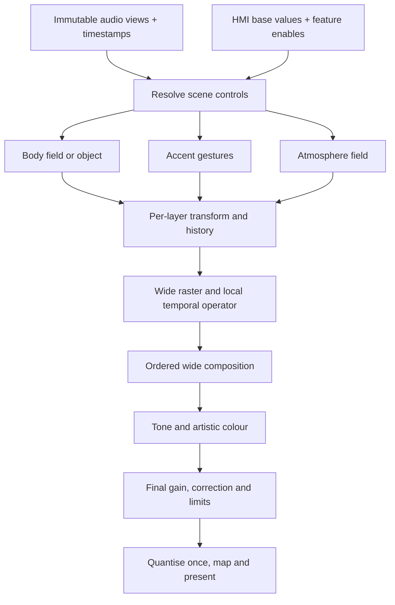

# K1 Modular Pipeline — Architecture, Evidence and Integration

Research/design snapshot: 23 September 2026 UTC; Mac work records use 24 September local time.

This extends the Connor product teardown with a fresh read-only audit of DualMCU, Titan Mini and the HMI lane. It separates implemented mechanisms from proposed integration, host arithmetic from physical results, and working-source identity from installed-image identity.

Read the first chapter for the decision. The specialist chapters carry exact source paths, hashes, feature mappings and contracts. The final chapter is the implementation handoff. The standalone HTML provides an interactive synthetic audition, not firmware or optical emulation.

# K1 as a modular light instrument

Research and architecture proposal · 23 September 2026 UTC / 24 September in the current Mac work records

## Decision

Build on K1’s existing audio engine, applied-state authority and physical output backends. Add a bounded, explicitly staged appearance pipeline with separately owned feature state. Keep the established renderer as a named compatibility profile. Introduce a genuine wide producer and an audio-owned tempo-field extension alongside the existing winner/flywheel event. Extend the HMI contract with supported capabilities and authoritative state before assigning new visual parameters to physical sliders.

There is no need to anchor the whole system to either Sensory Bridge or Emotiscope. Their artistic decisions can become alternative, named appearance profiles over shared observations. Musical-frequency analysis, scalar or colour history, a steady beat clock and an ensemble of periodicities are compatible architectural ingredients. They are not interchangeable semantics.

This is a proposed integration architecture, supported by a fresh read-only source audit and focused synthetic mathematics. No target firmware, console profile, installed image or physical wiring was changed by this study. Current working sources are dirty: HEAD alone does not identify the inspected implementation. The evidence packet records relevant working-file hashes and distinguishes current source, retained receipts, donor behavior and proposed changes.

## What the fresh audit changes

| Question | Current source finding | Architectural consequence |
|---|---|---|
| Are we already beyond Sensory Bridge’s Q15.16? | DualMCU already has genuine SQ15x16 colour histories. Titan’s retained musical renderer is older and uses RGB8 history for Bloom. Both routes still narrow general effect frames to Pixel8. | Preserve useful existing precision; close the actual narrowing boundaries. Do not migrate every type because its bit count sounds better. |
| Does native RGB16 solve the problem? | Titan has a wide staging/packing interface, but normal musical output fills it by lifting RGB8. DualMCU also widens byte values at its WS2816 edge. | Real lower bits must originate before composition, treatment and dimming. Multiplying a byte by 257 remains a compatibility adapter. |
| Is multi-tempo a new detector? | Both AP cores already calculate 96 tempo hypotheses and a fresh 96-bin ACF salience field. The VP-facing output retains a single tracker event. | Extend the semantic publication before considering another expensive analyzer. |
| Can those 96 phases be exposed directly? | The Goertzel bank refreshes two bins per 22.5 ms novelty tick: a complete bank takes 1.08 s. | Carry per-candidate measurement age and phase anchor. Do not stamp an old candidate as fresh on every AP publication. |
| Are per-channel controls already isolated? | Titan’s configuration function can reconstruct both channel states when either mode changes, and clears both waveform colour states when either palette changes. | Implement selective field updates and reset causes before attaching high-rate slider control to this API. |
| Does the console display confirmed values? | It caches returned engine state, but current fader/graph values are sourced from local physical/requested state. LIVE describes the session. | Distinguish physical position, requested value, applied value and effective visual behavior. |
| Does CC14 mean 14 useful physical bits? | The console reads a 12-bit ADC and applies an 80-count CC14 emission hysteresis, approximately 0.488% of full scale. | Parameter mapping and emission filtering matter as much as wire width. Fine material controls need a measured control-resolution budget. |

Exact paths, line references and qualifications appear in the precision, visual, AP and HMI chapters. The active HMI implementation is `K1.Sliders`; the named `K1-HMI-BLE-MIDI` tree is the earlier 1.91-inch reference. Both were considered, without reviving the archived lane as production authority.

## What “modular” must mean here

The user’s requirement is strong and useful: every artistic feature must have an explicit on/off control, and using one feature must not accidentally overwrite another feature’s parameters or state. A list of booleans is insufficient to provide that guarantee.

The proposed contract guarantees **state and control isolation**. It also declares intended **visual interactions**. Blur changes what persistence retains; additive light changes when a limiter acts; palette changes affect live-coloured history. Those interactions are properties of the chosen composition, not necessarily bugs. No architecture can make arbitrary noncommuting operations visually independent while preserving their definitions.

Use a small static directed graph of known stages, compiled with fixed storage and supported capabilities. Each feature has a named slot and stable identity. A preset changes parameters, enabled bits and permitted algorithm choices; it does not install code, allocate arbitrary nodes or reorder the real-time graph. This gives extendability without creating an unbounded plugin runtime on an MCU.

Every feature descriptor must declare:

| Field | Required meaning |
|---|---|
| Identity / version | Stable feature ID, semantic version and capability bit; never reuse an ID with a different meaning |
| Scope | Global observation producer, per-channel appearance feature, per-layer feature or physical-output operation |
| Inputs / outputs | Typed domains, units, freshness requirements and the fields the feature may read or write |
| Parameters | Canonical engine-owned values, ranges, defaults, mapping curve, smoothing and dependencies |
| State | Storage size, owner, timebase, initialization and every reset cause |
| Bypass | Exact identity operation or no-contribution behavior; no implicit change to unrelated settings |
| Lifecycle | Reset-on-disable, decay with zero input, or an explicitly supported warm-resume policy |
| Cost | Fixed memory, bounded work, measured target cost once implemented, and supported combinations |
| Failure | Behavior for missing/stale input, invalid parameters, unsupported capability and epoch change |

The stored enabled flag and the numeric amount are separate. An amount of zero may be a valid endpoint; it must not erase the remembered setting or silently toggle another module. Disabled controls may retain their configured value and show an inactive state. Enabling a dependent visual feature may request a shared audio producer, but disabling one consumer must not stop a producer still needed elsewhere.

“All features toggleable” applies to artistic processing and interpretation. Buffer ownership, bounds checking, identity checks, fault handling, blackout and physical current constraints remain infrastructure. A user can select the compatibility path versus the wide path; individual numeric casts are not useful musical switches.

## The proposed dataflow

DualMCU keeps this real-time engine on RT1062. S3 carries bounded control, applied-state and telemetry traffic. Titan keeps the same semantic split inside its own engine, with its actual publication and output adapters. Neither audio features nor pixels are added to the inter-MCU control link simply to expose new visual options.

### Per-channel stages

| Stage | Responsibility | Optional behavior and identity |
|---|---|---|
| 1. Feature view | Select amplitude, spectrum/chroma and rhythm evidence without mutating shared AP state | Focus/exposure/visual sensitivity bypass to the declared unmodified view |
| 2. Gesture | Produce continuous position, width, intensity and palette coordinates | Direct envelope, spectrum/chroma object, stable pulse or bounded tempo ensemble; disabling a layer contributes zero |
| 3. Material/history | Remember scalar intensity, RGB deposits or explicit object state | Transport, diffusion and decay are independent parameters in the new profile; bypass eliminates that history contribution |
| 4. Geometry | Apply permitted centre-space motion and extent transforms | Identity transform preserves the canonical centre-origin gesture |
| 5. Rasterization | Turn continuous objects into fractional samples | Named coverage/energy policy; preserve a reference kernel separately from new kernels |
| 6. Layer composition | Combine contributions in a declared wide domain | Weighted mix, additive emission or maximum are choices with different semantics; they are not all applied in sequence |
| 7. Temporal treatment | Optional image low-pass and/or explicitly configured persistence | Bypass gives the current image. Persistent state belongs to this channel and this module only |
| 8. Artistic colour/tone | Palette mapping as appropriate to history, bounded palette movement, saturation/tint and optional knee | Each operation has an identity and declared order; no silent full hue-wheel sweep |
| 9. Device output | Declared conversion/calibration, gain, aggregate constraint, final quantization and topology | Identity colour correction remains default. Physical protection and blackout remain authoritative |

This is a vocabulary, not permission to move legacy transforms across each other. The compatibility profile keeps its existing exact ordering. The new profile fixes its ordering explicitly and owns its appearance reference. Palette ownership is especially important: scalar history must be coloured at its declared stage; RGB history already owns deposited colour.

### Four separate axes in the SuperPixie lesson

**Float composition** describes numeric storage and arithmetic. **Weighted blending** describes a combining operation and can be performed in float. **Continuous transforms** describe geometry before sampling. **Immediate-attack persistence** describes temporal behavior. None replaces all the others.

For the first new K1 profile, use a scalar FP32 reference implementation with explicit value domains and bounded intermediates; benchmark target cost before replacing hot operations with packed integer or vector kernels. Keep fractional geometry and persistent state wide. Native RGB16 is the output representation after all relevant operations, not the scene format.

A minimal layer can hold emitted RGB and coverage/opacity, or compute its contribution directly into a shared accumulator when lifetime permits. Choose whether coverage has already multiplied the colour. Do not multiply opacity twice, and do not treat a maximum mask for a glyph’s intersecting segments as interchangeable with maximum RGB between unrelated coloured layers.

The W3C compositing model is a useful mathematical reference for distinguishing layer coverage from blend operators. Its browser rendering defaults are not a colour-calibration specification for K1. Likewise, a type named `LinearRgb` is not evidence that legacy palette values represent measured linear light.

### A concrete first material that avoids a false independence claim

Preserve donor Bloom’s sampled field as its reference. For the first independently controlled candidate, use a bounded set of centre-origin pulse objects. Each object stores birth time, initial amplitude/width, colour ownership and radial motion state. Evaluate its position and width from elapsed time: `r = r0 + v·age`, `σ² = σ0² + 2D·age`, and amplitude retention from the chosen lifetime. Keep constant-peak versus constant-integrated-contribution normalization explicit. Sampling the resulting continuous profile still has finite-pixel and edge effects, but repeated low-order shifting no longer secretly supplies the entire diffusion model.

This candidate is a pulse/ribbon instrument, not exact continuous-VU Bloom. Onset/tempo events create bounded objects; a continuous envelope can feed a separate declared layer. Set a finite object capacity and deterministic admission/retirement policy. Do not create one indefinitely retained object per AP sample or hide dropped events. A full pool can merge a compatible deposit or reject a new decorative pulse according to a named policy; primary event accounting remains intact.

Live parameter changes must preserve continuity. The simple age formulas above assume constant parameters. Either lock a pulse’s parameters at birth, or re-anchor its current position, variance and amplitude at the effective edit time, then integrate only subsequent velocity, diffusion and decay. The preferred live-control profile uses re-anchoring: integrate `v(t)` into position, `2D(t)` into variance and the decay rate into log-amplitude. Replacing a lifetime-wide speed with the latest slider value would teleport old pulses; replacing lifetime decay could relight them. A host audition that deliberately replays an entire fixture with new settings must label that behavior separately from live control.

For a later sampled-field solver, merely adding a diffusion coefficient to an upwind transport kernel does not establish independence: the advection discretization itself adds diffusion. Its stability and numerical spread must be characterized across actual speed, diffusion and delta-time ranges. The host reference must distinguish mathematical material parameters from discretization artifacts. This is why the first candidate should use a directly inspectable continuous object model while the coupled Bloom profile remains available.

## State lifecycle: the actual protection against features stepping on each other

Apply a complete validated configuration revision at a render boundary. The control thread never writes partially updated render parameters in place. Compute a changed-field mask and dispatch changes only to owners whose semantics require it.

| Change | Preserve | Change/reset |
|---|---|---|
| A brightness | All AP state, B state, A motion/history | A output gain target only |
| A transport speed | B and unrelated A modules; current object continuity | A future velocity, with the declared smoothing; no phase restart |
| A persistence off | Gesture, palette, AP and B state | Remove A persistence contribution; apply its declared hidden-state policy |
| A palette | B palette/history and AP | A palette transition; recolour old trails only in a live-colour profile |
| A mode | All B state and shared AP | Only A mode-owned state, plus explicitly incompatible dependent A state |
| Tempo-ensemble appearance off | Winner detector and other tempo consumers | Remove this appearance consumer; keep shared producer if still needed |
| Sample-source epoch change | User configuration | Invalidate timestamp-dependent audio/phase observations; reset or transition dependent state explicitly |
| Blackout/fault | Configuration according to established lifecycle | Final output is black regardless of retained artistic light |

Reset-on-disable is the default for new persistent features because it avoids unexplained resurrection. Decay-while-bypassed with zero drive is a separately named useful option. Continuing to feed hidden live input is another behavior and must not be confused with passive decay. Freezing old history requires an explicit bounded resume policy; it is not a safe accidental consequence of skipping a function call.

If a click-free disable transition is used, feedback must distinguish requested-off from transition-active and fully-bypassed. Hard blackout overrides that transition. State from the previous mode cannot leak into a newly allocated module merely because both share scratch memory.

Snapshots publish settings once applied, not every modulated pixel value. The UI can separately show `supported`, `configured`, `active`, `transitioning`, `inactive because input unavailable`, and effective modulation. Those distinctions prevent a disabled feature’s fader from appearing broken and avoid treating an acknowledgement as emitted light.

## Multi-tempo: extend the evidence, preserve the clock

The two desired behaviors are complementary. A stable winner/flywheel supplies coherent primary motion and synchronization. A tempo field preserves alternative periodic structures and can supply texture, subdivisions and uncertainty-aware composition.

Keep two interfaces: the established compatibility event, and a new local AP-to-VP field with explicit version, source epoch, sequence, measurement/window times, relative salience and candidate identities. Do not repurpose the existing event’s BPM as a universal phase derivative: current source distinguishes target-bin BPM from the actual evolving flywheel rate.

Publish the already available ACF salience first as amplitude evidence. ACF peak strength does not itself provide oscillation phase. The slower candidate phase bank needs its own measurement timestamp, actual frequency convention and validity. A small phase-qualified subset can drive moving objects while the complete relative field remains available for diagnostics and non-phase-dependent composition. The AP chapter specifies the proposed records and refresh work.

The first compositor should preserve the winner as the principal gesture and allow a bounded compatible family beside it. Candidate selection needs stable identity and hold rules; otherwise a harmless rank swap becomes a visible object teleport. Normalize contribution weights within a declared family, retain a separate evidence-strength/validity gate, and allocate a fixed contrast budget. A normalized distribution alone must not turn weak noise into full-brightness rhythmic certainty.

Do not deduplicate musical ratios blindly. Half/double-time candidates may describe levels of the same groove, while competing unrelated candidates may express uncertainty. Adjacent-bin leakage is different again. Maintain these distinctions when reducing a 96-bin field. Expose a useful amount such as rhythmic-layer mix; keep detector thresholds and visual contrast controls separate.

Current real-time PLP research offers an adjacent idea: separate oscillatory pulse shape from stability/confidence and evaluate predictable motion at intended presentation time. It does not justify replacing K1’s functioning detector, claiming future audio is known, or adding a DAW-oriented algorithm without an MCU cost case.

## The HMI becomes part of the instrument

Retain the current nine-fader profile and its canonical assignments as the compatibility surface. A new fixed appearance profile is a separate proposed instrument, not an unnoticed remap or bank switch. Nine physical faders cannot independently expose master brightness plus every material, colour and rhythmic parameter for two channels.

The recommended next fixed layout is master brightness plus four direct material controls per channel: motion, spread, persistence and rhythm mix. That gives immediate A/B operation without banking, but gives up direct access to the current photons/chroma/mood/saturation quartet in this profile. That tradeoff must remain visible. The existing profile remains selectable as its own instrument configuration; no live rebind is introduced into the current closeout.

Independent engineering controls and feature toggles remain available through a capability-aware host editor and the canonical engine API. Performance macros may coordinate several parameters only when their mapping is named and inspectable; a macro is not evidence that the underlying parameters are independently controllable. Physical feature-toggle controls require a declared supported input surface; existing disabled pads are not silently repurposed.

The HMI path is:

`physical input → calibrated position → parameter-specific mapping → bounded intent → engine validation/application → applied-state feedback`.

Each stage has its own precision and timing. Preserve channel identity throughout paired CC14 messages. A 50 Hz update ceiling prevents uncontrolled traffic but must coalesce the latest value, preserve the final settled value and retain transaction semantics. The engine owns smoothing in physical units; stacking an opaque console low-pass, transport hysteresis and renderer low-pass can make a responsive feature feel detached.

Logarithmic controls need an explicit zero/off rule. For example, a decay-time slider can map a finite positive range logarithmically while the feature toggle controls bypass. A motion parameter should not cross through arbitrary sign changes to select direction; centre-out versus edge-in is a discrete, valid geometric policy. Ranges in the HMI chapter are engineering candidates for evaluation, not measured preference or authorized new wire assignments.

Extending the current control surface requires versioned capability negotiation and coherent applied-state replication. Preserve the existing 71 mapped controls and 68 snapshot-eligible values; do not shrink or silently renumber them. A new parameter set cannot be added by inventing spare MIDI numbers while leaving a fixed count/checksum/schema unchanged. Unsupported controls remain unavailable and cannot be reported as applied.

Titan should implement the same parameter meanings and state rules through its own adapter. That does not assert an already working BLE path to Titan. The bridge and output adapters are lane-specific work with their own evidence.

## Fadecandy: select the useful boundaries

The useful inheritance is late quantization, explicit transfer functions, bounded ownership, numerical reference code, measured hot-path optimization and a short host authoring loop. The historical Kinetis driver, RGB8 OPC boundary and arrival-time frame interpolation are not universal upgrades for our current lanes.

Separate frame interpolation, LUT interpolation and quantization as independent decisions. Keep identity correction exact. Reject nonfinite/nonmonotonic transfer tables before they become active. Preserve native WS2816C output and the cancelled residual-RGB8-dither decision for that route. A future different RGB8 product would need its own quantization/cadence case.

A host workbench should record wide scene/output frames, feature timestamps, configuration revision, source hashes and the selected appearance profile. Derive OPC or browser previews from that canonical record; neither is optical truth. Use the actual server only if its mapping/device utility earns its maintenance cost. A small host adapter can provide the useful iteration loop without making a PC part of autonomous playback.

## Timing and bounded cost

Keep the actual clocks separate: 24 kHz capture, 180-sample AP hops, slower novelty/tempo updates, artistic simulation, rasterization, control arrival and physical presentation. Do not retime a frozen compatibility profile because another subsystem has a 7.5 ms interval.

New continuous dynamics use elapsed time with declared behavior on gaps. A long missed interval must not create an unbounded catch-up loop. Use an analytical update where valid, bounded substeps for the stated stability limit, or an explicit reset/fade policy beyond a declared maximum gap. Never silently use a clamped delta while claiming real-time behavior was preserved.

The current DualMCU instructions retain a 2 ms effect-work ceiling at 120 FPS and an under-8-ms end-to-end requirement. These are requirements, not measurements obtained in this study. A 7.5 ms publication period plus a roughly 5 ms physical transfer can already exceed 8 ms for some event alignments. The implementation must define and measure event time, feature availability, render start/end, transfer start/end and latch; it cannot satisfy the requirement by relabelling API-return time. Any incompatible physical bound needs an explicit architecture decision, not a relaxed scorer.

Budget complete admitted combinations, including the worst existing AP slice, control traffic and output ownership. “Every feature is individually fast” does not prove that all enabled features meet the deadline. Unsupported combinations should be rejected with an explicit capability reason before application, not silently shed or half-apply modules mid-frame.

Fixed memory can be reused only when lifetimes do not overlap. One RGB FP32 frame for 320 pixels is 3,840 bytes, versus 1,920 bytes for RGB16 and 960 bytes for RGB8. Every additional full-frame history has that cost. A new graph need not allocate one full framebuffer per feature: object descriptors, scalar histories, scratch reuse and sparse layers can be more appropriate. The precision chapter budgets concrete candidate sets and records existing storage separately.

## Second-, third- and fourth-order consequences

| First decision | Second-order consequence | Third-order consequence | Fourth-order opportunity or risk |
|---|---|---|---|
| Publish a tempo field with honest age | VP gains alternative periodicities without replacing the winner | Candidate identity and confidence become visual state | A richer rhythmic instrument; badly managed ambiguity becomes clutter or false certainty |
| Preserve fractional composition | Faint tails and small colour changes survive | Existing noise and overlapping layers also survive | Better subtlety only when contrast, quiet space and low-end behavior are authored |
| Separate motion, diffusion and lifetime | Sliders can change one physical-looking property at a time | Controls become transferable across modes and hardware | A recognisable family of K1 materials, with units and reference profiles instead of mode-specific magic numbers |
| Selective per-channel updates | A adjustment stops resetting B | Independent live performance becomes trustworthy | Two channels can form deliberate counterpoint rather than accidental synchronization |
| Immediate attack plus controlled persistence | New events remain prompt while old light fades | Per-channel maxima can mix old and new hues | Expressive afterglow, or colour mud unless hue-memory semantics are explicit |
| Stable semantic controls | HMI gestures can be recorded and replayed | Performances become reproducible appearance recipes | User-authored instruments and later synchronized choreography without streaming pixels |
| Capability-aware feature toggles | Unsupported combinations become visible | Same UI can span different engines honestly | A modular product family; avoiding silent degradation becomes part of compatibility |
| Separate output calibration from art | Looks remain portable while each physical bar is characterized | Optics and low-end response can be compared independently | More consistent production appearance; calibration cannot be mistaken for a preferred artistic curve |
| Applied-state feedback | A control shows what the engine accepted | Pending, inactive and unavailable become explainable | The HMI becomes a reliable performance surface rather than a decorative traffic monitor |
| Host replay with source/profile identity | Comparisons stop losing their provenance | A useful library of musical and diagnostic scenes accumulates | Future agents can make cumulative decisions instead of rediscovering the same coupling |

There is also a physical feedback risk to evaluate when brightness becomes more dynamic: LED load can affect supply noise and microphone observations. A slider should not appear to change the beat merely because it changes electrical conditions. This is a conditional test direction, not a fault established by the source audit.

## Implementation sequence and decision gates

1. **Freeze references and declare semantics.** Preserve current lane identities, dirty-source hashes, compatibility vectors, control registry and output topology. Record each new feature’s domain, identity, state lifecycle and bypass behavior. This does not rewrite any existing execution plan.
2. **Repair selective configuration.** Implement field-specific application and reset causes, especially Titan’s coupled channel reset path. Prove unrelated state and parameters survive changes.
3. **Publish the existing rhythm evidence.** Add a local versioned tempo field, initially preserving truthful amplitude/age data and the existing winner path. Admit phase-driven ensemble motion only with valid phase anchors and bounded freshness.
4. **Build one wide material profile.** Implement scalar FP32 reference behavior through final treatment and native output conversion. Include continuous centre-space geometry and explicit scalar/RGB history ownership. Keep the old profile intact.
5. **Add optional modules incrementally.** Start with immediate-attack persistence and transport controls, then bounded ensemble composition, coverage policy and novelty-linked palette movement. Pairwise interaction checks follow the declared dependency graph.
6. **Extend control and feedback.** Add negotiated schema/capabilities and truthful applied/inactive state; expose full engineering controls in the host workbench. Preserve existing wire mappings and the current console profile.
7. **Evaluate the fixed appearance instrument.** Implement the separately named nine-fader profile only as its own scope, with the selected mapping and supported physical toggles. Reuse working calibration and establish actual parameter resolution and final-value delivery.
8. **Compare complete output.** Use the same timed inputs, settings, physical topology and optics; include brightness-matched viewing, sparse and dense music, quiet gaps, mode/palette interruptions and true black. Measure actual target runtime and presentation timing under the admitted full workload.

Work packages that depend on existing HMI bench acceptance must use its current detailed receipts. A recorded LIVE connection or automated traffic soak is not proof that nine independent physical controls applied correctly. Source and host research remain useful while specific physical acceptance rows are incomplete.

The companion execution brief gives exact seams, required outputs and acceptance. The final choice should be based on demonstrated appearance and reliable control, with rejected alternatives and unresolved physical questions retained alongside the successful candidate.

---

# K1 colour precision and output architecture: source audit

Research snapshot: 24 September 2026. Read-only source investigation; no target build, flash, serial session, optical measurement or firmware modification. The checkout is not evidence of the resident image.

## Decision

Use **scalar FP32 as the reference representation for a new, optional wide working pipeline**, with explicitly declared colour intent, bounded headroom, isolated history and one final native UNORM16 quantisation. Keep the existing renderer as a versioned appearance profile and numerical oracle. Sensory Bridge's signed Q15.16 remains relevant as donor behaviour and a possible storage/optimisation choice; it is not the next missing capability by itself.

We already have some of its machinery on DualMCU. We do **not** yet have its equivalent consistently across both K1 lanes. More importantly, neither inspected normal musical output path is an end-to-end wide colour path. Both eventually funnel through RGB8 before the WS2816 words are prepared. A 16-bit wire word cannot reconstruct information already discarded upstream.

Fadecandy supplies valuable ideas about late conversion, explicit output mapping, independent display cadence and efficient LUT evaluation. Calling the entire old pipeline technically superior would be misleading: it accepts RGB8, deliberately stores LUT knots at 15-bit precision for a packed multiply, couples two interpolation decisions, and generates RGB8 output by temporal error distribution. Native WS2816C K1 should retain its native RGB16 route, with identity output correction by default and no external RGB8 residual dither on that route.

## Source identity and lane differences

The audit captured complete relevant source text and SHA-256 identities in `evidence/precision/source-capture.json`; `manifest.json` is the compact identity ledger and `source-excerpts.json` contains numbered decisive excerpts.

| Lane | Current checkout HEAD | Working-tree qualification |
|---|---|---|
| DualMCU | `67a1cd0b0ecc626b28af2df9b0d11f855b402379` | Repository dirty in HMI/control work; all 37 files captured for this numerical/output audit matched HEAD at capture |
| Titan | `431140853dd8b58af53240ef84d5fb1a08bd8b45` | Repository dirty; captured `fixture_app.cpp`, `palette_runtime.cpp/.h`, `k1_live_runtime.cpp` and AGENTS differ from HEAD or are untracked; exact file hashes are retained |

Roots are `/Users/spectrasynq/Workspace_Management/Software/SpectraSynq-K1-DualMCU-Firmware` and `/Users/spectrasynq/Workspace_Management/Software/SpectraSynq-K1-RA8P1-Firmware`. Titan's `docs/REFERENCE-MANIFEST.md` still names DualMCU `6b1e7bc5c9f9871e6ea4e900455bcb37d756304a` as its behavioural import authority. Today's sibling DualMCU HEAD is not automatically Titan's authority. This explains some divergence; it does not justify silently replacing Titan's source.

| Boundary | DualMCU captured source | Titan captured source | Consequence |
|---|---|---|---|
| Position, timing, many controls | FP32 geometry, phase and envelopes | FP32 geometry, phase and envelopes | Continuous motion is already partly present; source colour and accumulation precision still matter |
| Palette HD sampler | FP32 interpolation between RGB8 stops | FP32 interpolation between RGB8 stops | Interpolation can create fractional values, but most callers return Pixel8 |
| Persistent colour for donor-derived modes | Twelve RGB signed SQ15x16 arrays of 160 pixels per channel | No equivalent SQ15x16 arrays in inspected imported renderer; Bloom transports RGB8 `previousFrame` | Histories are materially different; do not describe both as wide |
| Public working frame | `Pixel8`, three bytes/pixel | `Pixel8`, three bytes/pixel | Common composition/output seam is eight bit |
| Output treatment | Pixel8 incandescent/bulb/base/prism/order; legacy dither toggle | Pixel8 output treatment | Repeated multiplication and truncation lose dim detail |
| Native packing | Pixel8 ×257 after optional byte brightness | Separate Pixel16 staging/packing API preserves low bytes, but normal fixture render path stages Pixel8 ×257 | Wide transport is present; arbitrary wide authored musical pixels are not yet produced by the inspected path |
| Physical lane use in bounded image | `K1_WS2816_DUAL_DIN` packs logical A into two 80-pixel DINs; B has no connected output in this image | Selected logical channel staged into two 80-pixel DINs | Neither bounded bench route is proof of full independent A/B, four-half product output |

## What Q15.16 actually means here

Sensory Bridge's `CRGB16` contains **three `SQ15x16` channels**, not three `uint16_t` channels. Its adjacent comment saying “Unsigned Q8.8” is stale and contradicts the declarations. The signed fixed-point format uses a 32-bit storage word, 16 fractional bits, 15 magnitude integer bits and a sign bit. Nominal representable range is −32768 to 32767.9999847. A unit step is 1/65536.

The relevant colour convention is **normalised component values**: ordinary black is 0 and ordinary full channel is 1; values are multiplied by 255 or 254 at the output. It is not a 0–255 working code multiplied by an additional 65536. Headroom exists in the number format, though particular stages clamp or normalise it and some colour paths round through FastLED HSV bytes. The final LED transport is RGB8.

DualMCU's `Sq15x16` makes the same units explicit: constructors multiply a float by 65536, multiplication uses an int64 product shifted right 16, conversion to float divides by 65536, and `quantiseSqRounded` multiplies that normalised result by 255. `sqFromPixel8` first divides bytes by 255. Its donor Bloom keeps fractional RGB in `bloom_history`, stores that history before display edge fading/mirroring, and then separately quantises the displayed frame. This separation is worth preserving. Injection can still originate from Pixel8, so wide history does not mean every stage was wide.

| Representation | Meaning of 1.0/full scale | Spacing around normalised unit range | Bytes per RGB pixel | Appropriate role |
|---|---|---:|---:|---|
| RGB8 / UNORM8 | code 255 → 1 | 1/255 | 3 | Legacy compatibility, some bench transport |
| Signed SQ15x16 | raw 65536 → 1 | 1/65536, absolute | 12 | Existing donor history; bounded fixed-point alternative |
| RGB16 / UNORM16 | code 65535 → 1 | 1/65535 | 6 | Final native LED command, compact bounded storage |
| FP32 RGB | numeric 1 → declared reference level | 2^-23 immediately above 1; finer absolute spacing below 1 | 12 | New composition, continuous transforms, HDR headroom, scalar oracle |

FP32 has substantially finer arithmetic resolution near unit level and much wider dynamic range than Q15.16 at the same RGB storage size. That is a reason to prefer it for authoring/reference composition, **not** proof of a better image or faster execution on these exact builds. Fixed-point may still win for specific kernels or deliberate numerical parity. Do not confuse CMSIS `q15_t` (a signed fractional 16-bit type) with this 32-bit Q15.16 representation.

## Where current precision is lost

1. **Palette exit.** `sampleProductPaletteHd` computes floats but callers frequently invoke `quantiseLinearRgb` immediately. That quantiser truncates `255*x`; other SQ conversion paths round. These are distinct numerical contracts.
2. **Weighted geometry.** The common `render_primitives.cpp::addScaled` truncates each weighted contribution before addition into Pixel8. Two white contributions of 0.002 each become zero plus zero. Sum them in float first and their final native UNORM16 component is 262. This is derived arithmetic, not a claimed visual threshold.
3. **Titan history.** `transportOutward` reads Pixel8 history, distributes it with weighted byte operations and writes another Pixel8 snapshot. A fractional transport path can therefore lose energy through numerical truncation in addition to intentional decay and edge loss.
4. **Dual output treatment.** Incandescent and bulb operations quantise to bytes between stages. Base coat saturates those bytes. Edge policy also modifies bytes. Master/policy gain and current limiting then scale Pixel8 again. A high-resolution HMI brightness value does not make those output levels high resolution.
5. **Native packing.** DualMCU's `map8_to_16` repeats a byte into both halves of a word. Titan's normal `fixture_app` explicitly labels the same operation `REPLICATE8`. It can produce only 256 distinct pre-brightness component words. Titan's subsequent 16-bit brightness multiplication may create unequal high/low bytes; that does not prove a wide source renderer. A low-byte diversity test alone would give a false pass.
6. **Legacy dither location.** Current `product_output_treatment` exposes a four-phase byte dither toggle. It processes an already quantised byte scaled by 254/255; it cannot recover the discarded palette or geometry fractions. Its existence is not evidence that it is enabled in the resident image or an authorisation to put it into the native16 route.

`frame_blend.cpp` also uses Pixel8 history, but DualMCU's production runtime applies that helper only when the product renderer did not handle the channel. Do not attribute its EMA indiscriminately to every product effect.

## Colour-space truth: names are insufficient

`PaletteLinearRgb` currently normalises legacy RGB8 stops and interpolates their numbers. The inspected sampler contains no sRGB inverse transfer, LED calibration or optical measurement. Its name therefore establishes neither scene radiance nor measured linear light. Applying gamma because a variable says “linear” would repeat the very domain confusion this migration should remove.

The new contract should label inputs:

- `LegacyPaletteCodeV1`: existing authored RGB code relationships; preserve them through an explicit compatibility adapter.
- `WorkingRgbF32V1`: non-negative, device-primary light intention. 1.0 is a documented reference channel level. Mathematical additions and blends happen here. Until measured, a device-linear relationship remains a declared modelling assumption, not photometric truth.
- `DeviceDriveRgbF32V1`: bounded drive after the selected artistic tone/gain and device mapping.
- `DeviceRgb16V1`: rounded native UNORM16 command.

A future calibrated profile may establish a more physically meaningful working space. It must have a versioned asset/input conversion; it cannot silently reinterpret all existing palettes. Identity correction remains the default. Artistic warmth, saturation, tone compression and a measured device transfer are separate controls and stages.

## Proposed numerical and ownership contract

This is an implementation candidate, not a measured deployment result.

1. Keep event/presentation timestamps in the existing integer time domains. Use FP32 local elapsed seconds and bounded normalised/radial coordinates for rendering; do not convert an ever-growing absolute microsecond timestamp to float. Keep centre 79/80 and independent logical A/B.
2. Each source layer owns its state and writes finite FP32 RGB. Suggested initial authoring bound is 0–4 per component, at most eight simultaneously admitted layers, and 0–32 for a pre-tone accumulator. These limits are proposed resource/headroom limits, not natural limits of FP32. Validate parameters outside the hot loop; count/clamp anomalous output at the stage boundary. Do not permit NaN/Inf to propagate into integer conversions.
3. Define the blend operator. Additive light, weighted crossfade, premultiplied alpha-over and max-composition are different operations. Coverage is multiplied exactly once. Preserve headroom until the declared tone/gamut stage; a saturating byte add is not the reference operator for a wide layer.
4. History has a declared domain: scalar envelope recoloured now, stored RGB memory, geometric object state, or presentation persistence. Only the owning module reads/writes it. Never feed final brightness, current-limit gain, calibration or output quantisation back into authored history unless a particular effect explicitly requires that feedback.
5. Place artistic tone/gain and device mapping after composition. A optional LUT may be bypassed with exact identity. Frame interpolation, LUT interpolation and persistence have independent controls; disabling one must not change another's mathematics. Turning an artistic feature off is an identity operation at its own boundary; its reset/decay/freeze policy must be explicit.
6. Apply brightness with wide arithmetic once at its owned boundary. Preserve the current master versus channel intent; remove hidden duplicate scaling only through an explicit changed-profile evaluation. Keep current/thermal limits separate from optional appearance toggles. If a device LUT is nonlinear, determine power-limited drive consistently with that LUT instead of assuming a post-LUT code multiplier is a linear-light gain.
7. Quantise once at the native endpoint: `round(clamp(x,0,1)*65535)`. Saturate out-of-range finite values; handle non-finite values before conversion. Pack G16/R16/B16 without scaling bytes. Native16 output has no external RGB8 residual dither. A separate RGB8 bench adapter can have its own documented quantiser, without changing the wide scene.
8. Publication owns an immutable completed frame and generation. Display completion/elapsed display time governs presentation-history decisions, not an assumed render call count. Skipped or busy submissions must not advance a temporal quantiser as though photons were emitted.

Changing numeric representation can alter the appearance even when the formula is ostensibly unchanged: dim trails last longer, overlap grows brighter, quiet gaps fill, and palettes may seem less saturated as previously lost components survive. These are expected comparison targets, not automatic improvement. Preserve legacy golden vectors and add wide-profile acceptance separately.

## Bounded storage for both 160-pixel channels

The following is exact layout arithmetic for tightly packed RGB arrays, excluding object padding, DMA alignment, control/state objects, stack, audio and driver buffers. It is not a target linker result.

| Object | Bytes for 2×160 |
|---|---:|
| One RGB8 frame | 960 |
| One RGB16 frame | 1,920 |
| One RGB FP32 or SQ15x16 frame | 3,840 |
| One RGBA FP32 frame | 5,120 |
| Example: three RGB working frames + two RGB histories + two RGB16 publication buffers | **23,040** |
| Current DualMCU twelve full RGB SQ histories alone | **46,080** |

Thus float does not inherently require more RAM than existing SQ15x16 colour histories. The real cost is the number of simultaneously retained surfaces and effect states. Stream stateless layers through one scratch surface. Reserve state through fixed-capacity per-channel slots with declared maxima. A fade between two stateful effects may need both histories at once; an added persistence module needs another. Do not promise the 23,040-byte example covers every possible enabled graph. Admit configurations against their actual liveness and measured execution budget.

If the new path coexists with every existing DualMCU history, its example allocation adds 23,040 bytes; it does not magically replace the 46,080 bytes. Reclaiming mutually exclusive state requires a separate migration and reset/transition contract. No `malloc`/`new` in render. Baseline scalar timing must respect the existing RT1062 2 ms effect budget and actual audio scheduling; no speed claim follows from the small pixel count.

## Fadecandy: selective adoption

Pinned donor: `PimentNoir/fadecandy` at `36f616158f195a327f8486474af2956dad52881d`.

| Mechanism | Value for K1 | Required translation |
|---|---|---|
| Wide interpolation before final conversion | Retains fractions between authored frames | New K1 scenes should already be wide; avoid an RGB8 host ingress bottleneck |
| Explicit per-channel output LUT | Clear device mapping; replace costly per-pixel powers with a bounded table | Identity default, monotonic/finite/end-point checks, one declared colour domain and exact bypass |
| Packed `SMUADX` interpolation | Potential M7/M85 kernel optimisation | Benchmark against scalar reference; preserve 16-bit knots if accuracy matters, or explicitly qualify 15-bit knot loss |
| `USAT` saturation | Clear bounded conversion primitive | Use target compiler/CMSIS wrapper behind portable interface; keep scalar implementation |
| Refresh independent of host frames | Stable presentation cadence | K1 already has timestamped scheduling; evaluate analytic scenes at presentation time where possible |
| Error-feedback RGB16→RGB8 conversion | Useful concept for an RGB8-only device | Excluded from native WS2816C product output; not a prerequisite for smooth RGB16 |
| USB/server ecosystem | Authoring/replay and a comparison endpoint | Standard OPC is RGB8 and untimestamped; retain canonical wide/timed captures separately |
| Kinetis USB, timer and three-DMA engine | Historical reference | Not a portable RT1062/RA8P1 driver; preserve existing owned transmitter boundaries |

The old LUT uses a deliberately aliased/unaligned 32-bit load of neighbouring 16-bit values and `SMUADX`. A portable implementation should use safe loads or `memcpy`, with explicit alignment/endian and compiler assumptions; ARM instruction availability alone does not establish C++ correctness or performance. Current CMSIS documentation lists the SIMD intrinsic family for M7 and M85, but target options, memory placement and generated code still need inspection. Helium can be an additional backend only after the scalar contract works; it is not a reason to change the scene model.

Three donor details deserve regression cases:

- `FCP_INTERPOLATION` controls both temporal framebuffer interpolation **and LUT interpolation**. Prior host probe: an identity-mapped input byte 128 gives 32896 with interpolated LUT, 32768 with that switch off. K1 must not preserve this unwanted feature coupling.
- Fadecandy arrival interpolation incurs roughly one source interval of delay. At 60 Hz this is about 16.7 ms. Optional interpolation must not become an unconditional stage for prompt musical accents.
- The retained server-LUT probe reaches NaN for a non-default slope/cutoff/gamma combination. Validate a compiled LUT before publication. A selectable curve is not valid merely because a server accepted the parameters.

## Acceptance that distinguishes a real wide path

Use dim fractional coverage, two sub-byte additive contributions, overlapping HDR layers, abrupt palette changes, quiet gaps, long low-level decay, half-scale identity, native low-byte patterns, and final gain/current limiting. Compare captured pre-quantisation floats with the final intended word; do not accept low-byte diversity alone as proof. A dark-to-bright-to-dark case must demonstrate immediate-attack persistence independently of an EMA.

Toggle tests should show that disabled modules are exact identity at their boundary, A/B state does not alias, and enabling one feature does not alter another's parameter or history. Replaying the same timed input with different render cadences must preserve declared velocity/lifetime; any intentional material-diffusion difference belongs in the profile contract. Numeric and host tests cannot establish visual preference, measured PWM precision, diffuser response or physical latency.

## Decisive source locators

Paths below are relative to the explicit absolute roots above. Every cited captured file has SHA-256 and dirty status in `evidence/precision/manifest.json`; numbered source text is in `source-excerpts.json` or the adjacent full snapshot.

| Claim | Exact locator |
|---|---|
| Dual Pixel8 public seam | Dual `core/pixel.h:8–14`; `core/visual/channel_render_state.h` private frame/previous/scratch arrays |
| Dual SQ units and arithmetic | Dual `core/visual/product_effect_renderer.cpp:171–211,3513–3541` |
| Dual wide Bloom history before display operations | Dual `core/visual/product_effect_renderer.cpp:3607–3653` |
| Float palette numerics and byte exit | Dual `core/visual/product_palette.cpp:60–117,139–160` |
| Treatment/gain/limit order | Dual `firmware/rt1062/production_runtime.cpp:788–850` |
| Native byte replication and bounded bench A-only route | Dual `firmware/rt1062/ws2816_pack.h:35–78`; `fastled_parallel_output.cpp:111–122` |
| Titan byte history | Titan `src/k1/core/visual/product_effect_renderer.cpp:326–366,2029–2070` |
| Titan replicated normal frame versus wide packer | Titan `platform/ra8p1/fixture_app.cpp:359–386,400–410`; `palette_runtime.cpp:370–397` |
| Titan true16 helper versus byte lift | Titan `platform/ra8p1/hd_pixel16.h:10–42` |
| SB declaration and nominal full-scale convention | [constants.h, pinned 4.1.1](https://github.com/connornishijima/SensoryBridge/blob/5f329261987144242be4c3729f6d344631d3be1e/SENSORY_BRIDGE_FIRMWARE/constants.h#L38-L42); [led_utilities.h](https://github.com/connornishijima/SensoryBridge/blob/5f329261987144242be4c3729f6d344631d3be1e/SENSORY_BRIDGE_FIRMWARE/led_utilities.h#L208-L272) |
| Fadecandy order and residual conversion | [fc_pixel.cpp](https://github.com/PimentNoir/fadecandy/blob/36f616158f195a327f8486474af2956dad52881d/firmware/fc_pixel.cpp#L25-L90) |
| Fadecandy 15-bit LUT and coupled interpolation | [fc_pixel_lut.cpp](https://github.com/PimentNoir/fadecandy/blob/36f616158f195a327f8486474af2956dad52881d/firmware/fc_pixel_lut.cpp#L28-L86) |
| ARM intrinsics, not a speed claim | [CMSIS SIMD intrinsics](https://arm-software.github.io/CMSIS_6/latest/Core/group__intrinsic__SIMD__gr.html) |

The canonical Titan skill's platform-memory record and WS2816 recall were read and checked for entry compliance. Its historical receipts were not treated as current target state. This work establishes no new timeless silicon rule, and therefore changes no platform skill or firmware authority.

---

# K1 multi-tempo architecture: preserve the clock, expose the musical field

Read-only source audit, 24 September 2026. This is an integration design, not an implemented firmware change or a claim about emitted light.

## Decision

K1 does not need to choose Sensory Bridge or Emotiscope as an exclusive foundation. It already contains much of the expensive analysis required for Emotiscope-style multi-tempo expression. **The principal missing component is a timestamped, bounded publication of the tempo field to the visual pipeline.** Keep the established winner/flywheel as the canonical musical clock. Publish alternative rhythmic evidence alongside it, with separate authority for broad visual movement. A visually appealing secondary rhythm must not become a scheduling clock merely because it is bright.

Both current lanes compute a 96-candidate bank, spanning 60–155 BPM in 1 BPM increments, and two 96-bin autocorrelation salience arrays. Both collapse this information into one `TempoTrackerEvent` before VP. The main AP implementations inspected are byte-identical between DualMCU and Titan. The platform publication and scheduling paths differ materially.

The musical object is an **evidence field**, not 96 independent musicians, not a probability distribution, and not verified polytempo detection. Ambiguous metrical levels, broad peaks and harmonics can all produce several strong candidates from one underlying rhythm.

## What actually exists now

Source roots:

- DualMCU: `/Users/spectrasynq/Workspace_Management/Software/SpectraSynq-K1-DualMCU-Firmware`, HEAD `67a1cd0b0ecc626b28af2df9b0d11f855b402379`, dirty working tree.
- Titan: `/Users/spectrasynq/Workspace_Management/Software/SpectraSynq-K1-RA8P1-Firmware`, HEAD `431140853dd8b58af53240ef84d5fb1a08bd8b45`, dirty working tree.

The exact inspected bytes, including dirty platform files, are bound by SHA-256 in `evidence/ap-source-manifest.json` and `evidence/ap-runtime-excerpts.json`. All line references below refer to those snapshots. A HEAD alone does not identify a dirty working tree. No target was contacted, built, programmed or measured for this audit.

| Stage | Current implementation | Architectural implication |
|---|---|---|
| AP cadence | 24 kHz / 180 samples = 7.5 ms hop; legacy 12.8 kHz / 96 retained as parity reference | Sample rate changed without changing nominal AP and novelty periods |
| Spectral postprocess | Magnitude smoothing, mood-dependent LPF, band AGC, spectral tilt, soft knee, optional loud guard, Q16 spectrum | The analysis already uses mixed float and fixed-point processing; representation alone does not define its semantics |
| Novelty | Positive difference of the processed 80-bin spectrum, mean, square root | Detector input inherits this analysis treatment; it is not raw acoustic onset strength |
| Onsets | Full/band flux, transient/kick/snare/hihat events and decaying levels | Immediate local accents exist independently of the slow tempo lock |
| Onset beat estimate | Interval-based phase/confidence inside `AudioFeaturesV1` | This is a different estimator from `TempoTrackerEvent`; identical words do not imply identical confidence semantics |
| Tempo input | Maximum over each three-hop group, then 512-value novelty history | 44.444 Hz novelty sampling; peak pooling preserves attacks but is not a low-pass decimation filter |
| ACF | 96 fresh comb and point saliences, every novelty update in the unsliced source | Suitable amplitude evidence for a multi-tempo field already exists |
| Goertzel tempo bank | 96 bins; only two raw magnitudes/phases recomputed per novelty update | Each candidate is directly re-observed once per 1.08 s, not every 22.5 ms |
| Winner | Tactus prior, 10% challenger advantage, five-update persistence | A stable selection policy already exists; do not replace it just to expose the field |
| Confidence | Share, prominence and periodicity heuristic, EMA, warm-up, hysteresis | A heuristic quality signal, not a calibrated probability |
| Flywheel | Pulled running frequency, onset phase corrections, lock/coast rules | A useful persistent clock with different responsibilities from visual field composition |
| AP–VP boundary | `AudioPipelineOutput.tempo` → runtime `latest_tempo_` → `VisualAudioFrameView.tempo` | Only one selected tempo survives the boundary |

Precise source anchors: DualMCU `core/audio/audio_rate_config.h:7–38`; `gdft_postprocess.cpp:71–118, 133–260`; `onset_beat.cpp:240–336, 394–466`; `tempo_tracker.h:12–90`; `tempo_tracker.cpp:134–290, 473–582`; `audio_pipeline.cpp:144–183`; `core/visual/visual_audio_frame.h:103–108`. Titan equivalents use the `src/k1/` prefix.

### The lost interface is explicit

`TempoTrackerState` owns `bins[96]`, `smoothed[96]`, `tempo_prior[96]`, `confidence_prior[96]`, the novelty ring, and `acf.comb_salience[96]` / `acf.point_salience[96]`. `AudioPipeline` owns that state privately. `readTempoTracker()` returns only the selected BPM, flywheel phase, confidence, beat tick, lock, beat strength and updated flag. The debug reader exposes only the bank peak index and internal confidence. No general tempo-field reader or VP view exists in the inspected source.

This makes the first addition relatively small: a read-only evidence export after the existing update. It does not require 96 new analysers, a replacement tracker, or a second audio pipeline. Adding phase quality and freshness is the substantive work.

### Two important timing traps

1. **A fresh publication can contain old analysis.** AP publishes at 7.5 ms, tempo updates at 22.5 ms, and individual raw Goertzel observations refresh at 1.08 s. Updating the enclosing packet timestamp cannot make every contained feature fresh. Each feature family needs its own evidence age.
2. **Current selected BPM is not exactly the phase's running frequency.** `advanceFlywheel()` evolves phase with `flywheel_run_bpm`; `buildOutput()` reports the winner's `target_bpm`. Extrapolating that phase using only the exported BPM can introduce error during pulls and transitions. A new phase transport should carry its actual oscillator frequency or beat period. Preserve the incumbent event for parity and add the accurate clock descriptor beside it. Source: `tempo_tracker.cpp:326–434`.

The Goertzel phase is a response phase with an explicit `π × .08` shift; `updateTempoBank()` additionally advances sufficiently strong bins by the elapsed update interval after recomputation. Weak bins can retain a phase while their magnitude decays. A new API must not relabel these values as equally current, calibrated beat instants. Establish the phase convention with impulse/click fixtures before using them for predicted events.

## Sensory Bridge and Emotiscope are compatible influences

Sensory Bridge's later architecture turns a musical-note representation into continuously responding colour and spatial history. Emotiscope expands the temporal interpretation: multiple tempo candidates become moving geometry, and uncertainty can alter the balance between immediate spectral content and periodic movement. Both employ adaptation, smoothing and intentionally nonlinear appearance. The difference is emphasis, not a requirement to adopt mutually exclusive DSP engines.

Released Emotiscope 1.1 Metronome uses `m_i² / Σm` as contribution, with each candidate's own phase. This expression is not a normalised probability: summing the contributions yields `Σm_i² / Σm_i`. Its magnitude therefore changes with field strength/concentration. Spectronome keeps a spectral floor and reduces spectral prominence as the largest candidate's share grows. That is a compositional decision about what deserves attention.

Pinned donor source: [Metronome](https://github.com/Lixie-Labs/Emotiscope/blob/634b7ed8eefa2f1913ba1a1e7b29c116f22714d4/src/light_modes/active/metronome.h), [Spectronome](https://github.com/Lixie-Labs/Emotiscope/blob/634b7ed8eefa2f1913ba1a1e7b29c116f22714d4/src/light_modes/active/spectronome.h), [tempo](https://github.com/Lixie-Labs/Emotiscope/blob/634b7ed8eefa2f1913ba1a1e7b29c116f22714d4/src/tempo.h). Earlier teardown documents the donor bank traversal defect; reproduce the intended mechanism with safe complete traversal, not the defect.

K1's stronger opportunity is to expose **three simultaneous descriptions of music**:

- Immediate energy and onsets: local response and punctual accents.
- A continuous rhythmic evidence field: uncertain or layered movement.
- A conservative canonical clock: counted beats, anticipation and synchronisation.

These should cooperate without forcing the first two through the canonical clock's lock gate. The current confidence warm-up alone is 512 novelty updates, nominally 11.52 s; this is one reason a strict lock-only visual architecture would throw away useful expression during acquisition.

## Proposed bounded contracts

Keep `AudioFeaturesV1` stable for incumbent consumers. Add a versioned, engine-local `TempoFieldV1` sidecar to `AudioPipelineOutput` and a const view in `VisualAudioFrameView`. It is not an inter-MCU pixel/feature protocol: RT1062 owns AP/VP on DualMCU, and M85 owns both on Titan. BLE and the S3 bridge carry controls and bounded status, not this full field.

| Contract field | Meaning and rule |
|---|---|
| `schema_version`, `configuration_revision`, `generation` | Schema, detector/adapter configuration and actual field update identity; generation changes on new field evidence, not on every cached AP copy |
| `stream_epoch` | Reset/rate-discontinuity namespace; candidates from different epochs cannot be combined |
| `evidence_end_media_frame` | End of analysed support in `MEDIA_TIME_48K`, independent of when calculation finished |
| `result_available_us` | Local monotonic publication time; retain the event-time / availability-time distinction |
| `activity`, `field_valid`, `warmup`, `silence`, `coasting` | Explicit reasons the field may or may not drive light; zero evidence stays zero |
| `concentration` | Relative distribution concentration, explicitly named; never silently reused as beat correctness |
| `winner_clock` | Existing selection plus actual running beat period/frequency and phase reference; does not change incumbent decisions |
| `candidates[8]`, `candidate_count` | Fixed maximum proposed capacity; default four active tracks with capacity for transition overlap or a richer profile |
| `candidate_id` | Stable bank bin identity, e.g. bin `b` means `60+b` BPM; never a transient sort rank |
| `track_generation` | Distinguishes a newly admitted phase track from stale state that previously occupied a slot |
| `selection_salience`, `point_salience`, `prominence` | Distinct non-probabilistic evidence measures; keep policy-specific weights out of measurement fields |
| `phase_reference_media_frame`, `phase`, `running_frequency` | Complete time-referenced oscillator description; consumer evaluates it at presentation time |
| `phase_observed_media_frame`, `phase_valid`, `phase_uncertainty` | Distinguish direct observation from coasting extrapolation; do not refresh observation age by extrapolating |
| `family_root_id`, `ratio_numerator`, `ratio_denominator`, `derived` | Explicit relationship to another clock; generated subdivisions are marked derived, not claimed as separate detections |

Use fixed-width fields and bounded storage; use the existing media-clock types where their semantics fit. Define serialisation separately if a diagnostic exporter needs it. Do not dump a compiler-layout struct onto a wire. A design budget below 2 KiB per full snapshot, including optional 96-bin diagnostic saliences, is readily achievable; verify actual layout and double-buffer cost during implementation.

### Phase publication strategy

Stage one publishes saliences and candidate ages only. This is enough for a diagnostic field view and confidence-dependent mixing. Stage two adds up to four independently observed phase tracks, evaluated from a stable novelty-history snapshot at the field update. Keep the old interlaced bank untouched for the incumbent tracker. Reusing the completed ACF for amplitude selection avoids duplicating its cost.

Phase tracks have fixed candidate IDs, admission/removal hysteresis, and bounded phase correction. Do not re-seed every oscillator when sorting candidates. Publish all tracks against one reference media time. An incoming candidate crossfades with the outgoing track while both fit the fixed capacity. Large phase errors reduce phase authority or reinitialise the new track with a declared generation; they do not teleport existing geometry.

Two artistic policies should remain separately selectable:

1. **Field mode:** many candidate contributions, closest to Emotiscope's diffuse rhythmic reading. A full 96-phase experimental adapter may use the existing bank only with explicit observation ages and bounded coasting; it cannot pretend that all phases are newly measured. This is a valid visual experiment, not a validated synchronisation source.
2. **Family mode:** a small number of local maxima and compatible metrical relatives, with a controlled energy budget. It is easier to give distinct visual roles to four tracks than to make 96 ambiguous dots equally prominent. Keep field mode available for comparison instead of assuming this editorial reduction will look better.

Candidate selection should suppress neighbouring bins representing the same broad peak before choosing a second rhythm. Express spacing in relative tempo/cents or a measured lobe width, not simply a fixed number of BPM across the whole range. Half/double and 3:2 relationships are interpretations, not proof of distinct performers. The current 60–155 range excludes several relatives: a 90 BPM winner's 180 BPM subdivision is a derived oscillator unless a widened analyser independently measures it.

For a doubled phase, `frac(2φ)` is defined. For a half-speed phase, `φ/2` alone loses beat parity; use the integer beat count with the fractional phase. Store an extended phase/beat index or reuse a clock anchor that preserves this information. Never choose half-time alignment arbitrarily on every render.

### Weights and brightness must be separate

Let `s_i` be nonnegative evidence and let the VP produce its own artistic weights. A useful bounded policy is `w_i = s_i^p / Σs_j^p`, then multiply by a separately controlled rhythmic gain and an activity/validity envelope. Handle a zero denominator by emitting zero. This makes the candidate count independent of total allocated rhythmic energy. It is not automatically the right donor look: retain a donor-compatible `m_i²/Σm` adapter as a selectable policy for matched comparison.

Do not use the maximum normalised ACF bin as absolute confidence: normalisation deliberately makes the peak approach one. Retain unnormalised evidence energy or a pre-normalisation validity metric in a new measurement output if absolute activity is required. The existing `acf.valid` threshold is useful but not a full confidence model. Concentration, prominence, recent onset support, phase coherence and silence are different signals.

## Feature independence, silence and HMI

The shared analyser remains a single AP-owned service. Turning off a rhythm layer disables its visual use; it must not reset the tempo estimator used by another layer. Disabling evidence publication is a separate diagnostic/performance control. Suspending computation is permitted only when its actual dependants no longer need it, with an explicit warm-up on re-enable. Since the winner already needs the bank and ACF, switching off multi-tempo rendering does not remove those existing costs.

Each A/B channel owns its artistic weighting, phase offsets, geometry and persistence. It reads immutable common evidence. Both channels can consume the same candidate without advancing its phase twice. Per-layer state belongs to the layer, not a global `last_phase` that changes with render order.

Silence should attenuate expressive amplitude promptly while allowing declared, bounded phase coasting. No normaliser should turn near-zero noise into a full-brightness field. After the stale limit or epoch change, tracks lose observational authority. Reactivation requires new evidence, and a zero-input test must show no new detected onsets. A user may still select an idle animation, but it is explicitly an idle source.

| HMI control | Proposed semantic role | Independence requirement |
|---|---|---|
| Rhythm field enable | Bypass rhythmic layer contribution | Does not reset winner or other layers |
| Rhythm depth slider | Gain of rhythmic motion/light contribution | Does not change detector confidence or tempo |
| Multiplicity slider | Smooth concentration/spread across candidates, with bounded admission hysteresis | Avoid hard sort-order swaps as the slider moves |
| Coherence / family selector | Full field, compatible family, or canonical clock | Model selection is visible; no hidden detector replacement |
| Spectral context slider | Immediate spectral layer gain/floor | Independent of rhythm depth; optional confidence-ducking module has its own enable/depth |
| Phase offset | Artistic offset in cycles at a layer | Never writes AP phase or the canonical timebase |
| Motion scale | Pixels or normalised radial distance per beat | Does not alter BPM; respect centre 79/80 and direction contracts |
| Confidence response enable/depth | How evidence quality changes composition | A bypassable routing module, not an unavoidable global dimmer |
| Coast policy | Bounded continuation during evidence loss | Label seconds/beats and state explicitly; no infinite stale lock |

Use the existing parameter registry and HMI command path. A physical slider controls one named property in its fixed instrument configuration. Preserve the existing no-bank/no-pickup policy. A separately identified fixed appearance instrument is selected deliberately and receives an authoritative snapshot before accepting edits. Show the physical-versus-applied offset; the next real movement remains an absolute command and can cause a jump. An explicit engine parameter ramp may soften that change without introducing pickup. Expressive mappings can target several downstream parameters intentionally, but must remain inspectable as a macro. Do not conflate “independent” with arbitrary stage order: phase transforms, geometry and composition have typed dependencies.

Current visual sensitivity/chroma adaptation runs downstream of `AudioPipeline` in `applyProductAudioPolicy()`. Preserve that useful isolation. The AP postprocessor itself still derives novelty after mood/AGC/nonlinear processing; if those analysis settings become user-adjustable, separate a stable rhythm-measurement path or treat the change as a detector revision with appropriate state transition. Sliding visual softness must not alter the perceived BPM.

## Costs, cadence and decimation

All values here are arithmetic from source, not measured cycle counts:

| Quantity | Derived value |
|---|---:|
| AP rate | 133.333 Hz |
| Novelty/unsliced tempo rate | 44.444 Hz |
| Novelty interval | 22.5 ms |
| 512-sample novelty history | 11.52 s |
| Raw 96-bin bank refresh with two bins/update | 1.08 s |
| ACF lag rows at the production rate | 181, lags 15–195 |
| ACF inner products/update | 73,667 |
| ACF inner products/second | Approximately 3.274 million |
| Existing two-bin Goertzel recurrences/update | 1,024 |
| Four additional fresh phase tracks/update | 2,048 recurrences plus four phase/magnitude evaluations |
| Four-track recurrence rate | Approximately 91,022/second |

The extra phase-track recurrence count is small relative to the ACF inner-product count, but the operations, transcendental costs, memory placement and scheduling are different. This is justification for a bounded prototype, not a timing pass. Publish once per real field update and reuse immutable data across render frames. Do not copy all 96 bins at every LED refresh.

The existing three-hop maximum is nonlinear peak pooling, not anti-alias filtering. An onset envelope can contain modulation above the 22.222 Hz Nyquist limit of the novelty stream even though the candidate tempos are only 1–2.583 Hz. A low-pass/decimate alternative must be evaluated on fast hats, pulse trains, swing and transient timing. Replacing max pooling outright can weaken short attacks. A promising separate experiment keeps timestamped peak events for phase cues while applying a defined low-pass to a continuous envelope used for periodicity. Its group delay must be represented; filtering cannot silently move event time to result-available time. Keep this experiment independent of the initial field export to preserve attribution.

The maximum value also discards which of the three hop samples produced it. In the steady schedule the possible contributing hop times span 15 ms. Carrying the argmax media time is a low-cost way to recover that information for a new event path; it does not by itself remove spectral-analysis or filtering delay.

## Lane-specific integration

**DualMCU.** Add the sidecar to the AP output and runtime's immutable latest publication; construct the VP view without sending the field across SPI/BLE. The current runtime supplies canonical media time from capture but supplies `frame_ms` to the legacy tracker from hop-ready wall time. Preserve this incumbent trajectory for parity. The new field's phase reference should be media-based, avoiding processing jitter in oscillator time. Use the existing media-to-monotonic mapping when a presentation-time projection is needed. Existing musical-target reservations and output budget remain authoritative; alternative candidates do not each create competing hard deadlines. Source: `firmware/rt1062/production_runtime.cpp:1030–1145, 1220–1256`; `core/system/realtime_render_scheduler.cpp:14–114`.

**Titan Mini.** The same AP changes can be ported as a distinct validated source update. Current `LiveAudioRuntime` derives tracker `frame_ms` from media frames, keeps private/committed publications, and explicitly sets `predicted_next_beat_valid=false` in `finalisePublication()`. `fixture_app.cpp` passes the latest tempo to the palette runtime. Therefore shared AP code does not imply that DualMCU's predicted-beat scheduling currently operates on Titan. First integrate continuous phase evaluation against the existing Titan clock/publication model. Reopening predictive scheduling is a separately measured change. Source: `platform/ra8p1/k1_live_runtime.cpp:98–170, 226–247`; `platform/ra8p1/fixture_app.cpp:304–325`.

Titan also has an optional build-time ACF slicing overlay. It can complete an ACF from earlier evidence on a later AP hop. The new contract must preserve the analysed interval and the result-available time through such an overlay. Do not infer whether slicing is active from the portable source alone; bind the actual build configuration when implementation starts. This audit did not rebuild a generated image or inspect live silicon.

## Second-, third- and fourth-order consequences

**Second order — several clocks create visual interference.** Two plausible phases can make broad motion feel complex, but simultaneous accents can become repetitive clutter. Allocate roles: the canonical clock controls strong punctual accents, alternatives control lower-energy width, drift or background. Preserve negative space and a spectral fallback when rhythmic evidence weakens.

**Third order — extra layers change adaptation indirectly.** Composition that fills more of the strip can trigger power limiting or change perceived contrast, making a layer appear to suppress another even when its state is independent. Distinguish software independence from finite output headroom. Allocate a layer energy/occupancy budget before common output treatment, and expose resulting limiter activity to the evaluation harness.

**Third order — uncertainty may be a material parameter.** Broad tempo ambiguity can legitimately produce a soft cloud while concentrated evidence produces a narrow ribbon. That is an authored mapping of evidence to material, not a claim that entropy is musical emotion. Keep spread, luminance and travel velocity independently controllable so the mapping can be judged and bypassed.

**Fourth order — future multi-device synchronisation needs musical identity.** Sending a normalised phase without epoch, candidate identity, beat count and frequency is insufficient across a reset, tempo-family change or half-time switch. A compact selected-clock control protocol can later use these semantics; this does not require pixel streaming or placing AP/VP on the radio MCU.

**Fourth order — the evidence contract becomes the reusable asset.** New detectors, a future NPU instrument classifier or more capable onset extraction can publish additional evidence without forcing an effect rewrite. They cannot overwrite measured confidence with a model's unrelated score. Feature version, provenance, age and confidence meaning let the renderer combine old and new services safely.

## Execution sequence and acceptance

1. **Read-only export:** snapshot existing ACF saliences and observation ages without changing tracker arithmetic or update order. Canonical winner/flywheel trajectories must remain identical on the established fixtures when all new consumers are off.
2. **Bounded phase adapter:** introduce fixed-ID tracks and explicit media-time reference. Test impulse placement, fractional BPM, phase wrap, half/double beat parity, delayed completion and epoch resets. Exercise a candidate leaving and re-entering the selected set; sort changes must not swap histories.
3. **One compositional module:** add field/family policies, independent gain and context ducking. Compare identical input across single-clock, donor-style field and selected-family policies. Keep centre-origin geometry and A/B isolation.
4. **HMI integration:** register controls with ranges/units/defaults and one applied-state authority. Verify toggling one module and moving its sliders leaves unrelated AP decisions and layer state unchanged. Repeated reconnects and profile changes must not replay a stale physical fader as a new edit.
5. **Lane timing:** measure publication-to-render and presentation timing on each actual build. Recheck the existing AP/VP deadline and audio-loss gates; the arithmetic estimates above do not substitute for them.

Required difficult fixtures include silence→music→silence, weak nonperiodic noise, straight rhythm, swung rhythm, syncopation, tempo ramps, half/double ambiguity, an abrupt metrical change, stale data, delayed analysis, dropped publication, invalid numbers, reconnect and stream reset. Score both estimator behaviour and appearance separately. A visually preferred uncertainty treatment is allowed without claiming it improved beat accuracy.

Research is complete for the current source snapshot. The next concrete implementation is the read-only tempo-field export with fresh evidence metadata; predictive multi-clock scheduling and anti-aliasing changes remain separately attributable experiments.

---

# K1 visual modularity: source inventory and integration design

Research scope: read-only working-source inspection of DualMCU and Titan; official Emotiscope 1.1 and final SuperPixie source. No firmware was edited, built, flashed or run. An isolated host probe executed the exact captured Titan configuration function with minimal type fixtures to check its reset behaviour. Observed code, derived consequences and proposed architecture are distinguished below.

## Decisions that follow from the actual source

**Build one bounded appearance architecture with typed optional stages, while retaining each lane's incumbent as a reference profile.** K1 already has fractional motion, colour history, per-channel state, scene policy and palette mechanisms. It does not yet have one common high-precision, independently controllable visual pipeline across the two lanes. The gaps are often ownership and integration, rather than the complete absence of mathematics.

“Toggleable without stepping on another feature” should mean: no hidden parameter writes, no unrelated state resets, declared order, explicit resources, exact bypass semantics and visible applied state. It cannot mean that two enabled artistic transformations have no visual interaction. Blur changes the input to persistence; tone mapping changes the result of addition; a shared physical power budget can dim both channels. Those interactions must be designed and disclosed.

Current source baselines:

| Lane | Source head observed | Actual working visual path |
|---|---|---|
| DualMCU | `67a1cd0b0ecc626b28af2df9b0d11f855b402379`, dirty working tree | `Sq15x16` colour arithmetic and 12 fixed-point RGB history arrays per channel in the product renderer; source colours can already pass through `Pixel8`; rendered frame, treatment, edge transformation, gain and current limit are `Pixel8` |
| Titan Mini | `431140853dd8b58af53240ef84d5fb1a08bd8b45`, dirty working tree | Older imported product renderer transports `Pixel8` history. Separate optional float palette morph and continuous centre-effect machinery exist, but quantise into the byte frame. `stageWideFrame(Pixel16*)` and native GRB48 packing form a newer output seam; ordinary `step()` does not itself populate that seam; the fixture adapter subsequently stages an explicitly labelled `REPLICATE8` conversion |

Working-file hashes, not HEAD alone, identify this inspection. Do not describe Titan's physical RGB16 transport as proof of wide precision throughout musical rendering. Conversely, do not describe DualMCU as wholly RGB8: its retained fixed-point history is a real improvement worth preserving.

Source evidence IDs used below resolve to absolute paths, line ranges and SHA256 in `visual-evidence.json`.

## Actual stage order and present seams

DualMCU `ProductionRuntime::render()` performs the following [D-RUNTIME]:

1. Derive elapsed render time; build product runtime policy.
2. Copy/AP-scale audio through product audio policy, then prepare each channel's audio-focus view.
3. Clear byte frames; apply channel controls, scene policy and automatic colour shift.
4. Run a product mode per enabled channel; fallback dot if a mode did not render.
5. Apply frame EMA **only to the fallback**, not as a universal filter on product modes.
6. Apply byte output treatment: incandescent mapping/filter → bulb mask → base coat → optional four-phase byte dither → prism overlay → order reversal.
7. Apply edge policy, channel/master output gain and shared current limit.
8. Stage both byte frames and submit to the output adapter.

The product modes own substantial persistence and motion internally. `previousFrame()` is not universally the last emitted image: several renderers snapshot authored history before display-only fades/mirroring. A new global effect must not silently reuse it as an arbitrary output feedback buffer [D-BLOOM, D-STATE].

Titan `PaletteRuntime::step()` owns a different wrapper [T-STEP]: scheduled release → preview/diagnostic/continuous centre mode **or** music/presence/dwell path → clear and product render when appropriate → output treatment. Physical brightness belongs to the packing adapter. Its presence logic keeps the renderer alive for the established five-second dwell and then ages authored history using Q8.8 until black; it deliberately avoids replacing that post-music black with the boot preview. A proposed persistence stage must honour this lifecycle rather than introducing an independent screen saver.

Titan's optional palette transition already supports interrupted fades through weighted catalogue contributions, retaining a fixed allocation and avoiding a second effect evaluation. Repeated selection of the same target does not restart the fade. At rest it uses the original sampler directly [T-PALETTE]. This is valuable reusable behaviour, not a missing feature to rebuild.

## Donor feature inventory and integration matrix

“Partial” means a related mechanism exists, not that donor behaviour is matched. Emotiscope references below are official `634b7ed8eefa2f1913ba1a1e7b29c116f22714d4`; SuperPixie is `cacbe615aa31a3c8d5a7d7e66286c67a7a7779ce` unless explicitly marked initial.

| Donor function | K1 current equivalent and gap | Proposed seam | Toggle / bypass / interaction contract |
|---|---|---|---|
| Emoti scalar Bloom: VU history, fractional transport, later recolouring | K1 Bloom retains injected **RGB** history; Dual fixed point, Titan bytes. It is not Emoti scalar Bloom [D-BLOOM, T-BLOOM, E-BLOOM] | `HistoryField<Amplitude>` sibling of `HistoryField<RGB>`; common radial transport interface | Select history meaning explicitly. Off selects incumbent source; changing meaning resets or crossfades that field only. Never reinterpret RGB memory as amplitude |
| Emoti coupled Bloom speed/decay | K1 exposes alpha and shift scale, but repeated resampling still couples spreading to update cadence [D-BLOOM] | Material module with velocity, diffusion and lifetime; separate reference-coupled variant | Enable independent material controls in new profile; reference profile retains its law. Report inactive controls rather than silently remapping them |
| Spectrum | K1 Spectrum River exists; stable catalogue entries GDFT/GDFT_CHROMAGRAM are disabled. Static spectrum and a moving history are different contracts [D-CATALOGUE, E-MODES] | Optional `SpectrumBody` source consuming existing spectrum view | Source off contributes zero; does not disable AP spectrum needed by other modules |
| Octave / chromagram | Chroma Constellation and chromatic colour exist; not the same continuous twelve-class field [D-CATALOGUE, E-MODES] | `ChromaBody`, with optional spatial interpolation | Field bypass contributes zero. Preserve chroma convention/normalisation in adapter; do not refold differently per effect |
| Analog VU swept dot | Related waveform/comet modes exist; legacy VU_DOT and VU entries are disabled [D-CATALOGUE] | `AmplitudeGesture` with envelope and swept rasterizer | Envelope owns its own state; width and travel do not change input gain. Centre/edge radial motion remains mandatory |
| Metronome all-candidate phase/weight rendering | K1 tempo modes consume one `TempoTrackerEvent`; `VisualAudioFrameView` has no candidate family [D-AUDIOVIEW] | Optional `TempoFamilyGesture` consumes a bounded AP candidate view | Off contributes zero; stale family fades its layer without erasing immediate spectrum/body. Existing tracker still serves incumbent modes |
| Spectronome confidence-based spectrum/tempo composition | No equivalent composition policy identified in product runtime; director uses novelty/energy scene classification [D-POLICY, E-MODES] | Layer-weight resolver, independent of audio estimator | Off gives stored/manual layer weights. Confidence is estimator concentration, not calibrated correctness; preserve a body floor deliberately |
| Hype odd/even tempo pools | K1 percussion classes are not this function; odd/even here are adjacent tempo-bin parity, not kick/snare [E-MODES] | Alternative tempo-family gesture, not a percussion detector | Exclusive gesture choice within tempo slot; zero bank power and stale frames produce zero, not division artefacts |
| Swept dots / subpixel edge coverage | K1 has fractional dot/streak helpers. Generic `drawDot` divides opacity by spread; Emoti's active implementation does not use its computed spread compensation. Edge response differs [D-RASTER, E-RASTER] | Wide rasterizer with explicit `coverage_law` and `energy_law` | Select a named raster profile; off means point sampling, not uncontrolled deletion of motion. Reset previous position on first use/discontinuity |
| Novelty-driven auto colour momentum | Dual currently substitutes a constant mean rate of 0.03 turns/s; this is not novelty momentum [D-POLICY, E-COLOUR] | Per-channel palette-coordinate modulation | Off restores user base coordinate, preserving it. No full hue-wheel sweep; use bounded palette travel and finite excursion |
| Colour range / reverse range | K1 palettes, hue position, chroma and saturation cover parts; whole-range HSV semantics differ | Palette-coordinate adapter | Reverse affects palette coordinate only, not wire order or motion direction. Range changes do not rewrite palette ID |
| Float/HDR additive composition | Dual fixed-point effects often clamp/convert before output; Titan centre modes compose floats locally then quantise [D-BLOOM, T-CENTRE] | Common wide scene-linear-intent compositor; document its transfer interpretation | Float is a representation, not an artistic toggle. Layer blend operators are selectable; fixed bounds and finite checks always remain |
| Image LPF / softness | Dual has time-correct byte EMA for fallback only; many product modes have internal smoothing. No common optional wide image LPF [D-FRAMEBLEND, D-RUNTIME, E-GPU] | Local per-layer temporal filter after rasterisation | Off is identity. Exact initialisation from current input avoids black flash. Prefer milliseconds/cutoff over frame coefficient |
| Mode-transition `lpf_drag` | Titan palette morph and centre showcase transition exist; no general scene transition contract [T-PALETTE, T-CENTRE] | Scene transaction/transition resolver before composition | Default explicit cut or bounded crossfade. Do not borrow a shared LPF history to disguise arbitrary mode changes |
| Soft-knee HDR tone map | `vp_fix_agc_soft_knee` affects **audio spectrum**, not final image HDR [D-POLICY] | Single post-composition tone map | Off identity followed by mandatory finite clamp at output. Tone map cannot recover previously clipped additions; keep before final quantisation |
| Warmth / white balance / gamma | K1 byte incandescent filter exists; no equivalent released Emoti full float conditioning chain in common path [D-OUTPUT, E-GPU] | Distinct artistic warmth and output correction slots | Artistic warmth optional. Output correction defaults identity. Never stack donor gamma automatically on native WS2816 route |
| Background / Neutral | K1 base coat and Titan centre base component exist; donor coloured background differs | Dedicated atmosphere layer with explicit blend mode | Off zero. True-black policy suppresses it; a base layer must not fill the required quiet gap unintentionally |
| Screen saver / standby / touch/UI overlay | Current K1 presence/director/HMI policies cover different product roles | Separate lifecycle and HMI feedback slots | Do not import product-specific touch/screensaver policy wholesale. User-facing signal and safety/blackout ownership must be explicit |
| Emoti residual RGB8 dither | K1 legacy byte dither exists, but native WS2816 product route has settled decision against residual RGB8 dithering | Output-format capability, not a generic artistic module | RGB16 backend has no RGB8 dither control. RGB8 laboratory route may compare algorithms with actual cadence recorded |
| SuperPixie continuous transforms | K1 already has float position/velocity in modes, fractional rasterizers and Titan continuous radial centre fields [D-STATE, D-RASTER, T-CENTRE] | Transform object/field coordinates before sampling; radial translation, scale, width and direction | Off identity transform. Maintain centre/edge origin and channel geometry; 2D rotations/text are not useful direct imports |
| Initial SuperPixie weighted old/new frame blend | Related to K1 EMA, but final SuperPixie changed the semantics | Optional temporal filter operator | Do not call weighted averaging the final donor's persistence. EMA slows attack and release; expose independently |
| Final SuperPixie immediate-attack persistence | Some K1 scalar envelopes are asymmetric, but no common wide image `max(current,previous*decay)` module identified [S-PERSISTENCE] | Optional per-layer peak-hold release before global gain | Off identity; time-correct exponential decay. Componentwise RGB max can mix old/new hues. Scalar/intensity persistence is a separate semantic option |
| Coordinated transforms + colour + brightness transition | Titan palette morph exists; cross-mode geometry/brightness transaction not universal | One scene revision with local timeline and bounded old/new resources | Interrupted transition starts from resolved state, not last target. At most two scene contributors; reject or use declared cut if budget exceeded |
| Semantic commands / local autonomous animation | Dual S3 sends controls; RT1062 owns AP/VP. This architectural idea is already present | Extend current versioned command/state contract | HMI sends intent and timing, never per-pixel transport. Preserve CRC, revision, replay and snapshot rules already established |

Functions present but commented out in Emotiscope 1.1 GPU execution—alternative frame blending and phosphor decay—must not be labelled active released features. Its active image LPF is the source of softness there [E-GPU].

## Concrete architecture: fixed stage slots, typed data and bounded state

Use a static pipeline descriptor, compiled module catalogue and fixed buffers. The runtime feature mask selects implementations inside declared slots; users cannot assemble an arbitrary graph or change DMA topology with a slider.

Three layer roles are a proposed initial bound, not an assertion that every product needs three active layers. Render one at a time into a reusable scratch buffer and accumulate the scene. Retain distinct buffers only for enabled histories/temporal operators. Do not allocate an entire feature combination universe. Resource admission includes the worst case of a scene crossfade, not only one static preset.

The implementation contract should contain:

| Contract part | Required definition |
|---|---|
| Identity | Module ID, semantic version, reference profile/version, feature enable, channel scope |
| Input/output | Amplitude field, RGB field, object list, wide colour surface or output codes; allowed numeric range; coordinate system |
| Time | Event time, presentation time, actual elapsed `dt`; missed-update and long-gap behaviour |
| State | Fixed bytes, owner, initialisation, reset causes, disable behaviour, silence behaviour, epoch/generation |
| Parameters | Stable IDs, units, user base value, modulation source and depth, effective value, clamp reason |
| Resources | Maximum objects/passes/history slots, measured worst-case runtime, transition cost |
| Bypass | Identity for transformations; zero contribution for generators; original/manual weight for a resolver |
| Output invariants | Finite values, centre/edge origin, independent A/B, no silent global state mutation; true-black and backend precision contract |

Naming a surface `LinearRgb` does not prove physical linearity. Existing palette values are legacy code-value colours normalised/interpolated as floats. The new profile must specify whether operations use that reference-intent space or a calibrated linear-light space. An optional calibrated profile is a separate experimental change; do not re-interpret all legacy palettes silently.

There should be two explicit profiles initially:

- **Reference compatibility:** current donor/port equations, numeric rounding and order preserved to compare against frozen vectors. Feature extensions default off. Any change to source appearance is named.
- **K1 wide appearance:** defined colour interpretation, wider composition through gain/output, independent transport parameters, optional tempo-family layer, local persistence and bounded scene transitions.

Do not promise that “all options off” equals the incumbent merely because buffers use wider types. Different interpolation, clipping and rounding can change the result even with every optional module bypassed. Require a separately defined reference adapter, then admit the new appearance as its own profile.

## Parameter ownership, toggles and meaningful silence

For each control, keep `base`, `modulation`, `effective` and `applied revision` separate. A novelty modulator changes an effective palette coordinate; it must not overwrite the user's slider value. Director automation changes a resolved scene, not the persisted manual configuration. Exposing both base and effective values makes it possible to understand why a fader appears stationary while the image changes.

Use explicit parameter operators: additive offset, multiplicative gain or selector. Apply modulation in one declared order, then clamp once. Do not allow two modules to write the same resolved parameter opportunistically. If the user assigns one slider to several controls, treat it as a named macro with declared mappings and one transaction.

Suggested state lifecycle:

| Event | Generator / history field | Temporal operator | Unrelated channel |
|---|---|---|---|
| Enable | Initialise only newly enabled owner; initialise phase at requested presentation time | Seed from current dry input, then ramp wet mix if requested | No reset |
| Disable | Stop contribution; retire owned state after requested fade | Wet mix to zero, clear after bypass; re-enable does not resurrect old image | No reset |
| Ordinary parameter edit | Preserve state; smooth the parameter in physical units | Preserve state unless meaning/format changes | No reset |
| History meaning changes | New typed history, or bounded crossfade; no reinterpretation | Reset only if input meaning changes | No reset |
| Palette changes | RGB history retains historic colour; amplitude history is recoloured; both are deliberate | Preserve unless palette-history policy explicitly requests purge | No reset |
| Scene replacement | Transfer only declared compatible state; otherwise cut/crossfade | New scene does not inherit anonymous global feedback | No reset unless transaction includes it |
| Silence dwell expires | Stop injection; decay; cross epsilon at deterministic finite time and set exact zero | Decay independently, then zero once below threshold | Channel-local unless shared product silence policy is explicit |
| Explicit blackout | Final gain forces zero immediately; state policy is chosen separately | No tail may override final zero | Only targeted channel, or both for master blackout |
| Transport discontinuity | Reset/fade affected clock-dependent objects; reject stale revisions | Do not integrate huge `dt` blindly | Unaffected timeline continues |

A module can be enabled yet inactive because its source is absent, the selected mode does not consume it, or its wet amount is zero. Expose `enabled`, `active`, `reason` separately. An HMI must not quietly substitute a different function when a feature is unavailable on a profile/backend.

Fixed protective stages—finite-value handling, physical current budget, final quantisation, output timing, bounds and topology—are not artistic features and remain enforced. Their resource constraints should be visible without becoming fader mappings.

## Non-commuting operations: where “independent” needs a precise meaning

| Combination | Why order matters | K1 design consequence |
|---|---|---|
| Peak-hold persistence and global dimming | Gain before persistence can retain the previous brighter frame after the user dims | Keep performance/master gain after artistic persistence; blackout must win |
| RGB persistence and palette change | Componentwise maximum can turn old red plus new green into yellow | Offer RGB-colour memory and scalar-intensity memory as distinct operators; label the difference |
| Spatial blur and peak hold | Blur spreads an old maximum; peak hold after blur captures that spread | Lock stage order per profile; avoid arbitrary reorder controls |
| Tone map and addition | `T(a+b)` differs from `T(a)+T(b)` | Accumulate permitted wide values, tone-map once at the defined seam |
| Coverage law and gamma | Emoti sqrt coverage combined with squaring can approximately cancel under limited isolated conditions | Move raster/output transfer together when defining compatibility; no automatic donor gamma import |
| Per-layer persistence and scene crossfade | Persisting the mixed output lets the old scene linger under the new one | Prefer local layer persistence; make cross-scene afterglow an explicit option |
| Advection and palette | Advect RGB preserves origin colour; colourise after advection changes the whole trail with today's palette | Typed history, not one generic “feedback” framebuffer |
| Blur/persistence and quiet gap | Tails can bridge the designed gap, hiding two-ribbon separation | Quiet-gap test measures occupancy after the complete pipeline, not before filters |
| Shared power limit and A/B | Raising A can legitimately reduce B under one shared budget | Distinguish resource coupling from hidden state coupling; expose limiter scale and reason |
| Changing cadence and repeated resampling | Matching velocity and decay does not preserve diffusion | A material profile needs a transport model/reference cadence, or independently specified diffusion |

These interactions make local bypass essential. A useful debug mode can view body, accent, atmosphere, post-persistence and final output independently using the same recorded input, without treating those taps as separate product pipelines.

## Current Titan configuration coupling: source trace and exact reset matrix

This is a concrete integration obstacle for sliders. The current `PaletteRuntime::configure()` is a broad reconfiguration API, not a selective live-parameter update API [T-CONFIG]. Its live caller is real: `fixture_app.cpp::live_handle_config` accepts direct `SET_CONFIG` and staged `COMMIT_SET`; both call `live_apply_config`, which unconditionally builds a `PaletteConfig` and calls `palettes.configure()` **before** copying audio focus and extended visual controls. The legacy palette opcode also calls the same function [T-CALLER].

| Accepted change | A/B effect state | Colour memory | Other state reset |
|---|---|---|---|
| Either `mode_a` or `mode_b` differs | Both complete `ChannelRenderState` objects reconstructed | Both lost | All rows below |
| Either palette differs, modes unchanged | Effect/history objects otherwise retained | Both `waveform_k1_dot` colour EMAs cleared | All rows below |
| Brightness only | Preserved | Preserved | Both dwell-armed flags; live-presence validity/time/sequence; publication tracking; schedule and cycle origin; wide-frame validity; path/diagnostic counters |
| Visual-only or focus-only `LiveConfigBlob` edit | `PaletteConfig` may be identical, but configure still runs | Preserved unless its palette/mode also differs | Same unconditional metadata resets |
| Reapply identical accepted config | Preserved | Preserved | Same unconditional metadata resets |
| Rejected config | No accepted assignment | No reset in inspected function | Validation returns before mutations |

`transitions_[0/1]` are not the `ChannelRenderState` objects and are not reconstructed by the mode cut. Under the optional palette-morph build, each receives `select`; the class protects repeated same-target fades. This does not protect the other histories/presence metadata.

The isolated host probe in `probe_titan_configure.py` extracts this function verbatim, compiles it with minimal state fixtures and exercises unchanged, brightness-only, palette-A-only and mode-A-only cases. It reproduces all unconditional resets, B colour clearing after only palette A changes, and B history clearing after only mode A changes. The probe has `K1_PALETTE_MORPH` undefined; optional transition behaviour above was inspected separately in source. **This is source/host evidence, not proof that a user observed a visual glitch on the flashed target.**

Minimum refactor before adding fine-grained HMI control:

1. Validate the complete incoming revision and derive a field-level delta before mutating any state.
2. Treat initial activation, clock-epoch change, mode replacement, palette selection, performance parameter changes and output-route change as distinct causes.
3. Reset only the channel whose mode changed, and only its declared owned state; preserve the opposite channel, global AP clock and audio-presence publication.
4. On palette change, use the selected history policy. A waveform colour EMA purge, if retained for compatibility, affects only the changed channel.
5. Brightness, persistence time, layer mix, saturation, width and travel edits preserve render schedule, presence generation, dwell progress and unrelated histories. Smooth as appropriate; do not restart the scene.
6. Invalidate only the wide frame whose content/schema actually changed, and publish the next full generation atomically. Hold/output-route changes follow their existing output transaction rules.
7. Return the applied revision, changed-field mask, state-reset mask and inactive-control reasons. Identical idempotent transactions do not restart anything.

Use the current reset behaviour as an explicit compatibility test where historical operations require a restart. Do not erase it through a general cleanup without deciding which operations are scene replacements versus continuous performance edits.

## Evaluation sequence and higher-order implications

The first useful deliverable is one complete centre-origin scene with a retained incumbent comparison—not 30 half-connected toggles. Suggested scene: scalar or RGB body field, one bounded tempo-family accent layer, optional local persistence, one palette transition, wide output. Compare identical timed input through both lanes' reference paths and the candidate.

Necessary acceptance observations:

- With a module bypassed, the declared seam returns identity or zero exactly; disabled state cannot leak an old image on re-enable.
- Editing A preserves B's control state, phase and history unless an explicitly shared power budget changes output gain. Test brightness, palette, mode and a repeated identical command separately.
- Immediate attack remains prompt when persistence is enabled; release time matches at multiple render intervals. Silence reaches and retains exact zero; the boot preview does not resurrect after normal musical silence.
- The same scene at the same presentation times retains intended centroid, lifetime and spread across frame rates, or declares the reference-cadence dependence. Test narrow impulses, fast movement and dropped updates.
- Interrupted palette/scene transitions begin from resolved current appearance; no second effect advance, stale frame or extra source event is consumed.
- Scalar versus RGB history has visibly and numerically distinct, documented palette-change behaviour.
- Full-pipeline quiet-gap occupancy remains below the chosen threshold. An early buffer being black is insufficient.
- Runtime ceilings include both channels, maximum enabled objects, worst allowed filter work and a transition overlap. Capacity failure reports a reason and retains the valid scene; it does not silently remove a feature.

Second-order effect: once colour and movement retain fractional precision, less aggressive audio gain or visual saturation may suffice. Third-order effect: separately authored body/accent/afterglow roles make a multi-tempo bank legible without increasing the number of bright simultaneous gestures. Fourth-order effect: a stable appearance descriptor can be rendered on DualMCU, Titan and host previews with common semantics, while display-specific calibration and physical topology remain adapters.

The risks are the mirror image: more precision exposes more weak detail; more persistence manufactures visual rhythm; more automated modulation steals fader agency; more transition layers consume the same real-time budget needed for audio. The architecture therefore needs explicit contrast/occupancy, parameter ownership and resource admission alongside its richer colour representation.

## Source provenance

Remote working roots are `/Users/spectrasynq/Workspace_Management/Software/SpectraSynq-K1-DualMCU-Firmware` and `/Users/spectrasynq/Workspace_Management/Software/SpectraSynq-K1-RA8P1-Firmware`. Each quoted function and line range is tied to a captured file hash in `visual-evidence.json`; the full capture manifest is `source-snapshot/visual-manifest.json`.

Donor anchors:

- [Emotiscope 1.1 GPU order](https://github.com/Lixie-Labs/Emotiscope/blob/634b7ed8eefa2f1913ba1a1e7b29c116f22714d4/src/gpu_core.h)
- [Emotiscope 1.1 LED maths](https://github.com/Lixie-Labs/Emotiscope/blob/634b7ed8eefa2f1913ba1a1e7b29c116f22714d4/src/leds.h)
- [Emotiscope 1.1 active modes](https://github.com/Lixie-Labs/Emotiscope/tree/634b7ed8eefa2f1913ba1a1e7b29c116f22714d4/src/light_modes/active)
- [SuperPixie final persistence](https://github.com/connornishijima/SuperPixie_Firmware/blob/cacbe615aa31a3c8d5a7d7e66286c67a7a7779ce/leds.h#L193-L218)
- [SuperPixie continuous vector drawing](https://github.com/connornishijima/SuperPixie_Firmware/blob/cacbe615aa31a3c8d5a7d7e66286c67a7a7779ce/vector_drawing.h)
- [SuperPixie scene transitions](https://github.com/connornishijima/SuperPixie_Firmware/blob/cacbe615aa31a3c8d5a7d7e66286c67a7a7779ce/system.h#L138-L259)

Upstream code provenance/licensing must accompany any source reuse. Architectural ideas and independently implemented numerical contracts should still state which source behaviour they reproduce; copied code is not made source-independent by placing it behind a module interface.

---

# K1 HMI integration: an instrument for the modular visual pipeline

**Research/design audit — 24 September 2026.** Read-only examination of the current Mac checkouts and their latest closeout receipts. No implementation, build, serial connection, calibration, flash or physical test was performed. Proposed parameter names, ranges and protocol extensions below are design proposals, not existing firmware capabilities.

## Decision

Bring the HMI lane into the architecture through a shared, typed parameter contract owned by the engine. Preserve the present nine-fader profile. Build the first complete engineering interface in the host appearance laboratory, then offer a separately identified, fixed **Appearance9** instrument profile: master brightness plus Motion, Spread, Persistence and Rhythm Mix independently for A and B.

Nine faders cannot independently expose master plus every new dimension on both channels. Appearance9 deliberately trades away direct physical access to the existing photons, chroma, mood and saturation controls. Those remain independent engine parameters available through the host editor. There is no hidden bank, pickup algorithm, automatic reassignment or reinterpretation of the existing profile in this proposal. The current research request does not apply a new profile to hardware.

The controller sets intentions. The engine owns numerical transforms, constraints, feature dependencies, application time and returned state. Both DualMCU and Titan should present the same semantics; their transport adapters can differ.

## 1. What the source actually provides

The active implementation is `/Users/spectrasynq/Workspace_Management/Software/K1.Sliders`, HEAD `2f17b8a967de64a4088cc4e6976ddcf16922bb76`, with substantial uncommitted work. The authoritative product control/profile files are in `/Users/spectrasynq/Workspace_Management/Software/SpectraSynq-K1-DualMCU-Firmware`, HEAD `67a1cd0b0ecc626b28af2df9b0d11f855b402379`, also dirty. A HEAD alone cannot reproduce this audit; the accompanying `hmi-evidence.json` records relevant current file hashes.

`K1-HMI-BLE-MIDI` is the earlier Waveshare 1.91 design/donor, HEAD `70dbe713e968a0b780b97c781b5142dc9f7e1a24`. Its architecture establishes the original nine-slider/seven-pad instrument concept. The current DualMCU `intent.md` explicitly says K1.Sliders owns the console implementation and the donor does not own this work.

| Physical fader | Current canonical parameter | Zero-based MIDI channel | CC MSB / LSB | Source range |
|---|---|---:|---:|---|
| 1 | `global.master_brightness` | 2 | 4 / 36 | 0–1 |
| 2 | `primary.photons` | 0 | 1 / 33 | 0.05–1 |
| 3 | `primary.chroma` | 0 | 2 / 34 | 0–1 |
| 4 | `primary.mood` | 0 | 3 / 35 | 0–1 |
| 5 | `primary.saturation` | 0 | 4 / 36 | 0–1 |
| 6 | `secondary.photons` | 1 | 1 / 33 | 0.05–1 |
| 7 | `secondary.chroma` | 1 | 2 / 34 | 0–1 |
| 8 | `secondary.mood` | 1 | 3 / 35 | 0–1 |
| 9 | `secondary.saturation` | 1 | 4 / 36 | 0–1 |

Source: `K1.Sliders/src/console/k1_console_contract.generated.h`, lines 28–39. Full absolute source paths and hashes appear in the evidence manifest.

This is already more than a unidirectional MIDI controller:

- The console reserves product `0xC024`, magic `K1C24`; Deck16 and ENC8 retain their identities.
- Startup is snapshot-first. Stationary faders are latched as a local baseline after a valid returned snapshot; subscription does not transmit all nine values. Generic MIDI separately retains its send-all behaviour.
- The first eligible change is offered immediately; continuing updates are coalesced at 20 ms, or 50 Hz, per fader. The latest pending value is retained; returning to the last sent value cancels an obsolete pending value.
- Commands carry MIDI channel as part of their address. Master and A saturation intentionally share CC numbers but must remain distinct.
- The console tracks pending and confirmed values through the shared reference state controller. BLE connection is not application confirmation.
- Pads remain masked with `PAD_MASK=0`. Calibration is outside the current closeout. The design here does not enable either.

Sources: `src/console/k1_profile.h` lines 15–20 and 67–157; `src/console/main.cpp` lines 109–121 and 178–198; `src/console/k1_session.cpp` lines 69–78; DualMCU `contract/k1_deck_state_controller.cpp` lines 98–129.

## 2. Precision and state feedback need attention before adding new knobs

**CC14 is the wire representation, not proof of 14-bit physical control.** The scan scales ADC readings against 4095, produces a filtered position, and derives CC14 and a 16-bit UI position from it. The active K1 profile also applies an 80-count CC14 movement band: `80/16383 ≈ 0.488%` of normalised travel. ADC noise, electrical travel, calibration and filtering further determine usable resolution; none were freshly measured here.

This matters disproportionately for logarithmic controls. With the proposed 20 ms–4 s persistence range, a 0.488% normalised increment corresponds to about a 2.6% multiplicative change in half-life. Wide representation and a smooth numerical curve cannot restore movements discarded before transmission. Retain the existing behaviour for its current profile; evaluate descriptor-specific movement thresholds for any future appearance profile. Do not simply remove hysteresis and turn noise into continual BLE traffic.

**The current display still shows physical position.** `ui.cpp` lines 238–246 formats `snap.fader_cc[i]` as the large number; the head position uses `fader_u16`. The session cache separately exposes applied state and `main.cpp` lines 448–468 prints it as `K1CONF`. The global LIVE label indicates session synchronisation. It does not establish that every displayed number is the engine's confirmed value.

The future display should make five concepts legible without requiring five large numbers:

| State | Meaning | Suggested presentation |
|---|---|---|
| Physical | Where the non-motorised fader is | Solid fader head |
| Requested | Latest transmitted value | Small pending marker until resolved |
| Applied | Engine-confirmed base value | Primary numeric readout, in useful units |
| Effective | Value after an explicitly enabled modulation/ramp | Optional moving marker or bounded meter |
| Inactive / unavailable | Stored setting has no current contribution, or target cannot implement it | Named reason, not a fabricated zero |

The reference controller already distinguishes pending, rejected and confirmed state, but the present wrapper/UI does not expose all of it. Reuse that structure. Never label local echo, generic ACK or BLE subscription as applied.

Snapshot-first protects reconnects from stationary-fader overwrite. With the existing no-pickup policy, the next real movement sends an absolute physical position; it can jump away from an externally changed/preset value. That is a known interaction consequence, not a reason to smuggle pickup into this design. Show the offset honestly. If a future profile uses an engine-side transition ramp, specify its duration and distinguish the applied target from the current effective value.

## 3. Proposed fixed Appearance9 profile

| Fader | Assignment | Independent engine parameter | What this replaces on the physical surface |
|---|---|---|---|
| 1 | Master | Existing master brightness | Nothing |
| 2 | A Motion | A transport speed | A photons |
| 3 | A Spread | A diffusion coefficient | A chroma |
| 4 | A Persistence | A release half-life | A mood |
| 5 | A Rhythm Mix | A secondary rhythm layer mix | A saturation |
| 6 | B Motion | B transport speed | B photons |
| 7 | B Spread | B diffusion coefficient | B chroma |
| 8 | B Persistence | B release half-life | B mood |
| 9 | B Rhythm Mix | B secondary rhythm layer mix | B saturation |

These assignments expose the strongest discoveries from the donor teardown while retaining meaningful A/B independence. They are largely direct controls. Rhythm Mix is an artistic blend between declared layers; it must not secretly retune the tempo estimator or alter audio sensitivity.

Candidate ranges for a host audition—not validated product specifications:

| Control | Candidate mapping from normalised travel `x` | Reason and evidence status |
|---|---|---|
| Motion | `v = 240 x²` logical pixels/s | Extra travel at slow speeds. The existing waveform control catalogue already spans 0–240, but applying this range to a new transport module is a proposal. Zero holds transport; it does not disable injection, decay or the effect. |
| Spread | UI: RMS spread after one second `σ₁ = 12x` logical pixels; engine: `D = σ₁²/2` pixels²/s | Makes the second moment of an isolated impulse legible. This is a proposed independent diffusion control, not a claim about optical blur or a faithful emulation of every Bloom boundary. `D=0` adds no explicit diffusion. |
| Persistence | `t½ = 0.020 × 200ˣ` seconds | Positive logarithmic range from 20 ms to 4 s; converts internally to `exp(-ln(2) Δt/t½)`. Source donors justify immediate attack and retained history; this numerical range is an audition hypothesis. |
| Rhythm Mix | `m = x`, 0–100% | Controls the declared secondary rhythm contribution. Fix and document whether this uses crossfade, bounded additive energy or another operator. Mix is distinct from candidate confidence. |

Report logical-pixel units with the profile's geometry version. A future different pixel count must not silently change the appearance. An alternative authoring display can use centre-to-edge travel time and normalised spread; that should be a reversible unit conversion, not another hidden modulation.

Direction remains a separate enumerated setting constrained to K1's centre-origin geometry. No full-strip translation or hue-wheel sweep follows from moving a fader.

Do not make bottom-of-travel mean feature disabled. Each module has an explicit enable switch and a retained amount/value. A zero rhythm mix, a frozen transport and disabled persistence are three different states. The existing photons floor remains 0.05; master brightness keeps its independent output authority. Optional effects cannot defeat master zero or a higher-priority output hold.

For the first host implementation, put module enables beside the independent engineering parameters. A future console touch interface may expose those switches with returned-state indication. It is not currently implemented, and this proposal does not assign the masked physical pads. If tactile access to every parameter becomes necessary, add a separately specified physical instrument rather than pretending nine faders offer unlimited simultaneous control.

## 4. The control contract must be versioned with the rendering architecture

The current transport is bounded and intentionally strict:

| Existing seam | Actual source constraint | Consequence of adding features |
|---|---|---|
| Console profile | JSON `profile_version:1`; generated bindings; full profile SHA-256 in identity | Changing assignments changes admission data on both endpoints. A JSON edit alone is insufficient. |
| BLE state | Protocol v1; 71 controls; 68 eligible snapshot records; registry MD5 and layout SHA-256 | A longer catalogue cannot be hidden behind the old hash or accepted by merely relaxing validation. |
| State parser | HELLO min/max must exactly match v1; exact map/layout/identity checks | It is not yet general capability negotiation. |
| SPI bridge | v1, 64-byte maximum payload; control ID and counts use 8-bit fields | Multi-parameter updates and catalogue growth need explicit bounds and transactional framing. |
| MIDI decoder | CC14, boolean/enum, program and NRPN lookup against generated map | MIDI supports more addresses, but unused numbers do not automatically create engine controls. |

Sources: `contract/k1_deck_state_v1.h` lines 15–40, 78–94 and 125–127; `contract/k1_deck_state_controller.cpp` lines 132–159, 244–290; `contract/bridge_protocol.h` lines 8–20, 85–92 and 137–173; `firmware/s3_ble/ble_identity.h` lines 132–157; `scripts/generate_console_contract.py` lines 63–82, 119–158.

The next contract should separate four identities: hardware product, protocol/schema version, capability catalogue, and physical instrument profile. Retain `0xC024` for the same console hardware; do not allocate a new product ID merely because its selected layout changes. Old peers need an explicit supported v1 view or must refuse unsupported assignments honestly. Exact compatibility must be generated and tested; the present strict checks should not be weakened into accepting arbitrary layouts.

For every parameter, declare:

- Stable semantic ID, channel/layer scope, type, physical unit, accepted range, default and transform/curve version.
- Feature owner and graph stage, dependencies and supported modes, plus whether it is a stored base value or live modulation output.
- Explicit enable, availability and active reason. `enabled=true` with an absent rhythm producer must not silently mean a fabricated pulse train.
- Smoothing and application boundary, reset/retain policy, serialisation, preset migration, and reporting cadence.
- Runtime cost class and support capability; unavailable features remain distinguishable from disabled features.

Generate engine descriptors, MIDI mapping, HMI bindings, host controls, snapshots and test expectations from one reviewed schema. The current generator is a good seam, but it hard-codes today's nine assignments and only supports selected physical binding kinds; it is not an existing universal feature registry.

Use a portable typed command/state API internally. Normalised MIDI is converted exactly once at the engine boundary into physical units. Do not repeat a slightly different exponential curve on the S3, RT1062, Titan and host and then compare unrelated rounded results. The returned engine value is authoritative.

## 5. Independent features, deliberate composition

The user's toggle requirement is architectural. It requires more than booleans around function calls. Each module owns its history and declares its bypass behaviour. A disabled module must not keep invisibly writing another module's buffer, change shared normalisers, retain an undocumented afterimage, or consume unbounded real-time work.

Useful control invariants:

1. Changing A spread modifies only A's declared spatial-history operation; it does not change B, A velocity, persistence half-life or tempo confidence.
2. Changing persistence release does not slow the attack of the prompt accent path. If an artistic attack smoother is separately enabled, its delay remains separately owned and displayed.
3. Rhythm mix changes rendering weights. Tempo estimation remains an AP responsibility and continues to expose genuine ambiguity/confidence.
4. Toggling a module retains its authored parameters. Re-enabling has a defined state policy—clear, seed from current input or resume with a valid timestamp—rather than revealing arbitrarily old history.
5. Features remain ordered where mathematics is noncommutative. Independent toggles do not imply that diffusion, tone mapping, clipping, persistence and blending can be arbitrarily reordered without changing appearance.
6. Master brightness and output limiting occupy their defined final authority. They do not become ordinary optional creative effects.

A performance macro may deliberately alter several leaves, but it must publish its mapping and apply the full set at one engine boundary. The base interface must still expose every independent leaf and enable. Do not let a host edit of one leaf be immediately overwritten by an undisclosed always-running macro. Define either a latched macro transaction or explicit modulation ownership, plus a visible custom/overridden state.

A/B-linked editing is also an explicit transaction, not a third logical channel or an implicit global setting. Coalesce obsolete continuous targets before application; preserve enable transitions and transaction order. Commands should carry the source/session identity, command or transaction ID, and expected configuration generation where atomic compare-and-apply matters. Return accepted, clamped, rejected and unavailable outcomes with the resulting configuration revision.

## 6. Timing, traffic and the Titan adapter

Retain a distinction between gesture rate and render time. At 50 Hz a control value may span several rendering updates. Continuous transforms should use the engine's own timestamped phase/position and delta time, not advance only when BLE packets arrive. An engine-side ramp can soften a parameter discontinuity, but indiscriminate smoothing adds control lag and can destroy immediate attack. Classify parameters: instantaneous switches with explicit transition rules; smoothed continuous targets; phase-continuous oscillator settings; and atomic scene changes.

Nine faders at 50 Hz imply a derived upper bound of 450 updates/s if all move continuously. A CC14 update contains two MIDI messages; current packing adds a timestamp between them. This arithmetic is not a measured BLE or SPI capacity guarantee. Extending controls should be tested under simultaneous movement, state return and audio/render load, with final targets retained through backpressure. The frozen display value and the command's final target matter more than counting intentionally coalesced intermediate positions as losses.

DualMCU already places control policy, AP and VP on RT1062; S3 transports commands and authoritative state. For Titan, reuse the same portable parameter meanings and transaction rules through a Titan command adapter. Do not move a new renderer or tempo phase generator onto the radio MCU just to simplify HMI wiring. Do not claim the current DualMCU HMI bridge already controls Titan; the transport binding, state schema and application boundary still require implementation and validation.

Local controls, host editor and a future automation/director can compete. Choose and expose ownership rather than accepting mysterious last-writer oscillation. A practical starting rule is engine-owned base state with explicit source/revision-tagged edits and optional separately enabled modulation. Autonomous modulation may affect an effective value while the physical fader edits its base; the UI must disclose that relationship.

## 7. Second-, third- and fourth-order consequences

| First decision | Second-order effect | Third-order consequence | Fourth-order design response |
|---|---|---|---|
| Separate motion, spread and persistence | Many more useful material combinations | Presets must capture relationships, not only one speed knob | Version presets with module graph/order, units, time constants and control-map transforms |
| Add per-feature toggles | More reachable states and transitions | Pairwise combinations can expose stale history and resource conflicts | Use module contracts and targeted interaction tests; do not attempt an undirected exponential toggle sweep |
| Expose multi-tempo mixture | Different layers may retain phase through ambiguity | Confidence changes can alter occupancy/energy without a fader move | Separate estimator confidence, authored mix and compositor energy policy in telemetry and controls |
| Use slow persistence and fine colour | Small command jumps remain visible for longer | Control hysteresis and log ranges become part of visual quality | Evaluate the whole gesture-to-history path, not only framebuffer precision |
| Retain no-pickup absolute faders | Preset/host state may disagree with physical positions | First movement can produce a large parameter step | Show offset and applied units; define optional engine transitions without silently changing pickup policy |
| Allow host and hardware editing | Independent operators can race | Deterministic replay and presets become unreliable if ownership is implicit | Record command source, configuration revision and application timestamp; replay engine commands rather than screen gestures |
| Use capabilities | Same UI can describe DualMCU and Titan | A preset may request unavailable modules on one lane | Report missing capabilities and an explicit fallback choice; never silently substitute a different look and call it parity |

## 8. Current bench evidence and what it does not establish

The current closeout evidence is newer than the previous review supplied with this task. The latest `intent.md` records matching application `verify_flash` identities for console `27c8d362…` and Waveshare `2162cd49…`, with the Teensy unchanged. This audit read that statement; it did not independently reread flash or reverify the installation binding.

Under `docs/evidence/k1-real-firmware-migration-2026-09-20/hmi-closeout-20260924T0115/`:

- `HOST_GATES.json` records PASS for radio, 71-control isolation, state replication, console profile, snapshot and state tests. The old lone-END positive-fixture issue is repaired in the current account; it should not be carried forward as an open defect.
- `LOADED_SOAK.json` records 1800.4 s, 29 automated K1NINE sends and PASS. This is a previously recorded automated stimulus result, not freshly rescored raw evidence or physical travel qualification.
- `RECOVERY_TRIALS.json` contains ten records: six PASS, two PARTIAL and two FAIL. Its `failed:4` combines the nonpasses. The leave-state prose still says to finish ten; report the specific receipt rather than repeating that stale count.
- `NINE_FADER_AUTOMATED.json` shows LIVE and decoded traffic, but `matched_expected` contains only index 0; eight returned values differ from the nine expected requests. APPLIED rises by seven for eighteen decoded records. This is not proof of complete nine-value application or isolation. Interleaving with physical scan/state timing is a possible explanation, not established causation.
- `PHYSICAL_FADER9P_SCORED.json` marks fader 1 PARTIAL and the other eight PARKED; `all_nine_low_mid_high:false`.

These limits do not block host design or controlled numerical research. They prevent us from presenting the current hardware control loop as fully qualified for an expanded feature surface.

## 9. Bounded implementation sequence

1. Define the feature/parameter schema and independent on/off/state semantics alongside the visual graph. Keep the existing v1 control catalogue and current instrument profile intact.
2. Implement host engineering controls against the same typed engine API used for fixture replay. Show meaningful units and requested/applied/effective values. Audition ranges before freezing a new physical profile.
3. Introduce negotiated v2 capabilities, bounded transactional updates and coherent snapshots across engine, bridge and console; retain an explicit v1 compatibility view where supported. Test mismatches without weakening admission.
4. Add the fixed Appearance9 profile and its generated labels/addressing only as a separate implementation change. Reuse 0xC024 hardware identity with an explicit profile identity. Keep pads and calibration out of that work unless separately enabled by its authorised scope.
5. Bind the same engine API to Titan and demonstrate semantic parity with identical command traces and audio inputs. Transport latency is measured independently of render output parity.
6. Complete the affected physical fader/state/recovery checks with source-bound candidates. Test feature disabled, zero amount, unavailable dependency, preset change, host edit, reconnect and rapid enable transitions as distinct cases.

Acceptance means that a slider controls the intended quantity, the display tells the truth, the same stored profile is interpretable on both engines, and turning one feature off cannot silently alter another feature's state or parameters. It does not mean every feature must consume zero shared hardware resources or that mathematically ordered image operations commute.

## Evidence index

`hmi-evidence.json` records exact absolute file paths and SHA-256 values for 29 inspected source/receipt files. `hmi-source-excerpts.txt` preserves the read-only source excerpts, line numbers, reported repository HEADs where captured, and current receipt text used for this analysis. The proposed Appearance9 profile, ranges, capability negotiation and Titan adapter remain unimplemented.

---

# Feature interactions that an on/off toggle cannot settle

These are **synthetic fixtures and model-derived results**, not firmware benchmarks, optical measurements or perceptual predictions. They support an explicit staged visual pipeline with private feature state, declared composition rules and predictable controls. They do not support arbitrary live stage reordering.

Run `python3 numerical/probe.py` from this folder. The script writes `fixtures.json`, `dynamics-series.json` and `results.json` under `numerical/`. The result uses the `scipy-evidence/1.0` envelope and includes input/code hashes, environment, assumptions and 20 mathematical checks. All checks passed. The separate product gate is **not evaluated**.

Working amplitudes are normalized, nonnegative linear RGB or scalar values. They are not calibrated light or electrical power. Computation uses float64; all times are seconds. The dynamics example samples every 10 ms. No ODE solver is needed because the declared recurrence has an analytical retention factor.

## 1. Immediate attack is a stage property, not a promise for the whole pipeline

For input `u`, peak-hold persistence is:

`P[n] = max(u[n], exp(-dt/τP) × P[n−1])`

An exponential moving average is:

`E[n] = (1−exp(-dt/τE)) × u[n] + exp(-dt/τE) × E[n−1]`

Use one unit impulse at `t=0`, initial state zero, `τP=300 ms`, `τE=80 ms`. The new sample is consumed immediately; EMA applies one interval's update at the first sample.

| Stages | Maximum amplitude | Time of maximum |
|---|---:|---:|
| Persistence alone | 1.000000 | 0 ms |
| EMA alone | 0.117503 | 0 ms |
| EMA → persistence | 0.117503 | 0 ms |
| Persistence → EMA | 0.628735 | 130 ms |

The last two chains differ by as much as **0.554857** at the same timestamp. Placing persistence after smoothing cannot restore the transient already removed upstream. Placing smoothing afterward means the composed result does not have immediate attack even though the persistence block itself does.

**Architecture implication:** declare onset-preserving accents and smoothed bodies as different paths. Do not describe all “softness” controls as interchangeable. A fixed composition stage can bring those paths together while each retains its own time constants and state.

**Avoid double counting:** `u + P(u)` peaks at 2 for the unit impulse. If the intended operation is “add only the afterglow,” the residual `max(P(u)−u,0)` gives `u + residual = P(u)` exactly for this scalar model. Calling the complete persisted envelope a separate additive tail silently doubles its attack.

**A slider interaction:** suppose the persistence state is 1 and master gain jumps from 1 to 0.2. With a constant unit input, one 10 ms update of **gain → persistence** still outputs **0.967216**; **persistence → gain** outputs **0.2**. A downstream master gain can impose the requested brightness immediately. If it is inside the history-generating path, the old brighter state survives. Decorative modulation and final output authority therefore need separate roles.

## 2. Bypass is a lifecycle decision

Disable a feature while its stored amplitude is 0.8; leave it disabled for one second with zero input, `τ=300 ms`; enable it again.

| Declared policy | State at re-enable | Meaning |
|---|---:|---|
| Freeze state | 0.800000 | Old content returns at its former strength |
| Reset on disable | 0.000000 | A new history begins |
| Decay without drive | 0.028539 | The old history continues to age |

All three are implementable; only the last two avoid frozen-history resurrection in this fixture. Choose and document one per feature. Mode changes, channel reassignment, topology changes and preset recall also need lifecycle rules.

“Run while bypassed” needs further definition. Decaying the existing state with **zero drive** differs from processing **live audio while hidden**, which may create a strong new state immediately before re-enable. Neither is equivalent to freezing.

**Architecture implication:** an enable bit controls contribution to the visible result; a separate lifecycle contract controls state. Reset/seed operations occur at a defined frame boundary. A gain ramp can smooth a transition, but it does not replace clearing incompatible history. Disabled transparent stages must publish the appropriate identity: pass-through for a filter, zero contribution for an additive layer, no override for a selector.

## 3. Blending rules are part of the feature's meaning

Two synthetic RGB layers overlap at one pixel: `A=(0.85,0.25,0.05)` and `B=(0.55,0.15,0.80)`.

| Operation | Resulting RGB | Consequence |
|---|---|---|
| Additive | `(1.40, 0.40, 0.85)` | Retains contributions but exceeds unity |
| Convex blend, 70% A / 30% B | `(0.76, 0.22, 0.275)` | Bounded when inputs and weights satisfy the contract |
| Componentwise maximum | `(0.85, 0.25, 0.80)` | Bounded; components can originate from different layers |
| Add then component clip | `(1.00, 0.40, 0.85)` | Changes the additive vector's component ratios |
| Add then uniform peak scale | `(1.00, 0.285714, 0.607143)` | Preserves those ratios while reducing every component |

No row is a universal upgrade. Convex mixing describes a crossfade; it does not describe two independent emissions. Componentwise maximum can construct an RGB vector belonging to neither source layer. These distinctions also apply to per-component colour persistence.

**A subtle toggle interaction:** start with a layer amplitude of 0.6. Enable a black layer and normalize over both active weights, each equal to 1. The existing amplitude becomes **0.3**, although the added feature contributes zero. A feature enable must not quietly redefine unrelated weight normalization. Reserve normalized weights for declared crossfade groups; specify independent layer gains separately.

**A shared limiter is an intentional coupling:** take two pixels, `(0.4,0.2,0.1)` and `(0.6,0.4,0.2)`. Add `(0.8,0,0)` only to pixel 1, then scale the whole frame so its largest component is 1. Pixel 0 becomes `(0.285714,0.142857,0.071429)`: **28.57% lower**, despite no local change. This is a mathematical peak limiter example, not an electrical current limiter. It shows why “features never affect one another” cannot be absolute once they share composition and output limits.

**Architecture implication:** keep wide intermediate headroom; define overlap operators at fixed junctions; apply one explicit output treatment/limit stage. Expose useful diagnostics such as active gain, clipped component count or headroom. Do not let every feature add its own gamma, clamp or master normalization.

## 4. Time must survive a changing render cadence

For an existing state with no new drive, use `x ← x × exp(-elapsed/τ)`. With `τ=300 ms`, the one-second tail is **0.035674** at both 100 Hz and 400 Hz. Reusing the 100 Hz per-frame coefficient at 400 Hz instead gives **0.000001620**.

Likewise, a fixed 0.99-per-update decay has a half-life of **689.68 ms at 100 Hz** and **172.42 ms at 400 Hz**. The visual parameter changes when cadence changes.

After a 250 ms gap, timestamp-based decay retains **0.434598** from an initial state of 1. Taking only one nominal 10 ms decay step retains **0.967216**. Unequal intervals of 10, 20, 40 and 180 ms give the same final analytical tail as one 250 ms interval; the script checks that property.

**Architecture implication:** pass presentation time and elapsed time into temporal features. Express persistence in milliseconds or half-life, motion in distance per second and phase in cycles. Specify a separate long-gap/restart policy. This preserves the declared zero-input decay, but cannot recover an onset or trajectory that was never observed. Spatial transport, rasterization and Bloom diffusion still require their own rate-consistency rules.

## Integration conclusion

The useful contract is: **private state, explicit lifecycle, fixed stage meaning, declared layer algebra, one timebase and an authoritative final output stage**. Toggles and sliders then operate within a predictable system. Verify combined paths and transitions with the same timestamped feature fixtures before separately judging the physical appearance. These mathematical checks establish mechanisms; they do not select the prettiest setting or prove a hardware deadline.

---

# K1 modular AP / VP / HMI — implementation handoff

Prepared 23 September 2026 UTC. Companion to the current-source modular light instrument study. This document defines the proposed implementation sequence; the research turn has not executed these firmware changes or installed a new console profile.

## Objective and authority

Deliver one complete, selectable K1 appearance profile that preserves genuine fractional colour through output, exposes useful multi-tempo evidence, composes independently controlled visual modules, and accepts truthful HMI commands. Preserve the established compatibility appearance and current product ownership. Prove control/state isolation, declared temporal behavior, complete output values and loaded target suitability. End with a matched physical comparison and an explicit adoption result.

The current user requirements are:

- Determine whether Sensory Bridge Q15.16 is already present and what precision K1 actually needs.
- Evaluate Fadecandy colour/rendering techniques selectively.
- Add missing Emotiscope 1.1 and useful SuperPixie mechanisms as independently toggleable artistic features.
- Make extendability and predictable composition foundational; one feature must not accidentally overwrite another.
- Treat multi-tempo expression as a high-priority capability alongside the existing canonical clock.
- Include the HMI slider lane and the full second-, third- and fourth-order implications.

Use `K1-Modular-Pipeline-Architecture.md`, the source hashes in the evidence packet and the donor pins from the preceding Connor teardown. The report is the design rationale. It does not supersede a repository's current instruction, reference manifest, protected-file procedure or another owner's active work.

| Lane | Actual source root and inspected reference |
|---|---|
| DualMCU | `/Users/spectrasynq/Workspace_Management/Software/SpectraSynq-K1-DualMCU-Firmware`; `67a1cd0b0ecc626b28af2df9b0d11f855b402379`, dirty working tree |
| Titan | `/Users/spectrasynq/Workspace_Management/Software/SpectraSynq-K1-RA8P1-Firmware`; `431140853dd8b58af53240ef84d5fb1a08bd8b45`, dirty working tree; retained portable reference `6b1e7bc…` |
| Current console | `/Users/spectrasynq/Workspace_Management/Software/K1.Sliders`; `2f17b8a967de64a4088cc4e6976ddcf16922bb76`, dirty working tree |
| HMI donor | `/Users/spectrasynq/Workspace_Management/Software/K1-HMI-BLE-MIDI`; `70dbe713e968a0b780b97c781b5142dc9f7e1a24`; reference only |

Recheck the affected working-file hashes before editing. Do not reset either lane to an older HEAD or equate matching HEADs with unchanged dirty platform files. Preserve the current Titan reference/import process; today's DualMCU renderer is not automatically Titan's new authority.

Keep RT1062 ownership of AP/VP/control and S3 transport-only responsibility. Keep Titan capture/publication/GPT-DMA boundaries. Preserve 160 pixels/channel, centre pair 79/80, independent A/B, admitted physical bench crop, native WS2816C RGB16 route and four-half-line full product scope. Preserve identity colour correction, current/blackout authority and cancelled native-path residual RGB8 dithering. Keep U55/M33/Helium out of the initial scalar integration unless a separately evidenced task calls for them.

The current console profile remains fixed: master plus photons/chroma/mood/saturation for A and B, snapshot-first, channel-aware CC14, latest-value coalescing, no banking or pickup. Existing calibration and masked-pad restrictions remain applicable to its current bench closeout. The new Appearance9 profile is a separately identified proposed instrument; it is not an unnoticed replacement of those assignments.

## Work package 1 — contracts and reference fixtures

**Why:** The missing guarantees live at boundaries: byte narrowing, collapsed tempo publication, broad configuration resets and strict fixed HMI schemas. Start with those contracts rather than copying whole donor files.

1. Preserve the existing compatibility fixtures and source truth. Record raw-renderer versus complete-output scope explicitly. Register behavioral changes through the lane's existing deferred-upgrade process; do not rewrite prior plans or regenerate donor expectations to match a candidate.
2. Define a fixed-capacity feature descriptor table. Include stable identity, version, domain/units, per-channel/layer scope, parameters, enables, dependencies, state size, clock, initialization, bypass, reset causes and unsupported-state behavior.
3. Define separate numeric domains: legacy palette codes, normalized working FP32 intent, bounded device drive and native UNORM16 words. No implicit reinterpretation of `PaletteLinearRgb` as measured linear light. Keep an explicit identity conversion/default.
4. Specify immutable configuration snapshots applied at a render boundary, changed-field masks and per-owner handlers. State remains private to a module and channel; common read-only audio evidence is shared.
5. Define limits from the admitted graph: active layers, pulse objects, simultaneous stateful transitions, histories, scratch lifetimes and output buffers. The report's eight-layer/headroom and 23,040-byte examples are candidate budgets, not measured existing limits.

**Outputs:** reviewed descriptors, source-bound compatibility inputs, a graph/ownership table and exact reset matrix. Proposed source files belong under the existing portable `core/visual/` and `contract/` seams, with Titan derivative equivalents; names must follow the active repository conventions.

**GO:** Every admitted node has defined units, identity bypass, state ownership and bounded storage. **STOP the dependent integration:** unsupported combinations, ambiguous colour/time domains or a reference mismatch. Continue independent source and host work.

## Work package 2 — selective configuration and noninterference

**Current seam:** Titan `platform/ra8p1/palette_runtime.cpp::configure`; callers in `fixture_app.cpp::live_apply_config`, direct `SET_CONFIG` and staged `COMMIT_SET`. The current function reconstructs both channels on either mode change, clears both waveform colour states on either palette change and resets shared live/dwell/scheduling metadata for every call.

1. Separate configuration validation from application. Build a field delta against the applied revision; reject invalid input before any mutation.
2. Dispatch A/B mode changes only to their owners. Distinguish palette transition changes, output selection changes, audio epoch changes and continuous artistic parameters. Preserve unrelated channel state and ongoing palette transitions.
3. Do not clear live presence, timing, dwell state or output generation merely because a continuous visual parameter changed. Reset each only for its declared cause.
4. Apply all fields in one validated transaction at the defined boundary. Do not publish a new applied revision before the whole transaction is active.
5. For shared/global operations, document the intentional cross-channel effect. A global current constraint is allowed to affect both outputs; an A-only mode change is not allowed to reset B's oscillator.

**Evidence:** a known running B history/phase survives A mode, palette and parameter changes; A's own retained state follows the specified transition; invalid transactions leave both unchanged. Test actual state/results rather than only counting configuration calls. Preserve old full-reset behavior only as an explicitly named lifecycle operation.

## Work package 3 — tempo evidence and phase-qualified expression

**Current seams:** `core/audio/tempo_tracker.h/.cpp`, `audio_pipeline.h/.cpp`, `core/visual/visual_audio_frame.h/.cpp`; Titan equivalents under `src/k1/`; lane-specific publication in DualMCU production runtime and Titan `k1_live_runtime.cpp`.

1. Add an engine-local `TempoFieldV1` sidecar without changing the incumbent `AudioFeaturesV1` or winner/flywheel trajectory. Export fresh ACF saliences and honest candidate observation ages. Field generation advances on new evidence, not on every copy into an AP publication.
2. Carry schema/configuration identity, stream epoch, evidence support time in the existing media clock, availability time, validity/activity/warm-up, stable candidate IDs and explicitly named relative evidence measures. Preserve the distinction between onset-interval confidence and tempo-tracker confidence.
3. Keep the existing tracker’s actual running oscillator frequency beside its phase anchor. Target-bin BPM alone is insufficient during flywheel pulls. No consumer mutates shared phase or advances it according to how many channels happened to render.
4. Admit up to four fresh expressive phase tracks initially, in a fixed capacity of eight including transition overlap. Evaluate them from a stable novelty snapshot, with phase convention tests and bounded correction/admission. The exact capacities are proposed initial limits; register any change with its cost case.
5. Keep the existing interlaced bank unchanged for compatibility. Its raw candidate refresh is 1.08 s, so a full-field experimental renderer must carry age/coast semantics. The new phase work adds computation; count and measure it rather than calling publication free.
6. Add separate field/family/winner composition policies. Preserve donor-style weighting as a named comparison; use a bounded normalized group only with a separate activity/validity envelope. A normalized salience peak is not a probability or an absolute confidence measure.
7. Use extended beat count for half-time derivations. Mark synthetic subdivisions as derived, especially outside the detector's 60–155 BPM range. Silence, stream reset and stale phase disable observational authority without inventing new beat events.

**Evidence:** old output vectors remain unchanged with consumers off; exact candidate IDs/epochs/times; zero evidence stays zero; rank changes do not exchange histories; half/double parity survives wrap/reset; delayed results are not labelled fresh. Record actual AP update cost under the loaded lane. Fresh 96-bin ACF every 22.5 ms and slow interlaced phases are distinct evidence families.

## Work package 4 — one genuine wide appearance profile

**Current seams:** `core/visual/product_effect_renderer.*`, `channel_effect_state.h`, `channel_render_state.*`, `product_palette.*`, `render_primitives.*`, `product_output_treatment.*`; Titan `palette_runtime.*`, `hd_pixel16.h`, `fixture_app.cpp` staging bridge.

1. Add a selectable wide path alongside compatibility output. Use scalar FP32 for the reference composition and explicit bounds. Keep source geometry, coverage, histories, palette samples, treatment and gain wide through the last meaningful operation.
2. Implement one continuous centre-origin pulse/ribbon profile. Store bounded object state and evaluate position/width/retention from timestamps. Preserve a separate coupled Bloom reference. Do not claim an upwind field solver has independent diffusion merely because it has a diffusion parameter.
   Parameter edits re-anchor the current position, variance and amplitude at the effective edit time and integrate only future changes; alternatively a separately named birth-locked profile may leave existing objects unchanged. Never multiply total birth age by a newly moved speed slider or recompute the whole decay history with a new lifetime. Add continuity fixtures for each material control.
3. Declare scalar/live-colour versus deposited-RGB memory. Preserve this meaning across palette changes and mode transitions. Do not feed final gain, current limitation, calibration or wire quantization back into artistic state without an explicit profile rule.
4. Add immediate-attack persistence as a separate module. Specify componentwise colour behavior and bypass lifecycle. A prompt accent must bypass any deliberately enabled image attack smoother if the profile promises prompt attack. Avoid adding both the full current signal and the full persisted signal unless double attack is intended.
5. Add optional coverage/energy policy, palette novelty response, tone treatment and other admitted modules in the fixed stage order. A feature writes only its declared output/state. Amount and enable remain separate.
6. Convert once at the native endpoint using finite validation, bounded drive and `round(x×65535)`. Replace the normal `liftPixel8` producer only for the new path; retain it as the compatibility adapter. Keep driver ownership and physical topology intact.
7. Keep exact identity correction default. Fadecandy frame interpolation, LUT interpolation and quantization are independent controls/algorithms. No copied packed kernel is accepted without a scalar comparison and measured target benefit.

**Evidence:** sub-byte contributions survive combined composition; low-level ramps and decay have expected outputs; native words match prequantization reference after all treatments. Unequal high/low bytes alone are insufficient because downstream brightness can create them from lifted RGB8. Include A/B isolation, centre geometry, zero/negative/nonfinite inputs, clipping and final blackout.

## Work package 5 — parameter schema, host editor and fixed HMI profile

**Current seams:** DualMCU `contract/product/control_map_v1.json`, `k1_console_profile_v1.json`, `ble_peer_registry_v1.json`, `contract/k1_deck_state_v1.h`, `k1_deck_state_controller.*`, `bridge_protocol.h`, generated console contracts and `scripts/generate_console_contract.py`; console `src/console/{k1_profile.h,k1_session.cpp,main.cpp,ui.cpp}`.

1. Define a reviewed versioned feature/parameter catalogue. Preserve the current 71-control/68-item v1 view; do not weaken exact identity/hash validation to admit a larger unknown catalogue. Specify capability negotiation, bounded IDs/counts, transaction fragmentation and snapshots before adding wire addresses.
2. Keep hardware identity distinct from instrument profile and capability identity. The same physical console remains product `0xC024`; any new profile must be admitted coherently at both ends. Generate mappings and expected serialization from the reviewed schema.
3. Build the host engineering editor first against the engine's typed API. Expose every independent leaf and artistic enable, supported/inactive reason and applied revision. The included HTML is an audition model, not an implementation of this transport or engine.
4. Perform normalized-to-physical mapping once at the authoritative boundary. Candidate Appearance9 mappings are motion 0–240 logical px/s, spread as RMS at 1 s, logarithmic persistence half-life 20 ms–4 s and rhythm mix 0–1. These ranges must be auditioned and qualified before freezing the physical profile.
5. Preserve current fader filtering for the compatibility profile. Evaluate parameter-specific emission thresholds, response, settling and final-value delivery for the new profile. Do not advertise CC14 as measured 14-bit physical resolution or remove hysteresis indiscriminately.
6. Display applied units as authoritative, with physical position and pending/effective indicators distinguishable. A LIVE label, local fader echo or generic transport ACK cannot stand in for the applied parameter.
7. Add Appearance9 only as the separately identified fixed instrument: master; A motion/spread/persistence/rhythm mix; B equivalents. No live banking/pickup. Existing photons/chroma/mood/saturation remain engine parameters and remain directly accessible on the existing profile. Do not silently enable masked pads or invent touchscreen capability.
8. Bind equivalent command semantics to Titan through its own adapter. Shared meanings do not prove shared transport. Preserve S3 transport-only ownership and bounded feedback.

**Evidence:** mismatched capabilities/profile/schema are rejected without mutation; supported v1 peers retain correct behavior; parameter transactions are atomic; reconnect does not send stationary positions; one A fader does not change B/AP; physical/requested/applied/effective values remain distinct; latest settled targets survive backpressure. Reuse current detailed bench receipts, preserving their failures and partial results.

## Work package 6 — combined evaluation and adoption

Use deterministic feature fixtures first, complete PCM replay second, and the actual admitted output hardware for optical/latency claims. Fix geometry, palette, brightness/current ceiling and output treatment for each comparison. Compare at matched settings and matched observed brightness where practical. Include a withheld musical excerpt.

The reference set includes an impulse, paired events, sustained input, silence/noise, a crescendo, palette change during a trail, A-only mode change, rapid enable/disable, half/double ambiguity, tempo ramp, dropped/delayed publication, epoch reset, rapid HMI gestures, reconnect, master zero and fault blackout.

| Acceptance claim | Required method | Pass condition / evidence |
|---|---|---|
| Compatibility retained | Existing source-bound golden fixtures, full current output where required | No unexplained delta; changed profile identified separately |
| Feature bypass | Actual stage trace and retained-state inspection | Exact identity/no contribution with declared lifecycle; no unrelated parameter/state change |
| Channel isolation | Running A/B histories under one-sided edits | Untouched channel state/phase preserved except declared global constraint |
| Complete wide path | Fractional input through all treatment and packing | Expected final native words; no hidden Pixel8 round trip |
| Tempo truth | Known periodic fixtures plus delayed/old data | Correct IDs, phase convention/frequency, epoch and age; no fabricated fresh evidence |
| Immediate attack | Full admitted chain with declared accent path | No hidden smoother contradicts the claimed attack behavior |
| Bounded dynamics | Varied dt, gaps, state transitions and object saturation | Stable bounded output, deterministic admission and declared long-gap behavior |
| HMI correctness | Actual requested/applied transactions and physical trials | Right parameter/channel/units, truthful returned value and retained final target |
| Runtime suitability | Actual loaded image with audio, HMI and output | Existing AP loss and VP timing gates pass for each admitted feature combination |
| Presentation latency | Event/support time → availability → render → transfer/latch | Metric matches the stated requirement; no API-return proxy substituted |
| Visual benefit | Controlled direct viewing and recorded setup | Stated preference with alternatives/conditions; numbers alone cannot pass |
| Product behavior | Output mapping, limits, true black, recovery | Existing product and physical-lane requirements preserved |

Use targeted pairwise interactions and graph-dependent combinations, plus worst-cost admitted configurations. Do not attempt a purposeless exhaustive sweep of every possible toggle. A fresh source change invalidates only evidence whose applicability it changes; do not endlessly rerun unrelated proof.

## STOP / GO and closeout

Stop the affected mutation for unknown source/target identity, conflicting active ownership, invalid reference inputs, schema ambiguity, nonfinite output, buffer-lifetime violations or failure of the gate governing the next dependent operation. Preserve the failed evidence and resume after the specific repair. Host research does not wait on unrelated physical qualification.

The existing lane's implementation/programming permissions and current HOLDs govern actual device work. This brief creates no universal no-flash rule, spending veto or requirement for the user to repeat authorization already given. It also does not authorize a push, merge, product promotion or unrelated hardware change merely because the architecture is documented.

At closeout, provide changed paths and hashes, old/new references, source/image/device identity where used, per-criterion PASS/FAIL/BLOCKED/NOT TESTED, actual comparison results, rejected alternatives, remaining cost/optical limits and exact next action. State whether each capability is source-present, host-verified, image-installed, physically observed or product-adopted. Do not compress prior task assignments or rewrite failed history into success.

---

## Additional primary references

These references inform specific design principles, not claims of measured K1 performance:

- [W3C Compositing and Blending Level 1](https://www.w3.org/TR/compositing-1/): coverage, premultiplication and composition operators are distinct choices. K1 uses those mathematical distinctions; it does not inherit browser colour assumptions.
- [Arm CMSIS-DSP fixed-point types](https://arm-software.github.io/CMSIS-DSP/main/group__FIXED.html): explicit signedness, fractional/integer bits, conversion and saturation. The source-specific SQ15x16 analysis remains authoritative for K1’s actual code.
- [Meier, Schwär and Müller, DAFx 2024](https://audiolabs-erlangen.de/resources/MIR/2024-DAFx-RealTimePLP): separates pulse oscillation from stability and derives rhythmic control signals. This supports an adjacent design direction, not a recommendation to replace K1’s detector without testing.
- [Müller FMP cyclic tempograms](https://www.audiolabs-erlangen.de/resources/MIR/FMP/C6/C6S2_TempogramCyclic.html): metrical ambiguity can be represented rather than collapsed. A tempo-family interpretation is not proof of independently played simultaneous tempi.

The donor repositories and earlier immutable pins are linked in the specialist chapters. All primary web references were checked for this research turn.
