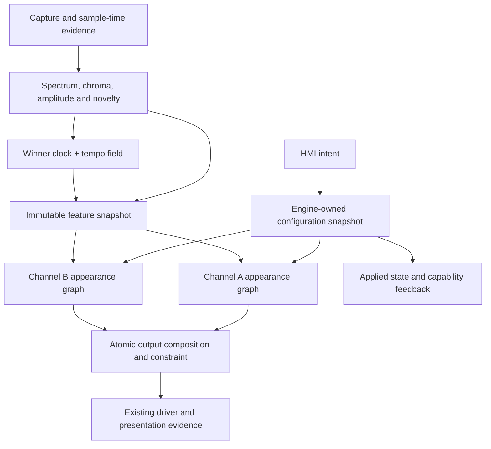

# K1 as a modular light instrument

Research and architecture proposal · 23 September 2026 UTC / 24 September in the current Mac work records

## Decision

Build on K1’s existing audio engine, applied-state authority and physical output backends. Add a bounded, explicitly staged appearance pipeline with separately owned feature state. Keep the established renderer as a named compatibility profile. Introduce a genuine wide producer and an audio-owned tempo-field extension alongside the existing winner/flywheel event. Extend the HMI contract with supported capabilities and authoritative state before assigning new visual parameters to physical sliders.

There is no need to anchor the whole system to either Sensory Bridge or Emotiscope. Their artistic decisions can become alternative, named appearance profiles over shared observations. Musical-frequency analysis, scalar or colour history, a steady beat clock and an ensemble of periodicities are compatible architectural ingredients. They are not interchangeable semantics.

This is a proposed integration architecture, supported by a fresh read-only source audit and focused synthetic mathematics. No target firmware, console profile, installed image or physical wiring was changed by this study. Current working sources are dirty: HEAD alone does not identify the inspected implementation. The evidence packet records relevant working-file hashes and distinguishes current source, retained receipts, donor behavior and proposed changes.

## What the fresh audit changes

| Question | Current source finding | Architectural consequence |
|---|---|---|
| Are we already beyond Sensory Bridge’s Q15.16? | DualMCU already has genuine SQ15x16 colour histories. Titan’s retained musical renderer is older and uses RGB8 history for Bloom. Both routes still narrow general effect frames to Pixel8. | Preserve useful existing precision; close the actual narrowing boundaries. Do not migrate every type because its bit count sounds better. |
| Does native RGB16 solve the problem? | Titan has a wide staging/packing interface, but normal musical output fills it by lifting RGB8. DualMCU also widens byte values at its WS2816 edge. | Real lower bits must originate before composition, treatment and dimming. Multiplying a byte by 257 remains a compatibility adapter. |
| Is multi-tempo a new detector? | Both AP cores already calculate 96 tempo hypotheses and a fresh 96-bin ACF salience field. The VP-facing output retains a single tracker event. | Extend the semantic publication before considering another expensive analyzer. |
| Can those 96 phases be exposed directly? | The Goertzel bank refreshes two bins per 22.5 ms novelty tick: a complete bank takes 1.08 s. | Carry per-candidate measurement age and phase anchor. Do not stamp an old candidate as fresh on every AP publication. |
| Are per-channel controls already isolated? | Titan’s configuration function can reconstruct both channel states when either mode changes, and clears both waveform colour states when either palette changes. | Implement selective field updates and reset causes before attaching high-rate slider control to this API. |
| Does the console display confirmed values? | It caches returned engine state, but current fader/graph values are sourced from local physical/requested state. LIVE describes the session. | Distinguish physical position, requested value, applied value and effective visual behavior. |
| Does CC14 mean 14 useful physical bits? | The console reads a 12-bit ADC and applies an 80-count CC14 emission hysteresis, approximately 0.488% of full scale. | Parameter mapping and emission filtering matter as much as wire width. Fine material controls need a measured control-resolution budget. |

Exact paths, line references and qualifications appear in the precision, visual, AP and HMI chapters. The active HMI implementation is `K1.Sliders`; the named `K1-HMI-BLE-MIDI` tree is the earlier 1.91-inch reference. Both were considered, without reviving the archived lane as production authority.

## What “modular” must mean here

The user’s requirement is strong and useful: every artistic feature must have an explicit on/off control, and using one feature must not accidentally overwrite another feature’s parameters or state. A list of booleans is insufficient to provide that guarantee.

The proposed contract guarantees **state and control isolation**. It also declares intended **visual interactions**. Blur changes what persistence retains; additive light changes when a limiter acts; palette changes affect live-coloured history. Those interactions are properties of the chosen composition, not necessarily bugs. No architecture can make arbitrary noncommuting operations visually independent while preserving their definitions.

Use a small static directed graph of known stages, compiled with fixed storage and supported capabilities. Each feature has a named slot and stable identity. A preset changes parameters, enabled bits and permitted algorithm choices; it does not install code, allocate arbitrary nodes or reorder the real-time graph. This gives extendability without creating an unbounded plugin runtime on an MCU.

Every feature descriptor must declare:

| Field | Required meaning |
|---|---|
| Identity / version | Stable feature ID, semantic version and capability bit; never reuse an ID with a different meaning |
| Scope | Global observation producer, per-channel appearance feature, per-layer feature or physical-output operation |
| Inputs / outputs | Typed domains, units, freshness requirements and the fields the feature may read or write |
| Parameters | Canonical engine-owned values, ranges, defaults, mapping curve, smoothing and dependencies |
| State | Storage size, owner, timebase, initialization and every reset cause |
| Bypass | Exact identity operation or no-contribution behavior; no implicit change to unrelated settings |
| Lifecycle | Reset-on-disable, decay with zero input, or an explicitly supported warm-resume policy |
| Cost | Fixed memory, bounded work, measured target cost once implemented, and supported combinations |
| Failure | Behavior for missing/stale input, invalid parameters, unsupported capability and epoch change |

The stored enabled flag and the numeric amount are separate. An amount of zero may be a valid endpoint; it must not erase the remembered setting or silently toggle another module. Disabled controls may retain their configured value and show an inactive state. Enabling a dependent visual feature may request a shared audio producer, but disabling one consumer must not stop a producer still needed elsewhere.

“All features toggleable” applies to artistic processing and interpretation. Buffer ownership, bounds checking, identity checks, fault handling, blackout and physical current constraints remain infrastructure. A user can select the compatibility path versus the wide path; individual numeric casts are not useful musical switches.

## The proposed dataflow

DualMCU keeps this real-time engine on RT1062. S3 carries bounded control, applied-state and telemetry traffic. Titan keeps the same semantic split inside its own engine, with its actual publication and output adapters. Neither audio features nor pixels are added to the inter-MCU control link simply to expose new visual options.

### Per-channel stages

| Stage | Responsibility | Optional behavior and identity |
|---|---|---|
| 1. Feature view | Select amplitude, spectrum/chroma and rhythm evidence without mutating shared AP state | Focus/exposure/visual sensitivity bypass to the declared unmodified view |
| 2. Gesture | Produce continuous position, width, intensity and palette coordinates | Direct envelope, spectrum/chroma object, stable pulse or bounded tempo ensemble; disabling a layer contributes zero |
| 3. Material/history | Remember scalar intensity, RGB deposits or explicit object state | Transport, diffusion and decay are independent parameters in the new profile; bypass eliminates that history contribution |
| 4. Geometry | Apply permitted centre-space motion and extent transforms | Identity transform preserves the canonical centre-origin gesture |
| 5. Rasterization | Turn continuous objects into fractional samples | Named coverage/energy policy; preserve a reference kernel separately from new kernels |
| 6. Layer composition | Combine contributions in a declared wide domain | Weighted mix, additive emission or maximum are choices with different semantics; they are not all applied in sequence |
| 7. Temporal treatment | Optional image low-pass and/or explicitly configured persistence | Bypass gives the current image. Persistent state belongs to this channel and this module only |
| 8. Artistic colour/tone | Palette mapping as appropriate to history, bounded palette movement, saturation/tint and optional knee | Each operation has an identity and declared order; no silent full hue-wheel sweep |
| 9. Device output | Declared conversion/calibration, gain, aggregate constraint, final quantization and topology | Identity colour correction remains default. Physical protection and blackout remain authoritative |

This is a vocabulary, not permission to move legacy transforms across each other. The compatibility profile keeps its existing exact ordering. The new profile fixes its ordering explicitly and owns its appearance reference. Palette ownership is especially important: scalar history must be coloured at its declared stage; RGB history already owns deposited colour.

### Four separate axes in the SuperPixie lesson

**Float composition** describes numeric storage and arithmetic. **Weighted blending** describes a combining operation and can be performed in float. **Continuous transforms** describe geometry before sampling. **Immediate-attack persistence** describes temporal behavior. None replaces all the others.

For the first new K1 profile, use a scalar FP32 reference implementation with explicit value domains and bounded intermediates; benchmark target cost before replacing hot operations with packed integer or vector kernels. Keep fractional geometry and persistent state wide. Native RGB16 is the output representation after all relevant operations, not the scene format.

A minimal layer can hold emitted RGB and coverage/opacity, or compute its contribution directly into a shared accumulator when lifetime permits. Choose whether coverage has already multiplied the colour. Do not multiply opacity twice, and do not treat a maximum mask for a glyph’s intersecting segments as interchangeable with maximum RGB between unrelated coloured layers.

The W3C compositing model is a useful mathematical reference for distinguishing layer coverage from blend operators. Its browser rendering defaults are not a colour-calibration specification for K1. Likewise, a type named `LinearRgb` is not evidence that legacy palette values represent measured linear light.

### A concrete first material that avoids a false independence claim

Preserve donor Bloom’s sampled field as its reference. For the first independently controlled candidate, use a bounded set of centre-origin pulse objects. Each object stores birth time, initial amplitude/width, colour ownership and radial motion state. Evaluate its position and width from elapsed time: `r = r0 + v·age`, `σ² = σ0² + 2D·age`, and amplitude retention from the chosen lifetime. Keep constant-peak versus constant-integrated-contribution normalization explicit. Sampling the resulting continuous profile still has finite-pixel and edge effects, but repeated low-order shifting no longer secretly supplies the entire diffusion model.

This candidate is a pulse/ribbon instrument, not exact continuous-VU Bloom. Onset/tempo events create bounded objects; a continuous envelope can feed a separate declared layer. Set a finite object capacity and deterministic admission/retirement policy. Do not create one indefinitely retained object per AP sample or hide dropped events. A full pool can merge a compatible deposit or reject a new decorative pulse according to a named policy; primary event accounting remains intact.

Live parameter changes must preserve continuity. The simple age formulas above assume constant parameters. Either lock a pulse’s parameters at birth, or re-anchor its current position, variance and amplitude at the effective edit time, then integrate only subsequent velocity, diffusion and decay. The preferred live-control profile uses re-anchoring: integrate `v(t)` into position, `2D(t)` into variance and the decay rate into log-amplitude. Replacing a lifetime-wide speed with the latest slider value would teleport old pulses; replacing lifetime decay could relight them. A host audition that deliberately replays an entire fixture with new settings must label that behavior separately from live control.

For a later sampled-field solver, merely adding a diffusion coefficient to an upwind transport kernel does not establish independence: the advection discretization itself adds diffusion. Its stability and numerical spread must be characterized across actual speed, diffusion and delta-time ranges. The host reference must distinguish mathematical material parameters from discretization artifacts. This is why the first candidate should use a directly inspectable continuous object model while the coupled Bloom profile remains available.

## State lifecycle: the actual protection against features stepping on each other

Apply a complete validated configuration revision at a render boundary. The control thread never writes partially updated render parameters in place. Compute a changed-field mask and dispatch changes only to owners whose semantics require it.

| Change | Preserve | Change/reset |
|---|---|---|
| A brightness | All AP state, B state, A motion/history | A output gain target only |
| A transport speed | B and unrelated A modules; current object continuity | A future velocity, with the declared smoothing; no phase restart |
| A persistence off | Gesture, palette, AP and B state | Remove A persistence contribution; apply its declared hidden-state policy |
| A palette | B palette/history and AP | A palette transition; recolour old trails only in a live-colour profile |
| A mode | All B state and shared AP | Only A mode-owned state, plus explicitly incompatible dependent A state |
| Tempo-ensemble appearance off | Winner detector and other tempo consumers | Remove this appearance consumer; keep shared producer if still needed |
| Sample-source epoch change | User configuration | Invalidate timestamp-dependent audio/phase observations; reset or transition dependent state explicitly |
| Blackout/fault | Configuration according to established lifecycle | Final output is black regardless of retained artistic light |

Reset-on-disable is the default for new persistent features because it avoids unexplained resurrection. Decay-while-bypassed with zero drive is a separately named useful option. Continuing to feed hidden live input is another behavior and must not be confused with passive decay. Freezing old history requires an explicit bounded resume policy; it is not a safe accidental consequence of skipping a function call.

If a click-free disable transition is used, feedback must distinguish requested-off from transition-active and fully-bypassed. Hard blackout overrides that transition. State from the previous mode cannot leak into a newly allocated module merely because both share scratch memory.

Snapshots publish settings once applied, not every modulated pixel value. The UI can separately show `supported`, `configured`, `active`, `transitioning`, `inactive because input unavailable`, and effective modulation. Those distinctions prevent a disabled feature’s fader from appearing broken and avoid treating an acknowledgement as emitted light.

## Multi-tempo: extend the evidence, preserve the clock

The two desired behaviors are complementary. A stable winner/flywheel supplies coherent primary motion and synchronization. A tempo field preserves alternative periodic structures and can supply texture, subdivisions and uncertainty-aware composition.

Keep two interfaces: the established compatibility event, and a new local AP-to-VP field with explicit version, source epoch, sequence, measurement/window times, relative salience and candidate identities. Do not repurpose the existing event’s BPM as a universal phase derivative: current source distinguishes target-bin BPM from the actual evolving flywheel rate.

Publish the already available ACF salience first as amplitude evidence. ACF peak strength does not itself provide oscillation phase. The slower candidate phase bank needs its own measurement timestamp, actual frequency convention and validity. A small phase-qualified subset can drive moving objects while the complete relative field remains available for diagnostics and non-phase-dependent composition. The AP chapter specifies the proposed records and refresh work.

The first compositor should preserve the winner as the principal gesture and allow a bounded compatible family beside it. Candidate selection needs stable identity and hold rules; otherwise a harmless rank swap becomes a visible object teleport. Normalize contribution weights within a declared family, retain a separate evidence-strength/validity gate, and allocate a fixed contrast budget. A normalized distribution alone must not turn weak noise into full-brightness rhythmic certainty.

Do not deduplicate musical ratios blindly. Half/double-time candidates may describe levels of the same groove, while competing unrelated candidates may express uncertainty. Adjacent-bin leakage is different again. Maintain these distinctions when reducing a 96-bin field. Expose a useful amount such as rhythmic-layer mix; keep detector thresholds and visual contrast controls separate.

Current real-time PLP research offers an adjacent idea: separate oscillatory pulse shape from stability/confidence and evaluate predictable motion at intended presentation time. It does not justify replacing K1’s functioning detector, claiming future audio is known, or adding a DAW-oriented algorithm without an MCU cost case.

## The HMI becomes part of the instrument

Retain the current nine-fader profile and its canonical assignments as the compatibility surface. A new fixed appearance profile is a separate proposed instrument, not an unnoticed remap or bank switch. Nine physical faders cannot independently expose master brightness plus every material, colour and rhythmic parameter for two channels.

The recommended next fixed layout is master brightness plus four direct material controls per channel: motion, spread, persistence and rhythm mix. That gives immediate A/B operation without banking, but gives up direct access to the current photons/chroma/mood/saturation quartet in this profile. That tradeoff must remain visible. The existing profile remains selectable as its own instrument configuration; no live rebind is introduced into the current closeout.

Independent engineering controls and feature toggles remain available through a capability-aware host editor and the canonical engine API. Performance macros may coordinate several parameters only when their mapping is named and inspectable; a macro is not evidence that the underlying parameters are independently controllable. Physical feature-toggle controls require a declared supported input surface; existing disabled pads are not silently repurposed.

The HMI path is:

`physical input → calibrated position → parameter-specific mapping → bounded intent → engine validation/application → applied-state feedback`.

Each stage has its own precision and timing. Preserve channel identity throughout paired CC14 messages. A 50 Hz update ceiling prevents uncontrolled traffic but must coalesce the latest value, preserve the final settled value and retain transaction semantics. The engine owns smoothing in physical units; stacking an opaque console low-pass, transport hysteresis and renderer low-pass can make a responsive feature feel detached.

Logarithmic controls need an explicit zero/off rule. For example, a decay-time slider can map a finite positive range logarithmically while the feature toggle controls bypass. A motion parameter should not cross through arbitrary sign changes to select direction; centre-out versus edge-in is a discrete, valid geometric policy. Ranges in the HMI chapter are engineering candidates for evaluation, not measured preference or authorized new wire assignments.

Extending the current control surface requires versioned capability negotiation and coherent applied-state replication. Preserve the existing 71 mapped controls and 68 snapshot-eligible values; do not shrink or silently renumber them. A new parameter set cannot be added by inventing spare MIDI numbers while leaving a fixed count/checksum/schema unchanged. Unsupported controls remain unavailable and cannot be reported as applied.

Titan should implement the same parameter meanings and state rules through its own adapter. That does not assert an already working BLE path to Titan. The bridge and output adapters are lane-specific work with their own evidence.

## Fadecandy: select the useful boundaries

The useful inheritance is late quantization, explicit transfer functions, bounded ownership, numerical reference code, measured hot-path optimization and a short host authoring loop. The historical Kinetis driver, RGB8 OPC boundary and arrival-time frame interpolation are not universal upgrades for our current lanes.

Separate frame interpolation, LUT interpolation and quantization as independent decisions. Keep identity correction exact. Reject nonfinite/nonmonotonic transfer tables before they become active. Preserve native WS2816C output and the cancelled residual-RGB8-dither decision for that route. A future different RGB8 product would need its own quantization/cadence case.

A host workbench should record wide scene/output frames, feature timestamps, configuration revision, source hashes and the selected appearance profile. Derive OPC or browser previews from that canonical record; neither is optical truth. Use the actual server only if its mapping/device utility earns its maintenance cost. A small host adapter can provide the useful iteration loop without making a PC part of autonomous playback.

## Timing and bounded cost

Keep the actual clocks separate: 24 kHz capture, 180-sample AP hops, slower novelty/tempo updates, artistic simulation, rasterization, control arrival and physical presentation. Do not retime a frozen compatibility profile because another subsystem has a 7.5 ms interval.

New continuous dynamics use elapsed time with declared behavior on gaps. A long missed interval must not create an unbounded catch-up loop. Use an analytical update where valid, bounded substeps for the stated stability limit, or an explicit reset/fade policy beyond a declared maximum gap. Never silently use a clamped delta while claiming real-time behavior was preserved.

The current DualMCU instructions retain a 2 ms effect-work ceiling at 120 FPS and an under-8-ms end-to-end requirement. These are requirements, not measurements obtained in this study. A 7.5 ms publication period plus a roughly 5 ms physical transfer can already exceed 8 ms for some event alignments. The implementation must define and measure event time, feature availability, render start/end, transfer start/end and latch; it cannot satisfy the requirement by relabelling API-return time. Any incompatible physical bound needs an explicit architecture decision, not a relaxed scorer.

Budget complete admitted combinations, including the worst existing AP slice, control traffic and output ownership. “Every feature is individually fast” does not prove that all enabled features meet the deadline. Unsupported combinations should be rejected with an explicit capability reason before application, not silently shed or half-apply modules mid-frame.

Fixed memory can be reused only when lifetimes do not overlap. One RGB FP32 frame for 320 pixels is 3,840 bytes, versus 1,920 bytes for RGB16 and 960 bytes for RGB8. Every additional full-frame history has that cost. A new graph need not allocate one full framebuffer per feature: object descriptors, scalar histories, scratch reuse and sparse layers can be more appropriate. The precision chapter budgets concrete candidate sets and records existing storage separately.

## Second-, third- and fourth-order consequences

| First decision | Second-order consequence | Third-order consequence | Fourth-order opportunity or risk |
|---|---|---|---|
| Publish a tempo field with honest age | VP gains alternative periodicities without replacing the winner | Candidate identity and confidence become visual state | A richer rhythmic instrument; badly managed ambiguity becomes clutter or false certainty |
| Preserve fractional composition | Faint tails and small colour changes survive | Existing noise and overlapping layers also survive | Better subtlety only when contrast, quiet space and low-end behavior are authored |
| Separate motion, diffusion and lifetime | Sliders can change one physical-looking property at a time | Controls become transferable across modes and hardware | A recognisable family of K1 materials, with units and reference profiles instead of mode-specific magic numbers |
| Selective per-channel updates | A adjustment stops resetting B | Independent live performance becomes trustworthy | Two channels can form deliberate counterpoint rather than accidental synchronization |
| Immediate attack plus controlled persistence | New events remain prompt while old light fades | Per-channel maxima can mix old and new hues | Expressive afterglow, or colour mud unless hue-memory semantics are explicit |
| Stable semantic controls | HMI gestures can be recorded and replayed | Performances become reproducible appearance recipes | User-authored instruments and later synchronized choreography without streaming pixels |
| Capability-aware feature toggles | Unsupported combinations become visible | Same UI can span different engines honestly | A modular product family; avoiding silent degradation becomes part of compatibility |
| Separate output calibration from art | Looks remain portable while each physical bar is characterized | Optics and low-end response can be compared independently | More consistent production appearance; calibration cannot be mistaken for a preferred artistic curve |
| Applied-state feedback | A control shows what the engine accepted | Pending, inactive and unavailable become explainable | The HMI becomes a reliable performance surface rather than a decorative traffic monitor |
| Host replay with source/profile identity | Comparisons stop losing their provenance | A useful library of musical and diagnostic scenes accumulates | Future agents can make cumulative decisions instead of rediscovering the same coupling |

There is also a physical feedback risk to evaluate when brightness becomes more dynamic: LED load can affect supply noise and microphone observations. A slider should not appear to change the beat merely because it changes electrical conditions. This is a conditional test direction, not a fault established by the source audit.

## Implementation sequence and decision gates

1. **Freeze references and declare semantics.** Preserve current lane identities, dirty-source hashes, compatibility vectors, control registry and output topology. Record each new feature’s domain, identity, state lifecycle and bypass behavior. This does not rewrite any existing execution plan.
2. **Repair selective configuration.** Implement field-specific application and reset causes, especially Titan’s coupled channel reset path. Prove unrelated state and parameters survive changes.
3. **Publish the existing rhythm evidence.** Add a local versioned tempo field, initially preserving truthful amplitude/age data and the existing winner path. Admit phase-driven ensemble motion only with valid phase anchors and bounded freshness.
4. **Build one wide material profile.** Implement scalar FP32 reference behavior through final treatment and native output conversion. Include continuous centre-space geometry and explicit scalar/RGB history ownership. Keep the old profile intact.
5. **Add optional modules incrementally.** Start with immediate-attack persistence and transport controls, then bounded ensemble composition, coverage policy and novelty-linked palette movement. Pairwise interaction checks follow the declared dependency graph.
6. **Extend control and feedback.** Add negotiated schema/capabilities and truthful applied/inactive state; expose full engineering controls in the host workbench. Preserve existing wire mappings and the current console profile.
7. **Evaluate the fixed appearance instrument.** Implement the separately named nine-fader profile only as its own scope, with the selected mapping and supported physical toggles. Reuse working calibration and establish actual parameter resolution and final-value delivery.
8. **Compare complete output.** Use the same timed inputs, settings, physical topology and optics; include brightness-matched viewing, sparse and dense music, quiet gaps, mode/palette interruptions and true black. Measure actual target runtime and presentation timing under the admitted full workload.

Work packages that depend on existing HMI bench acceptance must use its current detailed receipts. A recorded LIVE connection or automated traffic soak is not proof that nine independent physical controls applied correctly. Source and host research remain useful while specific physical acceptance rows are incomplete.

The companion execution brief gives exact seams, required outputs and acceptance. The final choice should be based on demonstrated appearance and reliable control, with rejected alternatives and unresolved physical questions retained alongside the successful candidate.
