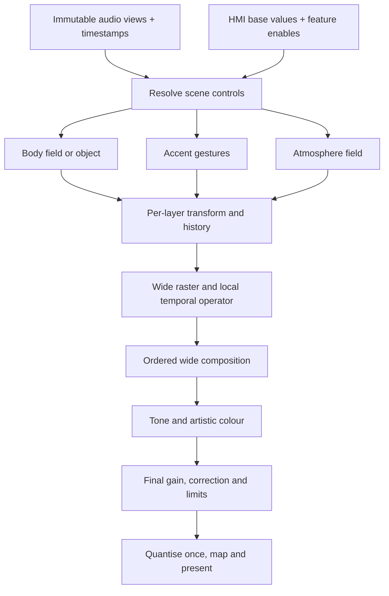

# K1 visual modularity: source inventory and integration design

Research scope: read-only working-source inspection of DualMCU and Titan; official Emotiscope 1.1 and final SuperPixie source. No firmware was edited, built, flashed or run. An isolated host probe executed the exact captured Titan configuration function with minimal type fixtures to check its reset behaviour. Observed code, derived consequences and proposed architecture are distinguished below.

## Decisions that follow from the actual source

**Build one bounded appearance architecture with typed optional stages, while retaining each lane's incumbent as a reference profile.** K1 already has fractional motion, colour history, per-channel state, scene policy and palette mechanisms. It does not yet have one common high-precision, independently controllable visual pipeline across the two lanes. The gaps are often ownership and integration, rather than the complete absence of mathematics.

“Toggleable without stepping on another feature” should mean: no hidden parameter writes, no unrelated state resets, declared order, explicit resources, exact bypass semantics and visible applied state. It cannot mean that two enabled artistic transformations have no visual interaction. Blur changes the input to persistence; tone mapping changes the result of addition; a shared physical power budget can dim both channels. Those interactions must be designed and disclosed.

Current source baselines:

| Lane | Source head observed | Actual working visual path |
|---|---|---|
| DualMCU | `67a1cd0b0ecc626b28af2df9b0d11f855b402379`, dirty working tree | `Sq15x16` colour arithmetic and 12 fixed-point RGB history arrays per channel in the product renderer; source colours can already pass through `Pixel8`; rendered frame, treatment, edge transformation, gain and current limit are `Pixel8` |
| Titan Mini | `431140853dd8b58af53240ef84d5fb1a08bd8b45`, dirty working tree | Older imported product renderer transports `Pixel8` history. Separate optional float palette morph and continuous centre-effect machinery exist, but quantise into the byte frame. `stageWideFrame(Pixel16*)` and native GRB48 packing form a newer output seam; ordinary `step()` does not itself populate that seam; the fixture adapter subsequently stages an explicitly labelled `REPLICATE8` conversion |

Working-file hashes, not HEAD alone, identify this inspection. Do not describe Titan's physical RGB16 transport as proof of wide precision throughout musical rendering. Conversely, do not describe DualMCU as wholly RGB8: its retained fixed-point history is a real improvement worth preserving.

Source evidence IDs used below resolve to absolute paths, line ranges and SHA256 in `visual-evidence.json`.

## Actual stage order and present seams

DualMCU `ProductionRuntime::render()` performs the following [D-RUNTIME]:

1. Derive elapsed render time; build product runtime policy.
2. Copy/AP-scale audio through product audio policy, then prepare each channel's audio-focus view.
3. Clear byte frames; apply channel controls, scene policy and automatic colour shift.
4. Run a product mode per enabled channel; fallback dot if a mode did not render.
5. Apply frame EMA **only to the fallback**, not as a universal filter on product modes.
6. Apply byte output treatment: incandescent mapping/filter → bulb mask → base coat → optional four-phase byte dither → prism overlay → order reversal.
7. Apply edge policy, channel/master output gain and shared current limit.
8. Stage both byte frames and submit to the output adapter.

The product modes own substantial persistence and motion internally. `previousFrame()` is not universally the last emitted image: several renderers snapshot authored history before display-only fades/mirroring. A new global effect must not silently reuse it as an arbitrary output feedback buffer [D-BLOOM, D-STATE].

Titan `PaletteRuntime::step()` owns a different wrapper [T-STEP]: scheduled release → preview/diagnostic/continuous centre mode **or** music/presence/dwell path → clear and product render when appropriate → output treatment. Physical brightness belongs to the packing adapter. Its presence logic keeps the renderer alive for the established five-second dwell and then ages authored history using Q8.8 until black; it deliberately avoids replacing that post-music black with the boot preview. A proposed persistence stage must honour this lifecycle rather than introducing an independent screen saver.

Titan's optional palette transition already supports interrupted fades through weighted catalogue contributions, retaining a fixed allocation and avoiding a second effect evaluation. Repeated selection of the same target does not restart the fade. At rest it uses the original sampler directly [T-PALETTE]. This is valuable reusable behaviour, not a missing feature to rebuild.

## Donor feature inventory and integration matrix

“Partial” means a related mechanism exists, not that donor behaviour is matched. Emotiscope references below are official `634b7ed8eefa2f1913ba1a1e7b29c116f22714d4`; SuperPixie is `cacbe615aa31a3c8d5a7d7e66286c67a7a7779ce` unless explicitly marked initial.

| Donor function | K1 current equivalent and gap | Proposed seam | Toggle / bypass / interaction contract |
|---|---|---|---|
| Emoti scalar Bloom: VU history, fractional transport, later recolouring | K1 Bloom retains injected **RGB** history; Dual fixed point, Titan bytes. It is not Emoti scalar Bloom [D-BLOOM, T-BLOOM, E-BLOOM] | `HistoryField<Amplitude>` sibling of `HistoryField<RGB>`; common radial transport interface | Select history meaning explicitly. Off selects incumbent source; changing meaning resets or crossfades that field only. Never reinterpret RGB memory as amplitude |
| Emoti coupled Bloom speed/decay | K1 exposes alpha and shift scale, but repeated resampling still couples spreading to update cadence [D-BLOOM] | Material module with velocity, diffusion and lifetime; separate reference-coupled variant | Enable independent material controls in new profile; reference profile retains its law. Report inactive controls rather than silently remapping them |
| Spectrum | K1 Spectrum River exists; stable catalogue entries GDFT/GDFT_CHROMAGRAM are disabled. Static spectrum and a moving history are different contracts [D-CATALOGUE, E-MODES] | Optional `SpectrumBody` source consuming existing spectrum view | Source off contributes zero; does not disable AP spectrum needed by other modules |
| Octave / chromagram | Chroma Constellation and chromatic colour exist; not the same continuous twelve-class field [D-CATALOGUE, E-MODES] | `ChromaBody`, with optional spatial interpolation | Field bypass contributes zero. Preserve chroma convention/normalisation in adapter; do not refold differently per effect |
| Analog VU swept dot | Related waveform/comet modes exist; legacy VU_DOT and VU entries are disabled [D-CATALOGUE] | `AmplitudeGesture` with envelope and swept rasterizer | Envelope owns its own state; width and travel do not change input gain. Centre/edge radial motion remains mandatory |
| Metronome all-candidate phase/weight rendering | K1 tempo modes consume one `TempoTrackerEvent`; `VisualAudioFrameView` has no candidate family [D-AUDIOVIEW] | Optional `TempoFamilyGesture` consumes a bounded AP candidate view | Off contributes zero; stale family fades its layer without erasing immediate spectrum/body. Existing tracker still serves incumbent modes |
| Spectronome confidence-based spectrum/tempo composition | No equivalent composition policy identified in product runtime; director uses novelty/energy scene classification [D-POLICY, E-MODES] | Layer-weight resolver, independent of audio estimator | Off gives stored/manual layer weights. Confidence is estimator concentration, not calibrated correctness; preserve a body floor deliberately |
| Hype odd/even tempo pools | K1 percussion classes are not this function; odd/even here are adjacent tempo-bin parity, not kick/snare [E-MODES] | Alternative tempo-family gesture, not a percussion detector | Exclusive gesture choice within tempo slot; zero bank power and stale frames produce zero, not division artefacts |
| Swept dots / subpixel edge coverage | K1 has fractional dot/streak helpers. Generic `drawDot` divides opacity by spread; Emoti's active implementation does not use its computed spread compensation. Edge response differs [D-RASTER, E-RASTER] | Wide rasterizer with explicit `coverage_law` and `energy_law` | Select a named raster profile; off means point sampling, not uncontrolled deletion of motion. Reset previous position on first use/discontinuity |
| Novelty-driven auto colour momentum | Dual currently substitutes a constant mean rate of 0.03 turns/s; this is not novelty momentum [D-POLICY, E-COLOUR] | Per-channel palette-coordinate modulation | Off restores user base coordinate, preserving it. No full hue-wheel sweep; use bounded palette travel and finite excursion |
| Colour range / reverse range | K1 palettes, hue position, chroma and saturation cover parts; whole-range HSV semantics differ | Palette-coordinate adapter | Reverse affects palette coordinate only, not wire order or motion direction. Range changes do not rewrite palette ID |
| Float/HDR additive composition | Dual fixed-point effects often clamp/convert before output; Titan centre modes compose floats locally then quantise [D-BLOOM, T-CENTRE] | Common wide scene-linear-intent compositor; document its transfer interpretation | Float is a representation, not an artistic toggle. Layer blend operators are selectable; fixed bounds and finite checks always remain |
| Image LPF / softness | Dual has time-correct byte EMA for fallback only; many product modes have internal smoothing. No common optional wide image LPF [D-FRAMEBLEND, D-RUNTIME, E-GPU] | Local per-layer temporal filter after rasterisation | Off is identity. Exact initialisation from current input avoids black flash. Prefer milliseconds/cutoff over frame coefficient |
| Mode-transition `lpf_drag` | Titan palette morph and centre showcase transition exist; no general scene transition contract [T-PALETTE, T-CENTRE] | Scene transaction/transition resolver before composition | Default explicit cut or bounded crossfade. Do not borrow a shared LPF history to disguise arbitrary mode changes |
| Soft-knee HDR tone map | `vp_fix_agc_soft_knee` affects **audio spectrum**, not final image HDR [D-POLICY] | Single post-composition tone map | Off identity followed by mandatory finite clamp at output. Tone map cannot recover previously clipped additions; keep before final quantisation |
| Warmth / white balance / gamma | K1 byte incandescent filter exists; no equivalent released Emoti full float conditioning chain in common path [D-OUTPUT, E-GPU] | Distinct artistic warmth and output correction slots | Artistic warmth optional. Output correction defaults identity. Never stack donor gamma automatically on native WS2816 route |
| Background / Neutral | K1 base coat and Titan centre base component exist; donor coloured background differs | Dedicated atmosphere layer with explicit blend mode | Off zero. True-black policy suppresses it; a base layer must not fill the required quiet gap unintentionally |
| Screen saver / standby / touch/UI overlay | Current K1 presence/director/HMI policies cover different product roles | Separate lifecycle and HMI feedback slots | Do not import product-specific touch/screensaver policy wholesale. User-facing signal and safety/blackout ownership must be explicit |
| Emoti residual RGB8 dither | K1 legacy byte dither exists, but native WS2816 product route has settled decision against residual RGB8 dithering | Output-format capability, not a generic artistic module | RGB16 backend has no RGB8 dither control. RGB8 laboratory route may compare algorithms with actual cadence recorded |
| SuperPixie continuous transforms | K1 already has float position/velocity in modes, fractional rasterizers and Titan continuous radial centre fields [D-STATE, D-RASTER, T-CENTRE] | Transform object/field coordinates before sampling; radial translation, scale, width and direction | Off identity transform. Maintain centre/edge origin and channel geometry; 2D rotations/text are not useful direct imports |
| Initial SuperPixie weighted old/new frame blend | Related to K1 EMA, but final SuperPixie changed the semantics | Optional temporal filter operator | Do not call weighted averaging the final donor's persistence. EMA slows attack and release; expose independently |
| Final SuperPixie immediate-attack persistence | Some K1 scalar envelopes are asymmetric, but no common wide image `max(current,previous*decay)` module identified [S-PERSISTENCE] | Optional per-layer peak-hold release before global gain | Off identity; time-correct exponential decay. Componentwise RGB max can mix old/new hues. Scalar/intensity persistence is a separate semantic option |
| Coordinated transforms + colour + brightness transition | Titan palette morph exists; cross-mode geometry/brightness transaction not universal | One scene revision with local timeline and bounded old/new resources | Interrupted transition starts from resolved state, not last target. At most two scene contributors; reject or use declared cut if budget exceeded |
| Semantic commands / local autonomous animation | Dual S3 sends controls; RT1062 owns AP/VP. This architectural idea is already present | Extend current versioned command/state contract | HMI sends intent and timing, never per-pixel transport. Preserve CRC, revision, replay and snapshot rules already established |

Functions present but commented out in Emotiscope 1.1 GPU execution—alternative frame blending and phosphor decay—must not be labelled active released features. Its active image LPF is the source of softness there [E-GPU].

## Concrete architecture: fixed stage slots, typed data and bounded state

Use a static pipeline descriptor, compiled module catalogue and fixed buffers. The runtime feature mask selects implementations inside declared slots; users cannot assemble an arbitrary graph or change DMA topology with a slider.

Three layer roles are a proposed initial bound, not an assertion that every product needs three active layers. Render one at a time into a reusable scratch buffer and accumulate the scene. Retain distinct buffers only for enabled histories/temporal operators. Do not allocate an entire feature combination universe. Resource admission includes the worst case of a scene crossfade, not only one static preset.

The implementation contract should contain:

| Contract part | Required definition |
|---|---|
| Identity | Module ID, semantic version, reference profile/version, feature enable, channel scope |
| Input/output | Amplitude field, RGB field, object list, wide colour surface or output codes; allowed numeric range; coordinate system |
| Time | Event time, presentation time, actual elapsed `dt`; missed-update and long-gap behaviour |
| State | Fixed bytes, owner, initialisation, reset causes, disable behaviour, silence behaviour, epoch/generation |
| Parameters | Stable IDs, units, user base value, modulation source and depth, effective value, clamp reason |
| Resources | Maximum objects/passes/history slots, measured worst-case runtime, transition cost |
| Bypass | Identity for transformations; zero contribution for generators; original/manual weight for a resolver |
| Output invariants | Finite values, centre/edge origin, independent A/B, no silent global state mutation; true-black and backend precision contract |

Naming a surface `LinearRgb` does not prove physical linearity. Existing palette values are legacy code-value colours normalised/interpolated as floats. The new profile must specify whether operations use that reference-intent space or a calibrated linear-light space. An optional calibrated profile is a separate experimental change; do not re-interpret all legacy palettes silently.

There should be two explicit profiles initially:

- **Reference compatibility:** current donor/port equations, numeric rounding and order preserved to compare against frozen vectors. Feature extensions default off. Any change to source appearance is named.
- **K1 wide appearance:** defined colour interpretation, wider composition through gain/output, independent transport parameters, optional tempo-family layer, local persistence and bounded scene transitions.

Do not promise that “all options off” equals the incumbent merely because buffers use wider types. Different interpolation, clipping and rounding can change the result even with every optional module bypassed. Require a separately defined reference adapter, then admit the new appearance as its own profile.

## Parameter ownership, toggles and meaningful silence

For each control, keep `base`, `modulation`, `effective` and `applied revision` separate. A novelty modulator changes an effective palette coordinate; it must not overwrite the user's slider value. Director automation changes a resolved scene, not the persisted manual configuration. Exposing both base and effective values makes it possible to understand why a fader appears stationary while the image changes.

Use explicit parameter operators: additive offset, multiplicative gain or selector. Apply modulation in one declared order, then clamp once. Do not allow two modules to write the same resolved parameter opportunistically. If the user assigns one slider to several controls, treat it as a named macro with declared mappings and one transaction.

Suggested state lifecycle:

| Event | Generator / history field | Temporal operator | Unrelated channel |
|---|---|---|---|
| Enable | Initialise only newly enabled owner; initialise phase at requested presentation time | Seed from current dry input, then ramp wet mix if requested | No reset |
| Disable | Stop contribution; retire owned state after requested fade | Wet mix to zero, clear after bypass; re-enable does not resurrect old image | No reset |
| Ordinary parameter edit | Preserve state; smooth the parameter in physical units | Preserve state unless meaning/format changes | No reset |
| History meaning changes | New typed history, or bounded crossfade; no reinterpretation | Reset only if input meaning changes | No reset |
| Palette changes | RGB history retains historic colour; amplitude history is recoloured; both are deliberate | Preserve unless palette-history policy explicitly requests purge | No reset |
| Scene replacement | Transfer only declared compatible state; otherwise cut/crossfade | New scene does not inherit anonymous global feedback | No reset unless transaction includes it |
| Silence dwell expires | Stop injection; decay; cross epsilon at deterministic finite time and set exact zero | Decay independently, then zero once below threshold | Channel-local unless shared product silence policy is explicit |
| Explicit blackout | Final gain forces zero immediately; state policy is chosen separately | No tail may override final zero | Only targeted channel, or both for master blackout |
| Transport discontinuity | Reset/fade affected clock-dependent objects; reject stale revisions | Do not integrate huge `dt` blindly | Unaffected timeline continues |

A module can be enabled yet inactive because its source is absent, the selected mode does not consume it, or its wet amount is zero. Expose `enabled`, `active`, `reason` separately. An HMI must not quietly substitute a different function when a feature is unavailable on a profile/backend.

Fixed protective stages—finite-value handling, physical current budget, final quantisation, output timing, bounds and topology—are not artistic features and remain enforced. Their resource constraints should be visible without becoming fader mappings.

## Non-commuting operations: where “independent” needs a precise meaning

| Combination | Why order matters | K1 design consequence |
|---|---|---|
| Peak-hold persistence and global dimming | Gain before persistence can retain the previous brighter frame after the user dims | Keep performance/master gain after artistic persistence; blackout must win |
| RGB persistence and palette change | Componentwise maximum can turn old red plus new green into yellow | Offer RGB-colour memory and scalar-intensity memory as distinct operators; label the difference |
| Spatial blur and peak hold | Blur spreads an old maximum; peak hold after blur captures that spread | Lock stage order per profile; avoid arbitrary reorder controls |
| Tone map and addition | `T(a+b)` differs from `T(a)+T(b)` | Accumulate permitted wide values, tone-map once at the defined seam |
| Coverage law and gamma | Emoti sqrt coverage combined with squaring can approximately cancel under limited isolated conditions | Move raster/output transfer together when defining compatibility; no automatic donor gamma import |
| Per-layer persistence and scene crossfade | Persisting the mixed output lets the old scene linger under the new one | Prefer local layer persistence; make cross-scene afterglow an explicit option |
| Advection and palette | Advect RGB preserves origin colour; colourise after advection changes the whole trail with today's palette | Typed history, not one generic “feedback” framebuffer |
| Blur/persistence and quiet gap | Tails can bridge the designed gap, hiding two-ribbon separation | Quiet-gap test measures occupancy after the complete pipeline, not before filters |
| Shared power limit and A/B | Raising A can legitimately reduce B under one shared budget | Distinguish resource coupling from hidden state coupling; expose limiter scale and reason |
| Changing cadence and repeated resampling | Matching velocity and decay does not preserve diffusion | A material profile needs a transport model/reference cadence, or independently specified diffusion |

These interactions make local bypass essential. A useful debug mode can view body, accent, atmosphere, post-persistence and final output independently using the same recorded input, without treating those taps as separate product pipelines.

## Current Titan configuration coupling: source trace and exact reset matrix

This is a concrete integration obstacle for sliders. The current `PaletteRuntime::configure()` is a broad reconfiguration API, not a selective live-parameter update API [T-CONFIG]. Its live caller is real: `fixture_app.cpp::live_handle_config` accepts direct `SET_CONFIG` and staged `COMMIT_SET`; both call `live_apply_config`, which unconditionally builds a `PaletteConfig` and calls `palettes.configure()` **before** copying audio focus and extended visual controls. The legacy palette opcode also calls the same function [T-CALLER].

| Accepted change | A/B effect state | Colour memory | Other state reset |
|---|---|---|---|
| Either `mode_a` or `mode_b` differs | Both complete `ChannelRenderState` objects reconstructed | Both lost | All rows below |
| Either palette differs, modes unchanged | Effect/history objects otherwise retained | Both `waveform_k1_dot` colour EMAs cleared | All rows below |
| Brightness only | Preserved | Preserved | Both dwell-armed flags; live-presence validity/time/sequence; publication tracking; schedule and cycle origin; wide-frame validity; path/diagnostic counters |
| Visual-only or focus-only `LiveConfigBlob` edit | `PaletteConfig` may be identical, but configure still runs | Preserved unless its palette/mode also differs | Same unconditional metadata resets |
| Reapply identical accepted config | Preserved | Preserved | Same unconditional metadata resets |
| Rejected config | No accepted assignment | No reset in inspected function | Validation returns before mutations |

`transitions_[0/1]` are not the `ChannelRenderState` objects and are not reconstructed by the mode cut. Under the optional palette-morph build, each receives `select`; the class protects repeated same-target fades. This does not protect the other histories/presence metadata.

The isolated host probe in `probe_titan_configure.py` extracts this function verbatim, compiles it with minimal state fixtures and exercises unchanged, brightness-only, palette-A-only and mode-A-only cases. It reproduces all unconditional resets, B colour clearing after only palette A changes, and B history clearing after only mode A changes. The probe has `K1_PALETTE_MORPH` undefined; optional transition behaviour above was inspected separately in source. **This is source/host evidence, not proof that a user observed a visual glitch on the flashed target.**

Minimum refactor before adding fine-grained HMI control:

1. Validate the complete incoming revision and derive a field-level delta before mutating any state.
2. Treat initial activation, clock-epoch change, mode replacement, palette selection, performance parameter changes and output-route change as distinct causes.
3. Reset only the channel whose mode changed, and only its declared owned state; preserve the opposite channel, global AP clock and audio-presence publication.
4. On palette change, use the selected history policy. A waveform colour EMA purge, if retained for compatibility, affects only the changed channel.
5. Brightness, persistence time, layer mix, saturation, width and travel edits preserve render schedule, presence generation, dwell progress and unrelated histories. Smooth as appropriate; do not restart the scene.
6. Invalidate only the wide frame whose content/schema actually changed, and publish the next full generation atomically. Hold/output-route changes follow their existing output transaction rules.
7. Return the applied revision, changed-field mask, state-reset mask and inactive-control reasons. Identical idempotent transactions do not restart anything.

Use the current reset behaviour as an explicit compatibility test where historical operations require a restart. Do not erase it through a general cleanup without deciding which operations are scene replacements versus continuous performance edits.

## Evaluation sequence and higher-order implications

The first useful deliverable is one complete centre-origin scene with a retained incumbent comparison—not 30 half-connected toggles. Suggested scene: scalar or RGB body field, one bounded tempo-family accent layer, optional local persistence, one palette transition, wide output. Compare identical timed input through both lanes' reference paths and the candidate.

Necessary acceptance observations:

- With a module bypassed, the declared seam returns identity or zero exactly; disabled state cannot leak an old image on re-enable.
- Editing A preserves B's control state, phase and history unless an explicitly shared power budget changes output gain. Test brightness, palette, mode and a repeated identical command separately.
- Immediate attack remains prompt when persistence is enabled; release time matches at multiple render intervals. Silence reaches and retains exact zero; the boot preview does not resurrect after normal musical silence.
- The same scene at the same presentation times retains intended centroid, lifetime and spread across frame rates, or declares the reference-cadence dependence. Test narrow impulses, fast movement and dropped updates.
- Interrupted palette/scene transitions begin from resolved current appearance; no second effect advance, stale frame or extra source event is consumed.
- Scalar versus RGB history has visibly and numerically distinct, documented palette-change behaviour.
- Full-pipeline quiet-gap occupancy remains below the chosen threshold. An early buffer being black is insufficient.
- Runtime ceilings include both channels, maximum enabled objects, worst allowed filter work and a transition overlap. Capacity failure reports a reason and retains the valid scene; it does not silently remove a feature.

Second-order effect: once colour and movement retain fractional precision, less aggressive audio gain or visual saturation may suffice. Third-order effect: separately authored body/accent/afterglow roles make a multi-tempo bank legible without increasing the number of bright simultaneous gestures. Fourth-order effect: a stable appearance descriptor can be rendered on DualMCU, Titan and host previews with common semantics, while display-specific calibration and physical topology remain adapters.

The risks are the mirror image: more precision exposes more weak detail; more persistence manufactures visual rhythm; more automated modulation steals fader agency; more transition layers consume the same real-time budget needed for audio. The architecture therefore needs explicit contrast/occupancy, parameter ownership and resource admission alongside its richer colour representation.

## Source provenance

Remote working roots are `/Users/spectrasynq/Workspace_Management/Software/SpectraSynq-K1-DualMCU-Firmware` and `/Users/spectrasynq/Workspace_Management/Software/SpectraSynq-K1-RA8P1-Firmware`. Each quoted function and line range is tied to a captured file hash in `visual-evidence.json`; the full capture manifest is `source-snapshot/visual-manifest.json`.

Donor anchors:

- [Emotiscope 1.1 GPU order](https://github.com/Lixie-Labs/Emotiscope/blob/634b7ed8eefa2f1913ba1a1e7b29c116f22714d4/src/gpu_core.h)
- [Emotiscope 1.1 LED maths](https://github.com/Lixie-Labs/Emotiscope/blob/634b7ed8eefa2f1913ba1a1e7b29c116f22714d4/src/leds.h)
- [Emotiscope 1.1 active modes](https://github.com/Lixie-Labs/Emotiscope/tree/634b7ed8eefa2f1913ba1a1e7b29c116f22714d4/src/light_modes/active)
- [SuperPixie final persistence](https://github.com/connornishijima/SuperPixie_Firmware/blob/cacbe615aa31a3c8d5a7d7e66286c67a7a7779ce/leds.h#L193-L218)
- [SuperPixie continuous vector drawing](https://github.com/connornishijima/SuperPixie_Firmware/blob/cacbe615aa31a3c8d5a7d7e66286c67a7a7779ce/vector_drawing.h)
- [SuperPixie scene transitions](https://github.com/connornishijima/SuperPixie_Firmware/blob/cacbe615aa31a3c8d5a7d7e66286c67a7a7779ce/system.h#L138-L259)

Upstream code provenance/licensing must accompany any source reuse. Architectural ideas and independently implemented numerical contracts should still state which source behaviour they reproduce; copied code is not made source-independent by placing it behind a module interface.
